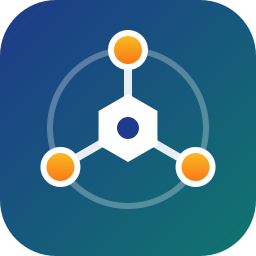

<div align="center">



# AgentOS

**Java 原生、私有部署、可审计的企业级 Agent OS**

一个目录定义一个 Agent，一个进程跑一群 Agent。

[](https://openjdk.org/projects/jdk/21/)
[](https://spring.io/projects/spring-boot)
[](https://docs.spring.io/spring-ai/reference/)
[](https://github.com/pgvector/pgvector)
[](LICENSE)
[](#路线图)

[简介](#简介) · [特性](#特性) · [架构](#架构) · [快速开始](#快速开始) · [定义一个 Agent](#定义一个-agent) · [REST API](#rest-api) · [路线图](#路线图) · [文档](#文档) · [参与贡献](#参与贡献)

</div>

> [!NOTE]
> 项目目前处于**设计阶段**：仓库里只有设计文档，代码尚未提交。本文的命令和接口描述的是 1.0 的目标形态。

## 简介

AgentOS 是运行和管理 AI Agent 的底座系统。它装在企业自己的服务器或 K8s 上，在上面同时运行运维助手、客服助手、知识管理助手等多个业务 Agent。这些 Agent 共享一套模型接入、工具调用、记忆、沙箱和审计能力，数据不出企业。

业界已有的开源 Agent OS 里，OpenClaw 用 Node.js、Hermes Agent 用 Python，Java 生态在这一层还没有对应项目。AgentOS 基于 Spring Boot 和 Spring AI 实现，可以直接接入企业现有的 Java 服务、运维工具链和审计流程。

AgentOS 只做运行时，不做可视化编排。需要复杂 workflow 时，可以让 Dify 这类编排平台调用 AgentOS 的 REST API。

## 特性

- **对接 LLM**：基于 Spring AI 2.0 的 `ChatModel` 抽象，支持 OpenAI、Anthropic、DeepSeek、Ollama，以及通义千问、Kimi、智谱等提供 OpenAI 兼容接口的模型。每个 Agent 按名称选择 Provider，切换模型不改业务。
- **ReAct 循环，组件全部来自 Spring AI 2.0**：Reason → Act → Observe，直到没有工具调用或达到最大轮数。循环由 AgentOS 驱动，工具执行用 Spring AI 的 `ToolCallingManager`（调用次数限制、异常反馈、观测随之生效），上下文用 `ToolContext`，同步与流式两种调用方式共用一套循环。每次工具调用都经过沙箱检查并写入审计表，单次模型调用、单个工具、整轮处理各有超时。
- **三层记忆**：会话消息逐条写入 PostgreSQL，按轮次截断后进入 prompt，跨重启恢复；长期记忆分核心区和归档区，后端可选 Markdown 文件、PostgreSQL 或自托管 Mem0，配置 Embedding 后通过 pgvector 做语义检索；情景记忆在扩展阶段补齐。
- **三档工具扩展**：零代码（写 `AGENT.md` 并复用现成 MCP server）、轻代码（任意语言写 MCP server）、重代码（Java `@Tool` Bean）。内置文件、Shell、HTTP、记忆、通知九个工具；工具多时按需暴露，减少工具定义占用的 token。
- **REST API**：10 个核心端点覆盖会话、Agent 调用、配置、记忆、工具和系统状态，业务系统用 HTTP 即可集成。
- **定时触发**：在 `AGENT.md` 里声明 cron，`AgentScheduler` 到点自动运行 Agent，与 CLI、REST 走同一条处理链路；多实例部署时用 ShedLock 保证同一任务只跑一份。
- **安全与审计**：沙箱用接口先行的设计，核心阶段是应用层白名单（路径、可执行文件、域名）；`tool_invocations` 和 `llm_calls` 从第一个版本开始落库，记录到每一轮的每一次迭代（含 token 用量、缓存命中、限流余量）；只有声明为幂等的工具才自动重试；密钥通过 `${ENV_VAR}` 注入，不写进配置文件。
- **可评估**：三个验收 Demo 用 Spring AI 的 `FactCheckingEvaluator`、`RelevancyEvaluator` 做回归测试，切换模型时有据可查。
- **部署简单**：一个可执行 JAR 加一个 PostgreSQL（带 pgvector 扩展）即可运行，后续提供 GraalVM Native Image。

## 架构

```
 ┌─────────────────────────── 接入层 ───────────────────────────┐
 │  CLI Channel (chat)    Web Service (REST)    AgentScheduler (cron) │
 └───────────────────────────────┬──────────────────────────────┘
                                 ▼
                       AgentService.process()
 ┌─────────────────────────── 引擎层 ───────────────────────────┐
 │        ReActLoop  ──  PromptBuilder  ──  ToolExecutor         │
 └──────────┬──────────────────────┬──────────────────┬─────────┘
            ▼                      ▼                  ▼
 ┌──────── 能力层 ───────────────────────────────────────────────┐
 │ ProviderService        MemoryService         ToolRegistry + Sandbox │
 │ (Spring AI ChatModel)  (会话 + 长期记忆)     (内置 / @Tool / MCP)     │
 └──────────┬──────────────────────┬──────────────────┬─────────┘
            ▼                      ▼                  ▼
      各家 LLM API     PostgreSQL / MEMORY.md     外部 MCP server
```

三个入口汇入同一个 `AgentService`。ReAct 循环直接调用 Spring AI 的 `ChatModel`，模型只返回工具调用请求，工具由注入的 `ToolCallingManager` 执行。每个工具都是 Spring AI 的 `ToolCallback`，外面套一层 `GovernedToolCallback` 负责审计、超时和重试，所以任何执行路径都绕不过审计。

## 技术栈

| 组件 | 选型 |
|------|------|
| 运行时 | JDK 21（virtual thread） |
| 框架 | Spring Boot 4.x、Spring MVC |
| LLM | Spring AI 2.0.x（`spring-ai-bom`，不依赖 Spring AI Alibaba） |
| MCP | `spring-ai-starter-mcp-client`（STDIO / SSE / Streamable-HTTP） |
| 持久化 | PostgreSQL 16+（pgvector）+ Spring Data JPA + Flyway |
| 知识库 | Spring AI ETL（`TikaDocumentReader`、`TokenTextSplitter`）+ `PgVectorStore` |
| 定时任务 | Spring `CronTrigger` + ShedLock |
| CLI | Picocli |
| 可观测 | Logback / SLF4J、Micrometer / Prometheus |
| 测试 | JUnit 5、Testcontainers、Spring AI 评估器 |

## 快速开始

### 环境要求

- JDK 21+
- Maven 3.9+
- PostgreSQL 16+ 并安装 pgvector 扩展（本地开发可直接用 Docker）
- 一个支持工具调用的 OpenAI 兼容模型接口（或 Anthropic、Ollama 等 Spring AI 支持的模型）
- 使用语义检索时，还需要一个 OpenAI 兼容的 Embedding 服务

### 构建

```bash
git clone <repo-url> agent-os
cd agent-os
mvn clean package
```

### 配置数据库与模型密钥

把 `.env.example` 复制为 `.env` 并填入真实值（`.env` 已加入 `.gitignore`，不要提交）：

```properties
AGENTOS_DB_URL=jdbc:postgresql://db-host:5432/agentos
AGENTOS_DB_USERNAME=agentos
AGENTOS_DB_PASSWORD=******

# 主链路模型（OpenAI 兼容接口），base-url 不带 /v1
AGENTOS_LLM_BASE_URL=https://llm-host
AGENTOS_LLM_API_KEY=sk-******
AGENTOS_LLM_MODEL=gpt-5.6-luna

# Embedding 服务（OpenAI 兼容接口），与主链路模型分开配置；
# 不配置时语义检索自动降级为关键词检索
AGENTOS_EMBEDDING_BASE_URL=https://dashscope.aliyuncs.com/compatible-mode
AGENTOS_EMBEDDING_API_KEY=sk-******
AGENTOS_EMBEDDING_MODEL=text-embedding-v4
AGENTOS_EMBEDDING_DIMENSIONS=1024
```

数据库需要安装 pgvector 扩展，或给账号建扩展的权限。表结构由 Flyway 在启动时自动创建和升级；向量表的维度取 `AGENTOS_EMBEDDING_DIMENSIONS`，启动时会实际调用一次 Embedding 接口校验维度是否一致。

没有现成的数据库时，可以用仓库里的 `compose.yml` 在本地启动 `pgvector/pgvector:pg17`：

```bash
docker compose up -d
```

### 初始化工作区

```bash
java -jar AgentOS-boot/target/AgentOS.jar init
```

`init` 在当前目录创建 `.AgentOS/` 工作区，可重复执行，不会覆盖已有文件：

```
.AgentOS/
├── agents/            # 每个子目录是一个 Agent
├── skills/            # 公共 Skill 库
├── output/            # Agent 产出物
├── memory/MEMORY.md   # 长期记忆
├── logs/              # 日志
├── mcp_servers.yaml   # MCP server 配置
└── AGENTS.md  SOUL.md  USER.md   # Bootstrap 文件
```

会话、审计记录和定时任务状态保存在 PostgreSQL 中。

### 运行

```bash
AgentOS profile create weather    # 生成 .AgentOS/agents/weather/AGENT.md
AgentOS chat --profile weather    # 交互对话
AgentOS serve                     # 启动 REST API，默认端口 8080
```

调用一次 Agent：

```bash
curl -X POST http://localhost:8080/api/v1/agents/weather/invoke \
  -H 'Content-Type: application/json' \
  -d '{"message": "北京今天适合穿什么？"}'
```

## 定义一个 Agent

一个目录就是一个 Agent。`AGENT.md` 的 frontmatter 是运行配置，正文是任务指令：

```markdown
---
name: daily-weather
description: 每天早上查天气并推送穿搭建议
provider:
  name: primary                 # 不写则用默认 provider
  reasoning_effort: low         # 推理模型才有
tools: [http_get, notify]
schedules:
  - key: morning
    cron: "0 0 8 * * *"
    zone: Asia/Shanghai
    message: 生成今天的天气穿搭建议
settings:
  max_iterations: 10
  max_history_turns: 20
---

查询北京当天天气，给出简短的穿搭建议，然后通过通知渠道 team-lark 推送。
```

需要更多能力时，在同一目录里继续添加：

- `skills/<name>`：指向 `.AgentOS/skills/<name>/` 的相对软连接。prompt 里只注入 Skill 的名称和描述，正文由模型按需读取。
- `scripts/`：Agent 自带的脚本。
- `REFERENCE.md`：参考资料，按需读取。

Provider 在 `application.yaml` 中按名称配置，密钥用环境变量：

```yaml
agentos:
  default-provider: primary
  providers:
    primary:
      type: openai               # OpenAI 兼容协议
      base-url: ${AGENTOS_LLM_BASE_URL}
      api-key: ${AGENTOS_LLM_API_KEY}
      model: ${AGENTOS_LLM_MODEL}
      reasoning-effort: low
      timeout: 120s
```

可以同时配置多个 provider（如 `deepseek`、`kimi`、本地 `ollama`），每个 Agent 在 `AGENT.md` 里按名称选择。

上面的字段示意了设计文档中的结构，最终键名以 1.0 发布时为准。

## REST API

| 方法 | 路径 | 说明 |
|------|------|------|
| `POST` | `/api/v1/sessions` | 创建会话 |
| `POST` | `/api/v1/sessions/{id}/messages` | 发送消息 |
| `GET` | `/api/v1/sessions/{id}` | 查询会话历史 |
| `DELETE` | `/api/v1/sessions/{id}` | 归档会话 |
| `POST` | `/api/v1/agents/{name}/invoke` | 无状态调用 Agent |
| `GET` | `/api/v1/profiles` | 列出 Agent 配置 |
| `GET` | `/api/v1/memory` | 查询长期记忆 |
| `GET` | `/api/v1/tools` | 列出可用工具 |
| `GET` | `/api/v1/health` | 健康检查 |
| `GET` | `/api/v1/info` | 运行信息 |

发送消息和调用 Agent 最多同步等待 60 秒，处理未结束时返回 `202` 和 `turnId`，处理在后台继续，可通过 `GET /api/v1/sessions/{id}` 查看结果；同一会话正有请求在处理时返回 `409`。

启动后可访问 `/swagger-ui` 查看 OpenAPI 文档。核心阶段不带认证，只适合部署在内网。

## 项目结构

```
AgentOS-core        核心抽象：TurnContext、Profile、Session、ReActLoop、PromptBuilder、ToolExecutor、AgentService、AgentScheduler
AgentOS-provider    LLM Provider：ProviderService，provider name → ChatModel 显式映射
AgentOS-memory      MemoryService 门面、长期记忆后端、save_memory / recall_memory
AgentOS-tool        内置工具、MCP Client、ToolRegistry、Sandbox、通知适配器
AgentOS-storage     PostgreSQL 持久化与 Flyway 脚本：会话、轮次、消息、审计表、定时任务
AgentOS-web         REST API、全局异常处理、OpenAPI
AgentOS-channel-cli CLI 对话渠道
AgentOS-cli         Picocli 命令入口、ConfigLoader
AgentOS-boot        Spring Boot 启动与依赖聚合
```

飞书、企业微信、钉钉渠道，知识库和人格库是后续加入的模块，详见[技术方案第 10 章](docs/TechnicalSolution.md#10-项目工程结构)。

## 路线图

- [ ] **US-1** 对接 LLM：`ProviderService` + 多 Provider 显式映射
- [ ] **US-2** ReAct 循环：`ReActLoop`、`ToolCallingManager` 工具执行、会话与审计表、HTTP 工具、CLI 对话
- [ ] **US-3** 记忆：`MemoryService`、`MEMORY.md`、`save_memory` / `recall_memory`
- [ ] **US-4** 工具体系：文件 / Shell 工具、白名单沙箱、幂等重试与错误反馈、MCP Client、`AGENT.md` 加载
- [ ] **US-5** Web Service：10 个 REST 端点、同步等待与轮次查询、完整 CLI
- [ ] 定时任务 `AgentScheduler`（ShedLock）与验收 Demo（每日天气、每日科技日报、每日 GitHub 日报），评估测试通过
- [ ] 流式输出、工具搜索、知识库（Spring AI ETL）、一句话生成 `AGENT.md`（结构化输出）

1.0 之后由社区推进：IM 渠道、Provider 故障切换、Tool Policy、容器沙箱、SSE 端点、Web 管理台、SSO 与多租户、集群部署。

## 文档

项目官网的源码在 `website/`（VitePress + three.js），本地预览：`cd website && npm install && npm run dev`。

| 文档 | 内容 |
|------|------|
| [行业调研](docs/IndustryResearch.md) | Agent OS 的定义、业界格局、Java 生态缺位、AgentOS 的定位与边界 |
| [需求文档](docs/DemandAnalysis.md) | 功能与非功能需求、数据模型、里程碑、验收标准 |
| [技术方案](docs/TechnicalSolution.md) | 架构、关键技术决策、Spring AI 使用边界、模块与表结构 |
| [AI 编程指南](docs/AiProgrammingGuide.md) | 用 Spec-Kit 和 Claude Code 分 user story 实施的方法 |

## 与相关项目的关系

| 项目 | 关系 |
|------|------|
| OpenClaw、Hermes Agent | 同类项目，定位不同。它们偏个人和小团队，AgentOS 面向需要私有部署和审计的企业。三者都用 markdown + frontmatter 的目录形态，社区 Skill 经审查后可导入。 |
| Dify、Coze | 互补。编排平台做 workflow，可以把 AgentOS 当后端运行时调用。 |
| Spring AI、LangChain4j | 复用。AgentOS 的 LLM 调用层直接基于 Spring AI。 |

## 参与贡献

欢迎提交 Issue 和 Pull Request。开始之前请先阅读[技术方案](docs/TechnicalSolution.md)，以及 [CLAUDE.md](CLAUDE.md) 中列出的设计约束，例如工具只经注入的 `ToolCallingManager` 执行、Provider 必须显式映射、审计表必须落库。

1. Fork 本仓库并创建分支：`git checkout -b feature/xxx`
2. 提交改动并补充测试：`mvn verify` 跑单元测试和集成测试（需要 Docker，用 Testcontainers 启动数据库）；涉及模型行为的改动，设置 `AGENTOS_LLM_API_KEY` 后运行 `mvn verify -Pllm`
3. 发起 Pull Request，说明改动内容和验证方式

不要在提交、Issue 或 PR 里包含任何 API Key、数据库密码。

## 安全

核心阶段的沙箱是应用层白名单，用来防止模型误操作，挡不住蓄意绕过，不要用它运行不可信代码，也不要直接对外提供多租户服务。把 Python、Bash 等解释器加入 Shell 白名单，相当于把 AgentOS 进程的系统权限交给模型。发现安全问题请通过私下渠道联系维护者，不要公开提交 Issue。

## 许可证

本项目基于 [Apache License 2.0](LICENSE) 开源。

## 致谢

- [Spring AI](https://docs.spring.io/spring-ai/reference/)
- [Model Context Protocol](https://modelcontextprotocol.io)
- [Anthropic Agent Skills](https://agentskills.io)：AgentOS 借用了它的目录形态与渐进式披露设计
- [OpenClaw](https://github.com/openclaw/openclaw)、[Hermes Agent](https://github.com/NousResearch/hermes-agent)
