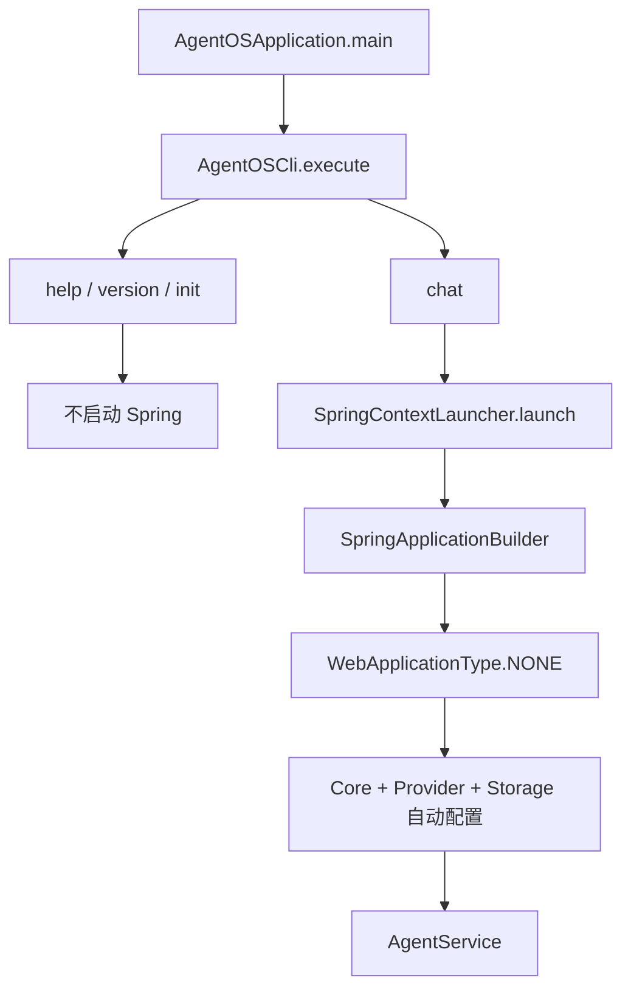
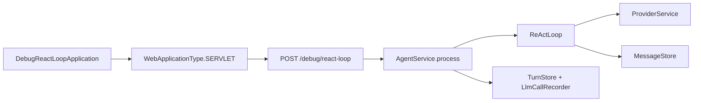

# AgentOS-boot 代码导读

`AgentOS-boot` 是最终组装模块。它把 CLI、Core、Provider、Storage 和 Tool 放进同一个 Spring Boot 应用，并打包成可执行 JAR。

## 启动分流

入口：[AgentOSApplication.java](../../AgentOS-boot/src/main/java/com/agentos/boot/AgentOSApplication.java)、[SpringContextLauncher.java](../../AgentOS-boot/src/main/java/com/agentos/boot/SpringContextLauncher.java)



Boot 只把 `SpringContextLauncher` 注入 CLI。`init/help/version` 不会因为运行在 Boot JAR 中而被迫连接数据库或校验模型配置；只有 `chat` 进入无 Web Spring Context，并在命令结束时关闭 Context。

## 临时 ReAct HTTP 调试入口

为了用浏览器、`curl` 或 IDE 断点观察完整的 `AgentService -> ReActLoop -> Provider -> Storage` 链路，开发期间可以使用临时启动入口：[DebugReactLoopApplication.java](../../AgentOS-boot/src/main/java/com/agentos/boot/dev/DebugReactLoopApplication.java) 和 web 模块的 [AgentLoopDebugController.java](../../AgentOS-web/src/main/java/com/agentos/web/dev/AgentLoopDebugController.java)。Controller 遵循 REST 入口集中在 web 模块的架构规则，boot 只负责启动与组装。



该入口通过 `agentos.debug.react-loop.enabled=true` 显式开启，正式 `AgentOSApplication` 仍保持 CLI 的 `WebApplicationType.NONE` 行为。同步接口会返回 `TurnResult` 和 `complete/error` 事件；`/debug/react-loop/stream` 以 SSE 返回 `delta` 与终态事件。请求固定使用 `debug-http` channel，因此会真实创建 session、turn、USER/ASSISTANT 消息和 `llm_call` 审计记录。调试完成后可以连同两个临时类一起删除。

Maven 的 `spring-boot:run` 默认主类仍是正式入口；调试时先把各模块安装到本地仓库，再覆盖 `agentos.boot.main-class`，并把工作目录设为仓库根目录，让 `.env` 和 `.AgentOS` 使用正确的相对路径：

```bash
mvn -B -ntp -pl AgentOS-boot -am install -DskipTests
mvn -pl AgentOS-boot spring-boot:run \
  -Dagentos.boot.main-class=com.agentos.boot.dev.DebugReactLoopApplication \
  -Dspring-boot.run.workingDirectory=..
```

`AgentOS-boot/pom.xml` 中的 `agentos.boot.main-class` 默认值是正式 `AgentOSApplication`，因此不会改变正常打包入口。

## 自动配置顺序

```text
DataSource / Flyway / JPA
  -> StorageAutoConfiguration
  -> ProviderAutoConfiguration
  -> CoreAutoConfiguration
  -> AgentService
```

Storage 需要 DataSource 才生效；Provider 建立具名模型连接和 `ProviderCatalog`；Core 在所有端口齐备后创建 `DefaultAgentService`。自动配置通过 `META-INF/spring/org.springframework.boot.autoconfigure.AutoConfiguration.imports` 被发现，不依赖 Boot 包扫描业务实现。

## 配置文件

入口：[application.yaml](../../AgentOS-boot/src/main/resources/application.yaml)

当前配置除了 Spring Boot、数据库和 Provider 外，还包含：

```yaml
agentos:
  workspace.root: .AgentOS
  turn.lease-ttl: 150s
  turn.lease-grace: 30s
  turn.cleanup: 1s
  audit.max-retries: 2
  tools.http.allowed-domains: ...
```

密钥仍然通过环境变量占位符注入，不应写入提交文件。HTTP 工具配置目前只绑定值对象，尚未进入工具执行链。

## Boot 集成测试

入口：[ReActApplicationTest.java](../../AgentOS-boot/src/test/java/com/agentos/boot/ReActApplicationTest.java)

测试启动独立 PostgreSQL Testcontainer，并使用 `LocalModelServer` 提供本地 HTTP 模型替身，验证一次纯文本 `chat` 形成：

```text
1 个 session
1 个 turn
2 条消息（USER + ASSISTANT）
1 条 llm_call
恰好 1 个 JPA LlmCallRecorder
```

测试同时确认容器中没有 `ChatModel` / `EmbeddingModel` Bean，`init` 不访问数据库。它证明的是本地模拟模型和真实 PostgreSQL 的装配链路，不是生产模型或真实天气服务验证。
