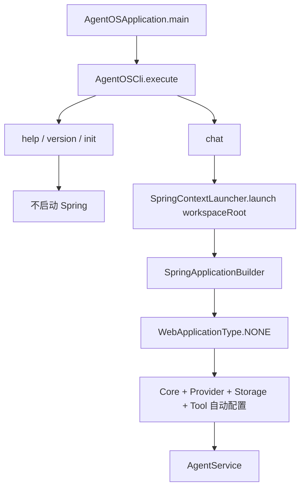

# AgentOS-boot 代码导读

`AgentOS-boot` 是最终组装模块。它把 CLI、Core、Provider、Storage 和 Tool 放进同一个 Spring Boot 应用，并打包成可执行 JAR。

## 启动分流

入口：[AgentOSApplication.java](../../AgentOS-boot/src/main/java/com/agentos/boot/AgentOSApplication.java)、[SpringContextLauncher.java](../../AgentOS-boot/src/main/java/com/agentos/boot/SpringContextLauncher.java)



Boot 只把 `SpringContextLauncher` 注入 CLI。`init/help/version` 不会因为运行在 Boot JAR 中而被迫连接数据库或校验模型配置；只有 `chat` 进入无 Web Spring Context，并在命令结束时关闭 Context。

## 工作区如何传到实际加载器

`ChatCommand` 在入口规范化工作区，只传一个绝对 Path。`ContextLauncher.launch(Path workspaceRoot)` 不再保留无参回退，`SpringContextLauncher` 检查 Path 非空、绝对且已规范化，然后调用：

```java
builders.get().web(WebApplicationType.NONE)
        .run("--agentos.workspace.root=" + workspaceRoot, "--agentos.runtime.chat=true");
```

这个参数属于 Spring 的 commandLineArgs，优先于普通文件/环境配置。它不会被 shell 再解释，也不修改 JVM 的 System properties。CoreAutoConfiguration 继续用同一个 WorkspaceProperties.root 创建 AgentLoader 和 ContextLoader，所以候选选择与实际 Agent/Bootstrap 加载一致。

包内的 builder 工厂构造器只供测试注入隔离 Environment；生产构造器仍使用 AgentOSApplication。测试配置源低于命令行参数、高于普通配置，关闭 `.env` 导入，只连接容器数据库和本地模型替身。

## 临时调试入口与本次验收的区别

仓库另有 web 的 [AgentLoopDebugController.java](../../AgentOS-web/src/main/java/com/agentos/web/dev/AgentLoopDebugController.java)，仅显式开启 `agentos.debug.react-loop.enabled` 时注册，属于此前创建的临时调试代码。本阶段没有新增或验收 REST/SSE 入口。

[DebugReactLoopApplication.java](../../AgentOS-boot/src/main/java/com/agentos/boot/dev/DebugReactLoopApplication.java) 当前存在于主源码，显式使用 SERVLET 模式并默认开启调试 Controller；它不经过 Picocli，也没有 CLI launcher 传入的 `agentos.runtime.chat=true`。不能据此推断已经执行了正式 chat 启动回收。测试源码里的 [DevTestApplication.java](../../AgentOS-boot/src/test/java/com/agentos/boot/dev/DevTestApplication.java) 则只测试 Provider，两者用途不同。

阅读正式链路优先在 `ChatCommand` → `SpringContextLauncher.launch(Path)` → `TurnReaperRunner.run` → `AgentService.process` 设置断点。需要观察 Servlet/SSE 适配时再使用调试主类；启动命令及真实数据库/外呼影响见[Spring 教程第6节](./Spring-SpringBoot-Guide.md)。默认上下文不注册调试 Controller，已有 `ReActApplicationTest` 断言固定此边界。

## 自动配置顺序

```text
DataSource / Flyway / JPA
  -> StorageAutoConfiguration
  -> ProviderAutoConfiguration
  -> ToolAutoConfiguration / 官方 ToolCallingAutoConfiguration
  -> CoreAutoConfiguration
  -> AgentService
```

上面是依赖阅读顺序，不是所有 Bean 的严格实例化顺序。Storage 在 Provider 前声明数据库审计；Tool 在官方工具自动配置前声明安全 resolver/processor，Manager 由官方创建；Core 在这些定义之后组装 `DefaultAgentService`。自动配置通过 `META-INF/spring/org.springframework.boot.autoconfigure.AutoConfiguration.imports` 被发现，不依赖 Boot 包扫描业务实现。

## 配置文件

入口：[application.yaml](../../AgentOS-boot/src/main/resources/application.yaml)

当前配置除了 Spring Boot、数据库和 Provider 外，还包含：

```yaml
agentos:
  workspace.root: .AgentOS
  turn.lease-ttl: 150s
  turn.lease-grace: 30s
  turn.cleanup: 1s
  turn.storage-timeout: 5s
  audit.max-retries: 2
  audit.attempt-timeout: 2s
  tools.http.allowed-domains: []
```

密钥仍通过环境变量占位符注入。HTTP 配置由 ToolAutoConfiguration 实际绑定并注入白名单与工具；这里的空域名列表表示全部拒绝。普通存储上限默认5秒、审计尝试默认2秒（范围1ms～5秒），均受当前轮次剩余预算约束；最后1秒由审计、终态、释放租约及输出通知共享，不能逐项重新计时。

## Boot 集成测试

入口：[ReActApplicationTest.java](../../AgentOS-boot/src/test/java/com/agentos/boot/ReActApplicationTest.java)

测试启动独立 PostgreSQL Testcontainer，并使用 `LocalModelServer` 提供本地 HTTP 模型替身，验证一次纯文本 `chat` 形成：

```text
1 个 session
1 个 turn
2 条消息（USER + ASSISTANT）
1 条 llm_call
恰好 1 个 JPA LlmCallRecorder
```

这只是其中的纯文本用例；同类还覆盖工具闭环、官方限次、慢工具、调用时无连接占用及审计关联，并确认没有额外 `ChatModel` / `EmbeddingModel` Bean、默认调试 Controller 未注册。`init` 的零连接行为由 CLI 初始化测试覆盖。这些证据来自本地模型替身和真实 PostgreSQL，真实模型另由专项验证。

## 默认 main 的真实 CLI 集成验证

[DefaultAgentCliIntegrationTest.java](../../AgentOS-boot/src/test/java/com/agentos/boot/DefaultAgentCliIntegrationTest.java) 先经真实 CLI init 生成 main，再不指定 profile 执行 CLI chat；使用真实 SpringContextLauncher、本地 LocalModelServer 和 `pgvector/pgvector:pg17`，没有直接调用 AgentService 绕过入口。

测试放置冲突默认目录与低优先级 workspace 配置，检查实际模型请求的模型名、空工具定义和所选 Bootstrap 标记；结束后检查上下文关闭、1 个 main 会话、1 个 SUCCEEDED 轮次、2 条消息、1 条 llm_call、0 条工具审计及租约释放。LocalModelServer 的请求捕获只存在于测试源码，不增加生产 prompt 日志。

`SpringContextLauncherTest` 用最小真实上下文固定 NONE 模式、命令行属性优先级、Path 校验和 close。两类测试证明的是本地模型替身与真实 PostgreSQL，不等于真实模型服务验收。

## Phase 7：启动与关闭验证

chat 的命令行参数开启一次性 TurnReaperRunner，SpringApplication 的启动 runners 完成后 launcher 才返回。模型审计的唯一 Bean 是 Storage 提供的 JpaLlmCallRecorder；Provider 调用/重试逻辑没有修改，也不会在数据库失败时退回日志实现。

`LlmAuditIntegrationTest` 用 localhost 模型替身 + PostgreSQL 验证 429 后两行、最终失败保留、Recorder 异常不重发模型、完整结构化日志及脱敏；模型收到 HTTP 时检查 Hikari 活跃连接为零。`ReActApplicationTest` 在工具 HTTP 收到请求时也检查无连接，并读回已提交的 in_progress 意图。Storage 的 AuditTransactionTest 检查退避期间无连接，构成实际运行中的事务边界证据。

Context 的关闭会调用 DefaultAgentService.close，先取消轮次再销毁数据源等依赖。正常 EOF、/exit 与 ChatCommand 的 try-with-resources 关闭同一个 Context；Ctrl-C 使用 Spring 注册的 JVM shutdown hook。SIGKILL 不会执行该 hook，不能承诺即时收尾。

## Phase 8/9：并发与真实天气怎么读

[SessionConcurrencyIntegrationTest.java](../../AgentOS-boot/src/test/java/com/agentos/boot/SessionConcurrencyIntegrationTest.java) 使用可控模型/工具阻塞和独立数据库连接，验证同会话第二条消息与 --new 零写入拒绝、不同会话继续、Provider 重试仍被整轮租约覆盖，以及模型/首个工具等待期间被接管后停止后续操作。只看两个 Java 线程都返回成功不足以证明这些约束。

[ArchitectureRulesTest.java](../../AgentOS-boot/src/test/java/com/agentos/boot/ArchitectureRulesTest.java) 扫描代表类防止空转，限制唯一 ToolExecutor、禁止自建 Manager/业务 ThreadLocal/MDC读取，并辅助检测注解事务包裹外呼或等待。它追踪同类委托，不能穷尽跨 Bean/异步调用；事务边界仍以模型、工具 HTTP 与退避期间的真实连接占用断言为主。

[ReActWeatherSmokeTest.java](../../AgentOS-boot/src/test/java/com/agentos/boot/smoke/ReActWeatherSmokeTest.java) 是显式 `llm` 专项：第一个方法使用真实 primary + 本地天气；第二个还要求 `AGENTOS_WEATHER_DEMO=true` 和已打包 JAR，运行真实 met.no 及两个独立 CLI 进程，第二次 --new。数据库来自独立 Testcontainers，子进程仅接收本次模型、容器库和临时工作区配置；旧会话归档后逐行比较旧轮次/消息/审计，检查新会话和租约。

2026-11-17 完整质量门463项与真实专项2项均通过。真实CLI样本每次2模型/1工具/4消息，不是模型永远只取数一次的契约。具体运行开关、产物路径和证据见[Phase 9 验证记录](../testing/phase9-validation-2026-11-17.md)；普通 verify 不发真实请求。
