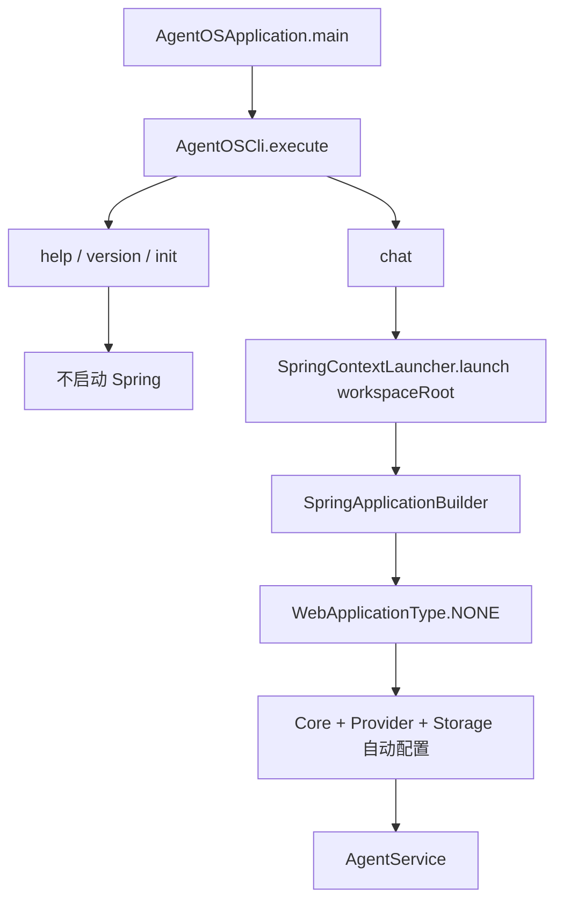

# AgentOS-boot 代码导读

`AgentOS-boot` 是最终组装模块。它把 CLI、Core、Provider、Storage 和 Tool 放进同一个 Spring Boot 应用，并打包成可执行 JAR。

## 启动分流

入口：[AgentOSApplication.java](../../AgentOS-boot/src/main/java/com/agentos/boot/AgentOSApplication.java)、[SpringContextLauncher.java](../../AgentOS-boot/src/main/java/com/agentos/boot/SpringContextLauncher.java)



Boot 只把 `SpringContextLauncher` 注入 CLI。`init/help/version` 不会因为运行在 Boot JAR 中而被迫连接数据库或校验模型配置；只有 `chat` 进入无 Web Spring Context，并在命令结束时关闭 Context。

## 工作区如何传到实际加载器

`ChatCommand` 在入口规范化工作区，只传一个绝对 Path。`ContextLauncher.launch(Path workspaceRoot)` 不再保留无参回退，`SpringContextLauncher` 检查 Path 非空、绝对且已规范化，然后调用：

```java
builders.get().web(WebApplicationType.NONE)
        .run("--agentos.workspace.root=" + workspaceRoot);
```

这个参数属于 Spring 的 commandLineArgs，优先于普通文件/环境配置。它不会被 shell 再解释，也不修改 JVM 的 System properties。CoreAutoConfiguration 继续用同一个 WorkspaceProperties.root 创建 AgentLoader 和 ContextLoader，所以候选选择与实际 Agent/Bootstrap 加载一致。

包内的 builder 工厂构造器只供测试注入隔离 Environment；生产构造器仍使用 AgentOSApplication。测试配置源低于命令行参数、高于普通配置，关闭 `.env` 导入，只连接容器数据库和本地模型替身。

## 临时调试入口与本次验收的区别

仓库另有 web 的 [AgentLoopDebugController.java](../../AgentOS-web/src/main/java/com/agentos/web/dev/AgentLoopDebugController.java)，仅显式开启 `agentos.debug.react-loop.enabled` 时注册，属于此前创建的临时调试代码。本阶段没有新增或验收 REST/SSE 入口。

旧文引用的 DebugReactLoopApplication 当前不存在，不能继续照抄该启动命令。现有测试源码里的 [DevTestApplication.java](../../AgentOS-boot/src/test/java/com/agentos/boot/dev/DevTestApplication.java) 只测试 Provider，不连接数据库，也不代表完整 ReAct 验收。调试本次默认 main 链路应沿真实 CLI 的 `ChatCommand` → `SpringContextLauncher.launch(Path)` → `AgentService.process` 设置断点。

## 自动配置顺序

```text
DataSource / Flyway / JPA
  -> StorageAutoConfiguration
  -> ProviderAutoConfiguration
  -> CoreAutoConfiguration
  -> AgentService
```

Storage 需要 DataSource 才生效；Provider 建立具名模型连接和 `ProviderCatalog`；Core 在所有端口齐备后创建 `DefaultAgentService`。自动配置通过 `META-INF/spring/org.springframework.boot.autoconfigure.AutoConfiguration.imports` 被发现，不依赖 Boot 包扫描业务实现。

## 配置文件

入口：[application.yaml](../../AgentOS-boot/src/main/resources/application.yaml)

当前配置除了 Spring Boot、数据库和 Provider 外，还包含：

```yaml
agentos:
  workspace.root: .AgentOS
  turn.lease-ttl: 150s
  turn.lease-grace: 30s
  turn.cleanup: 1s
  audit.max-retries: 2
  tools.http.allowed-domains: ...
```

密钥仍然通过环境变量占位符注入，不应写入提交文件。HTTP 工具配置目前只绑定值对象，尚未进入工具执行链。

## Boot 集成测试

入口：[ReActApplicationTest.java](../../AgentOS-boot/src/test/java/com/agentos/boot/ReActApplicationTest.java)

测试启动独立 PostgreSQL Testcontainer，并使用 `LocalModelServer` 提供本地 HTTP 模型替身，验证一次纯文本 `chat` 形成：

```text
1 个 session
1 个 turn
2 条消息（USER + ASSISTANT）
1 条 llm_call
恰好 1 个 JPA LlmCallRecorder
```

测试同时确认容器中没有 `ChatModel` / `EmbeddingModel` Bean，`init` 不访问数据库。它证明的是本地模拟模型和真实 PostgreSQL 的装配链路，不是生产模型或真实天气服务验证。

## 默认 main 的真实 CLI 集成验证

[DefaultAgentCliIntegrationTest.java](../../AgentOS-boot/src/test/java/com/agentos/boot/DefaultAgentCliIntegrationTest.java) 先经真实 CLI init 生成 main，再不指定 profile 执行 CLI chat；使用真实 SpringContextLauncher、本地 LocalModelServer 和 `pgvector/pgvector:pg17`，没有直接调用 AgentService 绕过入口。

测试放置冲突默认目录与低优先级 workspace 配置，检查实际模型请求的模型名、空工具定义和所选 Bootstrap 标记；结束后检查上下文关闭、1 个 main 会话、1 个 SUCCEEDED 轮次、2 条消息、1 条 llm_call、0 条工具审计及租约释放。LocalModelServer 的请求捕获只存在于测试源码，不增加生产 prompt 日志。

`SpringContextLauncherTest` 用最小真实上下文固定 NONE 模式、命令行属性优先级、Path 校验和 close。两类测试证明的是本地模型替身与真实 PostgreSQL，不等于真实模型服务验收。
