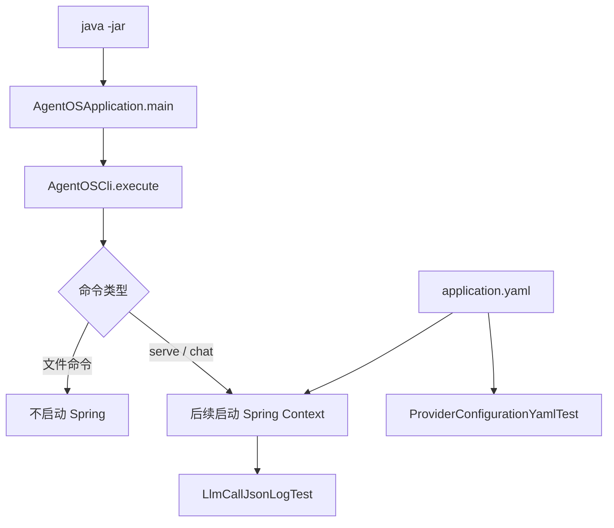

# AgentOS-boot 代码导读

`AgentOS-boot` 是最终组装模块，依赖其他模块并打包成可执行 JAR。当前新增的基础测试还会直接验证 YAML 绑定和 Provider 日志的 ECS JSON 输出。

`AgentOSApplication` 上的 `@SpringBootApplication` 声明了 Spring Boot 入口，但当前 `main` 先交给 CLI 解析命令；真正的 `SpringApplication.run(...)` 会由需要 Spring 的子命令启动。

配置文件目前负责：

- 数据库连接和 JPA 行为；
- Spring AI 自动配置开关；
- Provider、Embedding 和超时配置；
- Web 端口、优雅停机和日志格式。

## 当前 Boot 测试

| 测试 | 说明 |
|---|---|
| `ArchitectureRulesTest` | 检查模块依赖、工具调用入口、日志和注入约束 |
| `LoggingBaselineTest` | 检查基础文件日志包含 ECS JSON 和 MDC 字段 |
| `ProviderConfigurationYamlTest` | 隔离解析 `application.yaml`，验证环境变量缺省值和 Spring AI 开关 |
| `LlmCallJsonLogTest` | 从真实自动配置取得 Recorder，验证 27 个调用元数据字段写入 ECS JSON |

