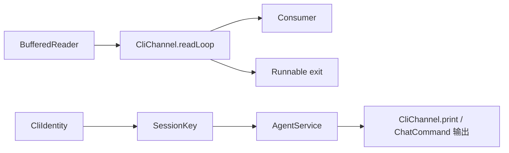

# AgentOS-channel-cli 代码导读

`AgentOS-channel-cli` 是纯 I/O 适配层。它不加载 Agent、不调用 Provider，也不创建数据库会话。

## 两个类

入口：[CliChannel.java](../../AgentOS-channel-cli/src/main/java/com/agentos/channel/cli/CliChannel.java)、[CliIdentity.java](../../AgentOS-channel-cli/src/main/java/com/agentos/channel/cli/CliIdentity.java)

`CliChannel.readLoop` 逐行读取：

- `/exit` 调用退出回调并停止；
- 空行不调用消息回调；
- 普通行交给消息回调；
- EOF 也调用退出回调。

`CliChannel` 的构造器注入 `BufferedReader` 和 `PrintWriter`，所以测试不需要真实终端。

`CliIdentity` 将 `userId`、`agentName` 转换为 `SessionKey("cli", userId, agentName)`。会话自然键因此包含渠道、登录用户和 Agent，避免不同用户或不同 Agent 共用同一活跃会话。

## 阅读边界

CLI 命令的单条模式和 Spring 启动由 `AgentOS-cli` 负责；这个模块只提供可复用的输入输出和身份值对象。后续 REST、定时任务等入口也应把自己的输入转换成 Core 的 `ProcessRequest`，不要把渠道判断塞进 `AgentOS-core`。

## 测试

- `CliChannelTest`：普通行、空行、`/exit`、EOF 和输出刷新；
- `CliIdentityTest`：默认本地用户和 `SessionKey` 字段。
