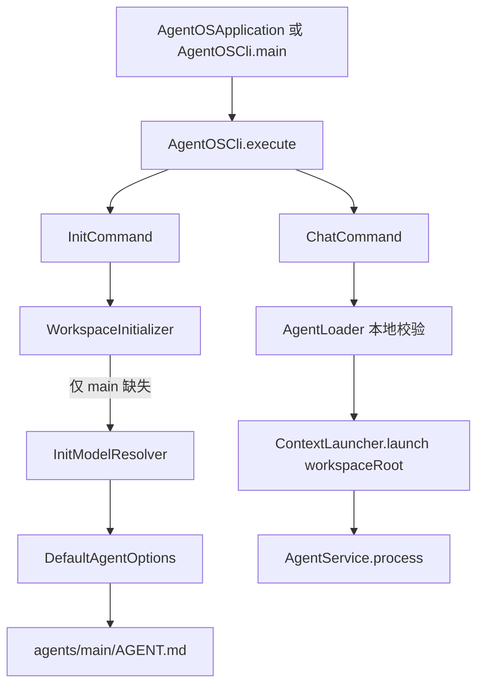

# AgentOS-cli 代码导读

`AgentOS-cli` 用 Picocli 把命令行参数转换成 Java 命令对象。它负责文件初始化、选择 Agent 和终端输入输出；聊天仍调用同一个 `AgentService.process`，不在 CLI 里另写模型循环或数据库访问。

## 先看两个入口

[AgentOSCli.java](../../AgentOS-cli/src/main/java/com/agentos/cli/AgentOSCli.java) 创建命令树，[AgentOSCommand.java](../../AgentOS-cli/src/main/java/com/agentos/cli/AgentOSCommand.java) 提供根帮助和版本。init/chat 都由入口动态注册，注入各自需要的文件输入和启动器。



`--help`、`--version` 和 `init` 不启动 Spring。独立 CLI JAR 能初始化工作区；聊天需要 Boot 提供的启动器。

## init 为什么可以离线执行

```bash
java -jar AgentOS-boot/target/AgentOS.jar init --model local-test-model
```

这里的模型名是演示输入，程序没有内置默认模型。`InitCommand` 先把 `--workspace`（默认 `.AgentOS`）相对执行目录转成规范化绝对路径，再交给 [WorkspaceInitializer.java](../../AgentOS-cli/src/main/java/com/agentos/cli/WorkspaceInitializer.java)。自定义路径就是工作区本身，不会再拼一层 `.AgentOS`。

初始化先检查已有路径类型、链接和已有 main。main 合法就保留，只有缺失时才调用 [InitModelResolver.java](../../AgentOS-cli/src/main/java/com/agentos/cli/InitModelResolver.java)，按下面的顺序取模型名：

1. `--model`；
2. 进程环境变量 `AGENTOS_LLM_MODEL`；
3. 命令执行目录 `.env` 的同名项。

“已经提供但为空白或占位符”会立即失败，不回退。高优先级已提供就不读取低优先级来源；缺模型时失败发生在任何工作区写入之前。

`.env` 用 UTF-8 Reader 和 JDK Properties 语法解析，支持转义、续行和重复键最后生效；不是 shell，不执行 `export`、变量插值或去引号。`ModelProjection` 只保留模型键，其他配置不进入 [DefaultAgentOptions.java](../../AgentOS-cli/src/main/java/com/agentos/cli/DefaultAgentOptions.java)。该 record 只带 model 和可选 providerName，不带连接、密码或环境 Map。

预检查完成后创建这些内容：

```text
agents/main/AGENT.md
skills/
output/
memory/MEMORY.md
logs/
AGENTS.md
SOUL.md
USER.md
```

main 是普通 Agent：名称固定 main、中文通用助手正文、具体模型和 `tools: []`。`--provider` 可选，省略时不写 provider.name，聊天时沿用默认连接。SnakeYAML 序列化字符串，模型名中的换行、冒号等不能变成额外配置或工具授权。

文件使用 `CREATE_NEW`，避免“先检查再覆盖”的竞争窗口。竞争者已经创建目标时检查类型；main 还要重新经过 AgentLoader 校验。中途失败保留已创建文件，重试只补缺项；已有 main 写坏时明确失败并提示人工处理，不自动覆盖。结果只返回 created/skipped 路径，不携带文件正文。

`init` 成功表示本地文件准备完毕，不证明模型、Provider 或数据库连通。已有合法 main 时新模型输入不会更新旧文件。

## AGENTS.md 和 main 各自负责什么

工作区根的 `.AgentOS/AGENTS.md` 是所有 Agent 共享的自然语言指令，和 SOUL/USER 一起进入上下文；它不是 Codex 的仓库根 AGENTS.md，也不存 Profile 配置。

`agents/main/AGENT.md` 才定义默认 Agent 的模型、工具名单和自身正文。main 的特殊之处只有 CLI 的默认选择优先级，运行时仍走普通 Profile、会话和 ReAct 链路。

## chat 怎么选 Agent

[ChatCommand.java](../../AgentOS-cli/src/main/java/com/agentos/cli/ChatCommand.java) 按顺序选择：显式 `--profile` → main → 没有 main 时的唯一旧 Agent。多个候选会列出名字并要求指定；零个提示 init。

main 路径存在但缺文件或配置损坏时失败，不切换到其他 Agent。显式选中的 Agent 也必须通过 AgentLoader 的本地校验，才会启动 Spring；未选中的坏 Agent 不妨碍显式选择有效 Agent。目录扫描使用 try-with-resources 关闭 Stream，并拒绝末级链接。

同一个规范化工作区通过 [ContextLauncher.java](../../AgentOS-cli/src/main/java/com/agentos/cli/ContextLauncher.java) 的 `launch(Path workspaceRoot)` 进入 Boot，实际 Agent 和 Bootstrap 都从这个根目录加载。

`--message` 问一次后退出。交互模式每行一条消息，空行提示但不创建轮次，`/exit` 或 EOF 结束。每条消息构造 `ProcessRequest("cli", 当前用户名, Agent 名, 消息, "cli")`。整个命令共用一个上下文，正常与异常退出都关闭资源。

退出码：成功 0；启动或 init 文件 I/O 失败 1；参数、坏 Agent 或空消息 2；单消息轮次失败、超时、会话忙或持久化未确认 3。UNCONFIRMED 输出 turnId 和“持久化未确认”。内部异常原文不直接输出。`--new` 归档尚未实现，当前明确拒绝，不能把普通聊天当作新会话。

## 测试和断点阅读顺序

- `InitModelResolverTest`：来源优先级、惰性读取、合成 properties、错误安全。
- `WorkspaceInitializerTest`、`InitCommandBehaviorTest`：零写入、YAML round-trip、幂等、竞争和部分失败。
- `ChatCommandTest`：选择矩阵、工作区参数、交互和上下文关闭。
- Boot 的 `DefaultAgentCliIntegrationTest`：真实 CLI→启动器→本地模型替身→PostgreSQL。

理解链路时先在 `InitCommand.call`、`WorkspaceInitializer.initialize`、`InitModelResolver.resolve` 设断点，再在 `ChatCommand.call/selectProfile/process` 和 `SpringContextLauncher.launch` 设断点。随后沿 `AgentService.process` 进入 ReAct；不要把 init 误认为已经运行了模型循环。
