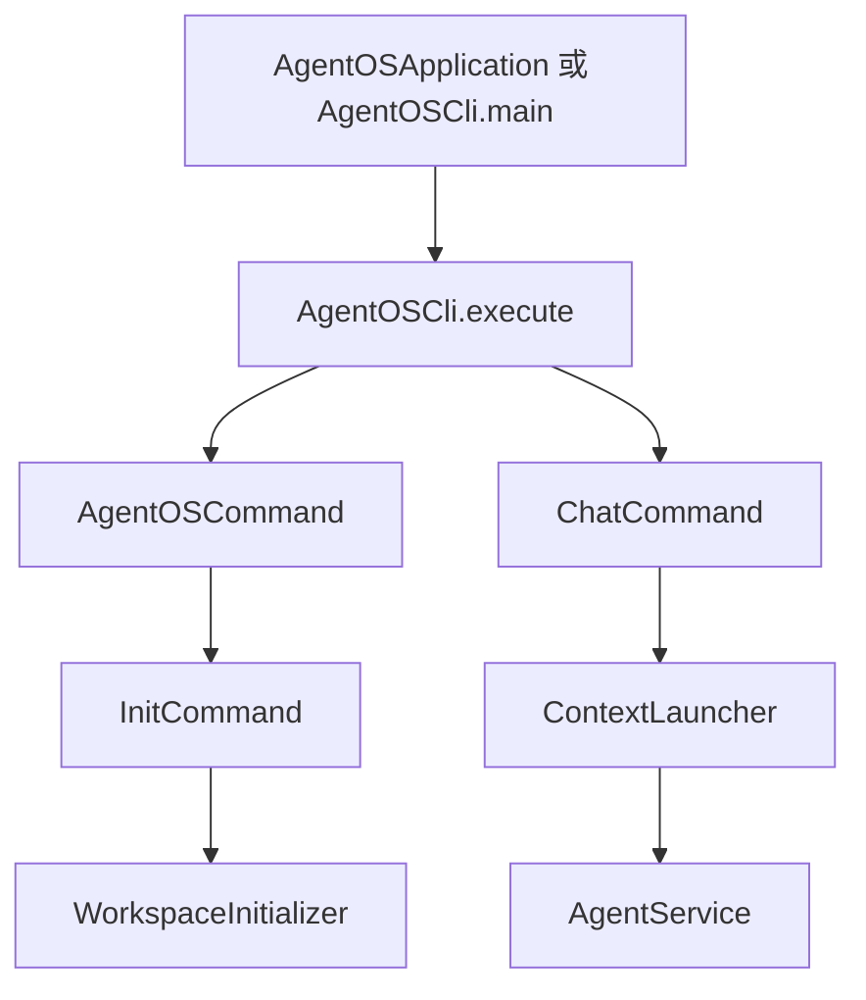

# AgentOS-cli 代码导读

`AgentOS-cli` 使用 Picocli，把命令行参数转换成 Java 命令对象。它只负责命令解析和入口编排，不实现模型调用或数据库访问。

## 命令树

入口：[AgentOSCli.java](../../AgentOS-cli/src/main/java/com/agentos/cli/AgentOSCli.java)、[AgentOSCommand.java](../../AgentOS-cli/src/main/java/com/agentos/cli/AgentOSCommand.java)



`AgentOSCli.execute(String...)` 保持独立 CLI 行为，`AgentOS-boot` 则调用带 `ContextLauncher` 的重载方法。这样 `--help`、`--version` 和 `init` 不需要启动 Spring 或连接数据库。

## `init`

入口：[WorkspaceInitializer.java](../../AgentOS-cli/src/main/java/com/agentos/cli/WorkspaceInitializer.java)

`WorkspaceInitializer` 在指定 workspace 下幂等创建：

```text
agents/
skills/
output/
memory/
logs/
memory/MEMORY.md
AGENTS.md
SOUL.md
USER.md
```

文件或目录已经存在时只记录 skipped，不覆盖原内容，也不启动 Spring。`InitCommand` 只打印新建和跳过数量。

## `chat`

入口：[ChatCommand.java](../../AgentOS-cli/src/main/java/com/agentos/cli/ChatCommand.java)

Agent 选择规则：

1. 指定 `--profile` 时直接使用名称；
2. 没指定时扫描 `.AgentOS/agents`；
3. 只有一个 Agent 才自动选择；没有或多个 Agent 都报错，多个时提示使用 `--profile`。

`--message` 是单条模式；没有它时进入 stdin 交互模式。交互中空行被忽略，`/exit` 或 EOF 结束。每条非空输入都构造 `ProcessRequest("cli", 当前用户名, Agent 名, 消息, "cli")`，再调用同一个 `AgentService.process`。

`--new` 参数已保留，但当前代码没有实现新 session 语义，不能把它当作已完成能力。

## 测试阅读顺序

- `WorkspaceInitializerTest`：目录和文件创建、幂等和不覆盖；
- `ChatCommandTest`：单消息、Agent 选择、假 `ContextLauncher`；
- `AgentOSCliTest`：根命令注册和不启动 Spring 的行为。
