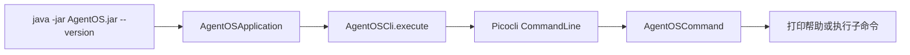

# AgentOS-cli 代码导读

CLI 模块使用 Picocli，把命令行参数转换成 Java 命令对象。

## 类的职责

| 类 | 作用 |
|---|---|
| `AgentOSCli` | 创建 Picocli 执行器并返回退出码 |
| `AgentOSCommand` | 根命令定义和帮助信息 |
| `VersionInfo` | 读取构建版本、Java 和系统信息 |

当前根命令已经存在，但 `init`、`serve`、`chat` 等子命令还没有逐个注册。因此不带参数时主要显示帮助。

