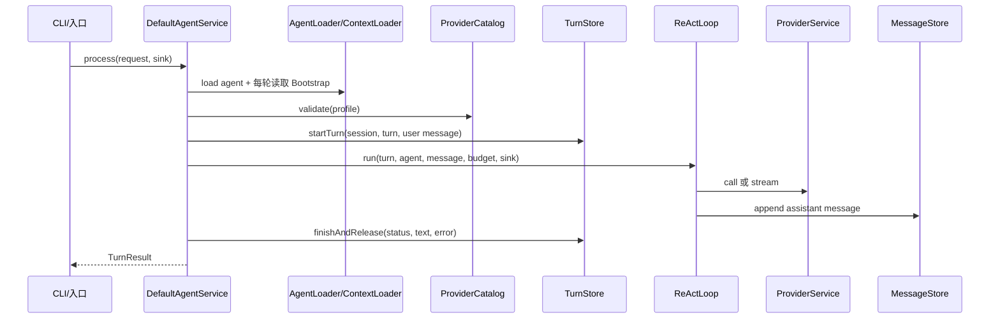

# AgentOS-core 代码导读

`AgentOS-core` 是业务规则和端口所在的模块。它知道 Agent 如何加载、一次轮次如何受预算约束、模型调用需要哪些字段，但不知道 PostgreSQL 表结构，也不直接创建 OpenAI 模型。

## 先看自动配置

入口：[CoreAutoConfiguration.java](../../AgentOS-core/src/main/java/com/agentos/core/config/CoreAutoConfiguration.java)

它显式创建：

```text
WorkspaceProperties -> AgentLoader / ContextLoader
ContextLoader -> PromptBuilder
TurnStore -> TurnGuard
TurnRunner、TurnBudgetRegistry
ProviderService + ProviderCatalog + SessionManager + TurnStore + MessageStore
    -> DefaultAgentService
```

`AgentService` 只有在 Provider、ProviderCatalog、Storage 端口都存在时才创建。这保证只有测试或 CLI 需要的组件装配完整后，才会出现真正的业务入口。

## `DefaultAgentService`：一轮请求的总编排

文件：[DefaultAgentService.java](../../AgentOS-core/src/main/java/com/agentos/core/turn/DefaultAgentService.java)



实现顺序值得注意：ProviderCatalog 在 `startTurn` 前校验，所以未知 Provider 不会先创建 session/turn；空白消息也在建轮次前拒绝。`startTurn` 成功后才注册预算和 MDC，最终在 `finally` 中移除预算、清理 MDC。

终态由 `TurnStore.finishAndRelease` 持久化确认结果决定：业务状态仍是 `SUCCEEDED`、`FAILED` 或 `TIMED_OUT`，另外返回 `PersistenceStatus.CONFIRMED` 或 `UNCONFIRMED`。终结回调发生在持久化收尾之后，回调异常只记安全日志，不改变已经确定的业务结果。

## Agent 配置和 Prompt

入口：[AgentLoader.java](../../AgentOS-core/src/main/java/com/agentos/core/agent/AgentLoader.java)

每次读取 `.AgentOS/agents/<name>/AGENT.md` 时会检查：

- 名称不能为空，不能含 `..`、`/` 或 `\\`，目录不能是越界软链接；
- frontmatter 使用 SnakeYAML `SafeConstructor`；
- `name` 必须等于目录名，`provider.model` 必填；
- `settings` 缺省为 `maxIterations=10`、`maxHistoryTurns=20`、`maxHistoryTokens=32000`、`turnTimeout=300s`；
- 未声明 `tools` 时使用空列表，并打 INFO；认识但尚未实现的键只打 WARN。

`ContextLoader` 在每轮重新读取 `AGENTS.md`、`SOUL.md`、`USER.md`，日期通过可注入 `Clock` 生成。`PromptBuilder` 按固定顺序生成一个系统消息：

```text
Agent 正文
-> Bootstrap AGENTS.md
-> Bootstrap SOUL.md
-> Bootstrap USER.md
-> 数据安全说明
-> 当地日期
-> 历史消息（当前调用方传入时）
-> 当前 UserMessage
```

系统消息只进入 ProviderRequest，不写入 MessageStore。

三个 Bootstrap 文件位于运行工作区 `.AgentOS/` 内，与仓库根目录给 Codex 使用的 `AGENTS.md` 不同。缺失时 `ContextLoader` 打 WARN 并跳过，仍可继续执行；在仓库根目录运行 `java -jar AgentOS-boot/target/AgentOS.jar init` 可用默认模板补齐，已有文件不会覆盖，也不会连接数据库。

当前 `DefaultAgentService.process` 会先调用一次 `ContextLoader.load`；随后 `TurnRunner` 在虚拟线程中执行 `ReActLoop`，`PromptBuilder.build` 再读取一次 Bootstrap。因此同一次请求可能在两个线程各出现一组缺失警告，这本身不表示模型调用了两次。调试时可在这两个加载点下断点，比较 `LoadedAgent.bootstrap()` 和最终的系统消息。

## 最小 ReAct 循环

入口：[ReActLoop.java](../../AgentOS-core/src/main/java/com/agentos/core/turn/ReActLoop.java)

当前版本的一次循环只有一次模型请求：

1. 用 PromptBuilder 生成输入；
2. `TurnGuard.checkpoint` 检查截止时间并续租；
3. 构造 `ProviderRequest`，带 `CallCorrelation(sessionId, turnId, 1)`；
4. 根据 `TurnSink.streaming()` 选择 `ProviderService.call` 或 `stream`；
5. 再次 checkpoint；
6. 空回答或工具调用返回 `FAILED`；普通文本追加一条助手消息并返回 `SUCCEEDED`。

工具列表当前固定为空，工具调用不会被执行。后续工具执行器接入后，循环才会扩展为多 iteration。

## 时间预算和租约

入口：[TurnExecutionBudget.java](../../AgentOS-core/src/main/java/com/agentos/core/turn/TurnExecutionBudget.java)、[TurnGuard.java](../../AgentOS-core/src/main/java/com/agentos/core/turn/TurnGuard.java)、[TurnRunner.java](../../AgentOS-core/src/main/java/com/agentos/core/turn/TurnRunner.java)

`TurnExecutionBudget` 用 `System.nanoTime()` 计算本地剩余时长，同时保存给 Provider 的绝对 `Instant deadline`，并额外预留 1 秒 hard stop。`TurnRunner` 使用虚拟线程执行任务，超过 hard stop 就取消任务并转成 `TurnDeadlineExceededException`。

`TurnGuard` 在模型调用前后检查：预算是否过期、是否还能续租。预算通过方法参数和 `TurnBudgetRegistry(turnId -> budget)` 显式传递，不使用 `ThreadLocal`。

## 端口表

| 端口 | 作用 | 当前实现 |
|---|---|---|
| `ProviderCatalog` | 建轮次前校验 Provider/Profile | `DefaultProviderCatalog` |
| `ProviderService` | 一次同步或流式模型调用 | `DefaultProviderService` |
| `SessionManager` | 查找活动会话、按空闲状态归档 | `JpaSessionManager` |
| `TurnStore` | 原子起轮、续租、终态和回收 | `JpaTurnStore` |
| `MessageStore` | 追加消息、读取历史轮次 | `JpaMessageStore` |
| `LlmCallRecorder` | 保存结构化模型调用记录 | 日志记录器或 `JpaLlmCallRecorder` |

## 测试怎么读

优先读 `AgentLoaderTest`、`PromptBuilderTest`、`ReActLoopTest`，再读 `AgentServiceTest`。测试夹具在 `AgentOS-core/src/test/.../support/`，包括内存 Session/Turn/Message 实现、脚本化 Provider 和事件记录 Sink。它们让 Core 测试不启动 Spring、不连接数据库，也不发送真实模型请求。
