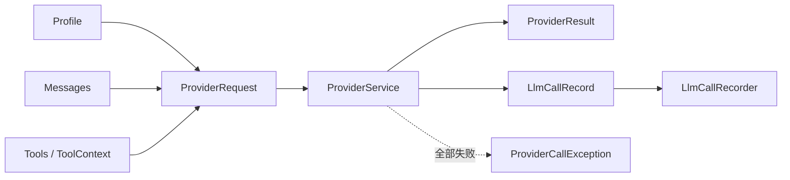
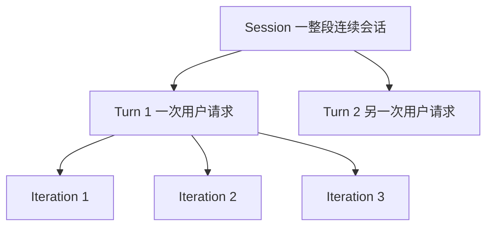

# AgentOS-core 代码导读

`AgentOS-core` 是项目地基。它定义规则和数据结构，尽量不依赖具体 Provider、数据库或 HTTP。



## 类的职责

| 类 | 作用 |
|---|---|
| `ErrorCode` | 稳定的业务错误类型，如 `SESSION_BUSY` |
| `AgentOSException` | 携带 `ErrorCode` 的统一业务异常 |
| `Profile` | 一次模型调用的模型和生成参数 |
| `ProviderRequest` | 发给 Provider 的完整请求 |
| `ProviderService` | 同步或流式调用模型的接口 |
| `ProviderResult` | 模型响应加全部调用记录 |
| `LlmCallRecord` | 一次实际模型请求的审计记录 |
| `LlmCallRecorder` | 审计记录的输出扩展点 |
| `FailureKind` | 判断错误是否适合重试 |
| `ProviderCallException` | 所有重试都失败后的异常 |
| `CallCorrelation` | 关联 Session、Turn、Iteration |
| `CallMode` | `CALL` 一次性返回，`STREAM` 流式返回 |
| `EmbeddingService` | 文本转向量的接口 |
| `EmbeddingStatus` | Embedding 当前状态和原因 |

## `CallCorrelation` 详解

文件：[`CallCorrelation.java`](../../AgentOS-core/src/main/java/com/agentos/core/provider/CallCorrelation.java)

它给一次模型调用标记业务位置：

```java
public record CallCorrelation(
        UUID sessionId,
        UUID turnId,
        Integer iteration) {}
```

三个字段的关系是：



| 字段 | 含义 | 变化规律 |
|---|---|---|
| `sessionId` | 整段连续对话的 ID | 同一会话的多个 Turn 通常相同 |
| `turnId` | 一次用户请求的轮次 ID | 同一 Turn 的多次模型调用相同 |
| `iteration` | 当前 Turn 内第几次模型调用 | 在同一个 Turn 中逐次变化 |

例如一次用户请求需要先让模型判断、再调用工具、最后组织答案：

```text
Session S100
└── Turn T200
    ├── Iteration 1：模型决定调用天气工具
    ├── Iteration 2：模型读取工具结果
    └── Iteration 3：模型生成最终答案
```

这三次调用的 `sessionId` 和 `turnId` 相同，`iteration` 分别是 1、2、3。

`CallCorrelation.none()` 返回三个 `null`，表示这次调用没有会话、轮次和循环上下文，例如独立测试或简单 CLI 调用。这里使用 `Integer` 而不是 `int`，就是为了允许“未知”状态；`null` 比用 `0` 表示未知更清楚。

这个对象会先放进 `ProviderRequest`，之后复制到 `LlmCallRecord`，这样审计记录可以回答：

```text
这次模型调用属于哪个会话？
属于哪个用户请求？
是该请求中的第几次模型调用？
```

## 最重要的边界

```text
core 只定义“需要什么能力”
provider 负责“如何连接模型”
web / cli 负责“如何接收和返回请求”
```

`ProviderRequest` 不负责 ReAct 循环。它只描述一次模型调用；要不要继续下一轮，由更上层的 Agent 引擎决定。

源码入口：[`ProviderRequest.java`](../../AgentOS-core/src/main/java/com/agentos/core/provider/ProviderRequest.java)、[`ProviderService.java`](../../AgentOS-core/src/main/java/com/agentos/core/provider/ProviderService.java)。

