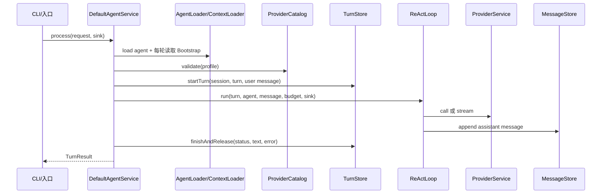

# AgentOS-core 代码导读

`AgentOS-core` 是业务规则和端口所在的模块。它知道 Agent 如何加载、一次轮次如何受预算约束、模型调用需要哪些字段，但不知道 PostgreSQL 表结构，也不直接创建 OpenAI 模型。

## 先看自动配置

入口：[CoreAutoConfiguration.java](../../AgentOS-core/src/main/java/com/agentos/core/config/CoreAutoConfiguration.java)

它显式创建：

```text
WorkspaceProperties -> AgentLoader / ContextLoader
ContextLoader -> PromptBuilder
TurnStore -> TurnGuard
TurnRunner、TurnBudgetRegistry
ProviderService + ProviderCatalog + SessionManager + TurnStore + MessageStore
    -> DefaultAgentService
```

`AgentService` 只有在 Provider、ProviderCatalog、Storage 端口都存在时才创建。这保证只有测试或 CLI 需要的组件装配完整后，才会出现真正的业务入口。

## `DefaultAgentService`：一轮请求的总编排

文件：[DefaultAgentService.java](../../AgentOS-core/src/main/java/com/agentos/core/turn/DefaultAgentService.java)



实现顺序值得注意：ProviderCatalog 和 ToolCatalog 都在 `startTurn` 前校验，所以未知 Provider 或工具名单不会先创建 session/turn；空白消息也在建轮次前拒绝。`startTurn` 成功后才注册预算和 MDC，最终在 `finally` 中移除预算、清理 MDC。

终态由 `TurnStore.finishAndRelease` 持久化确认结果决定：业务状态仍是 `SUCCEEDED`、`FAILED`、`INTERRUPTED` 或 `TIMED_OUT`，另外返回 `PersistenceStatus.CONFIRMED` 或 `UNCONFIRMED`。终结回调发生在持久化收尾之后，回调异常只记安全日志，不改变已经确定的业务结果。

## Agent 配置和 Prompt

入口：[AgentLoader.java](../../AgentOS-core/src/main/java/com/agentos/core/agent/AgentLoader.java)

每次读取 `.AgentOS/agents/<name>/AGENT.md` 时会检查：

- 名称不能为空，不能含 `..`、`/` 或 `\\`，目录不能是越界软链接；
- frontmatter 使用 SnakeYAML `SafeConstructor`；
- `name` 必须等于目录名，`provider.model` 必填；
- `settings` 缺省为 `maxIterations=10`、`maxHistoryTurns=20`、`maxHistoryTokens=32000`、`turnTimeout=300s`；
- 未声明 `tools` 时使用空列表，并打 INFO；认识但尚未实现的键只打 WARN。

`ContextLoader` 在每轮重新读取 `AGENTS.md`、`SOUL.md`、`USER.md`，日期通过可注入 `Clock` 生成。`PromptBuilder` 按固定顺序生成一个系统消息：

```text
Agent 正文
-> Bootstrap AGENTS.md
-> Bootstrap SOUL.md
-> Bootstrap USER.md
-> 数据安全说明
-> 当地日期
-> 历史消息（当前调用方传入时）
-> 当前 UserMessage
```

系统消息只进入 ProviderRequest，不写入 MessageStore。

三个 Bootstrap 文件位于运行工作区 `.AgentOS/` 内，与仓库根目录给 Codex 使用的 `AGENTS.md` 不同。缺失时 `ContextLoader` 打 WARN 并跳过，仍可继续执行；在仓库根目录运行 `java -jar AgentOS-boot/target/AgentOS.jar init` 可用默认模板补齐，已有文件不会覆盖，也不会连接数据库。

当前 `DefaultAgentService.process` 会先调用一次 `ContextLoader.load`；随后 `TurnRunner` 在虚拟线程中执行 `ReActLoop`，`PromptBuilder.build` 再读取一次 Bootstrap。因此同一次请求可能在两个线程各出现一组缺失警告，这本身不表示模型调用了两次。调试时可在这两个加载点下断点，比较 `LoadedAgent.bootstrap()` 和最终的系统消息。

## ReAct 工具循环（Phase 4）

入口：[ReActLoop.java](../../AgentOS-core/src/main/java/com/agentos/core/turn/ReActLoop.java)。纯文本仍只调用一次模型；工具分支会在同一轮内继续迭代：

1. ReActLoop 先从 MessageStore 读取同一 active 会话的已完成轮次；PromptBuilder 生成 system + 完整历史 + 当前 USER，并按轮数和 90% token 预算截断。
2. 从 ToolCatalog 取得本 Agent 授权 callbacks，checkpoint 后请求模型。ProviderRequest 只带 TurnContext，此时还没有本次响应的调用 ID，不建账本。
3. 普通文本回答追加 ASSISTANT 并返回。工具响应先整批校验 ID 非空且唯一，违规整批零执行。
4. 发布脱敏后的 `onToolCall`，交给 ToolExecutor。它在模型返回后建立 FIFO 账本，使用固定内部键把 TurnContext、账本、同一预算放进官方 Manager 的 Prompt。
5. Manager 正常返回才取得完整历史和新增 ASSISTANT/TOOL，发布 `onToolResult` 并只保存新增消息。致命异常不写本批未完成消息，之前成功迭代的消息和工具审计保留。
6. 使用完整 conversationHistory 请求下一次模型，iteration 递增；全部工具都 `returnDirect` 时直接以工具结果收口，不再请求模型。

循环不自己遍历执行 callback，`ToolExecutor` 是唯一调用 `executeToolCalls` 的生产类。`ToolCallLedger` 维护每个工具名的 ID 队列和全局原顺序；还持有捕获 turn/budget 的 checkpoint 闭包，治理与 HTTP 跳转可复用租约检查，而不更改 TurnContext 签名或引入 ThreadLocal。

Phase 5 已实现 `maxIterations` 判定与超限补审计，达到上限不发送额外总结请求。Phase 7 的审计故障会停止循环，保留已执行操作的不确定性。

### 输出端为什么也要治理

`ManagedTurnSink` 区分过程回调和终结通知。过程 callback 异常表示输出端失效，取消预算并返回 INTERRUPTED，后续不再调用该 sink。仍在阻塞的过程 callback 也不会被并发调用终结事件；hard stop 后取消预算，迟到恢复的回调不能继续模型、工具或消息操作。

`onComplete` / `onError` 只在持久化收尾后尝试一次，用虚拟线程等待至剩余 hard stop。抛错或阻塞只记安全的“未送达”日志，不撤销已经 CONFIRMED 的结果，也不补发第二个 error。没有通知预算时直接记录未送达。

## 时间预算和租约

入口：[TurnExecutionBudget.java](../../AgentOS-core/src/main/java/com/agentos/core/turn/TurnExecutionBudget.java)、[TurnGuard.java](../../AgentOS-core/src/main/java/com/agentos/core/turn/TurnGuard.java)、[TurnRunner.java](../../AgentOS-core/src/main/java/com/agentos/core/turn/TurnRunner.java)

`TurnExecutionBudget` 用 `System.nanoTime()` 计算本地剩余时长，同时保存给 Provider 的绝对 `Instant deadline`，并额外预留 1 秒 hard stop。`TurnRunner` 使用虚拟线程执行任务，超过 hard stop 就取消任务并转成 `TurnDeadlineExceededException`。

`TurnGuard` 在模型调用前后检查：预算是否过期、是否还能续租。预算通过方法参数和 `TurnBudgetRegistry(turnId -> budget)` 显式传递，不使用 `ThreadLocal`。

## 端口表

| 端口 | 作用 | 当前实现 |
|---|---|---|
| `ProviderCatalog` | 建轮次前校验 Provider/Profile | `DefaultProviderCatalog` |
| `ProviderService` | 一次同步或流式模型调用 | `DefaultProviderService` |
| `SessionManager` | 查找活动会话、按空闲状态归档 | `JpaSessionManager` |
| `TurnStore` | 原子起轮、续租、终态和回收 | `JpaTurnStore` |
| `MessageStore` | 追加消息、读取历史轮次 | `JpaMessageStore` |
| `ToolCatalog` | 校验并取得 Agent 工具名单 | `ToolRegistry` |
| `ToolInvocationRecorder` | 先登记意图再更新原行 | `JpaToolInvocationRecorder` |
| `LlmCallRecorder` | 保存结构化模型调用记录 | 日志记录器或 `JpaLlmCallRecorder` |

## 测试怎么读

优先读 `AgentLoaderTest`、`PromptBuilderTest`、`ReActLoopTest`，再读 `AgentServiceTest`。测试夹具在 `AgentOS-core/src/test/.../support/`，包括内存 Session/Turn/Message 实现、脚本化 Provider 和事件记录 Sink。大部分测试不启动 Spring；Manager 契约测试使用轻量 ApplicationContextRunner 获取官方自动配置 Bean。全部 Core 测试不连接数据库、不发送真实模型请求。

## Phase 7：审计失败与关闭时怎么收口

`RetryingAuditWriter` 只接收审计写入/查证函数，没有模型或工具执行能力。它负责总三次尝试、200/500ms 事务外等待，以及同一个 TurnExecutionBudget 的业务 deadline/hardStop；数据库实现负责每次独立事务与 JDBC 时限。`TurnBudgetRegistry` 缺少预算时直接拒写，不偷偷生成新预算。

`DefaultAgentService` 把起步也交给有界 TurnRunner。起步提交未知时只按原 turnId 查询，不重复建轮次/消息；仍查不清返回 FAILED + UNCONFIRMED，不发模型请求。确认开始后 finally 成对移除预算与 MDC。任何必要审计未确认都会在 budget 留下标志，即使轮次收尾成功也不能再返回 CONFIRMED；存储已回收的终态优先于迟到的本地结果。

服务实现 AutoCloseable：关闭后拒绝新轮次，取消现有预算并中断调用方等待，最多共享一秒等候收尾。取消缩短剩余 hardStop，不重置整轮计时。最后一次短收尾暂时清除、随后恢复中断标志，争取写 INTERRUPTED 并释放自己的 lease。虚拟线程执行器在 finally shutdownNow；不合作的 I/O 仍靠客户端超时限制。强杀不能保证关闭钩子执行，由下次 chat 启动或会话接管的 TurnReaper 恢复。

调试顺序：`RetryingAuditWriter.write` 看 retry/confirmed → `JpaLlmCallRecorder.record` 看 write_id → `GovernedToolCallback.call` 比较 begin 与 complete 失败 → `JpaTurnStore.recoverSession` 看父轮次/工具/owner 的原子变化。故障测试入口为 AgentServiceFailureTest、RetryingAuditWriterTest 和 storage 的 AuditTransactionTest，不要在共享库制造故障。
