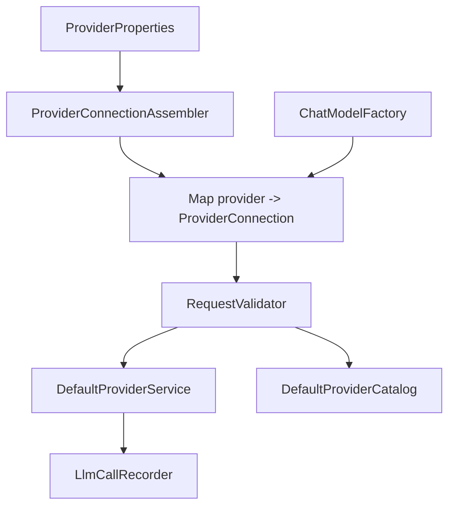

# AgentOS-provider 代码导读

`AgentOS-provider` 是外部模型适配层。它把配置中的具名连接转换成可调用的 OpenAI 兼容模型，并实现 Core 的 `ProviderService` 与 `ProviderCatalog`。

## 自动配置如何装配

入口：[ProviderAutoConfiguration.java](../../AgentOS-provider/src/main/java/com/agentos/provider/config/ProviderAutoConfiguration.java)



自动配置有三个边界：

1. 通过 `@EnableConfigurationProperties` 绑定 Provider 和 Embedding 配置；
2. 显式注册 `ProviderService`、`ProviderCatalog` 和默认日志记录器；
3. 不注册 `ChatModel` 或 `EmbeddingModel` Bean，模型只放在不可变的具名连接映射中。

当 Storage 自动配置提供 `JpaLlmCallRecorder` 时，`@ConditionalOnMissingBean(LlmCallRecorder.class)` 会阻止默认日志记录器重复创建。`DefaultProviderCatalog` 与 `DefaultProviderService` 复用同一个 `RequestValidator` 规则，但 Catalog 只负责建轮次前校验，不发请求。

## 一次模型调用

入口：[DefaultProviderService.java](../../AgentOS-provider/src/main/java/com/agentos/provider/chat/DefaultProviderService.java)

```text
ProviderRequest
  -> deadline 预算检查
  -> RequestValidator.resolve(profile)
  -> 计算图片数量和请求选项
  -> 第 1 次 call/stream
  -> 生成一条 LlmCallRecord
  -> 记录器确认写入
  -> 暂时性失败且预算允许时等待 Retry-After
  -> 第 2 次尝试（最多两次）
  -> ProviderResult 或 ProviderCallException
```

同步和流式共用 `execute`。每次真实外呼结束后立即记录；记录失败会阻止该次调用继续向上返回。流式一旦已经交出文本增量，就不再重试，避免用户收到重复内容。

`buildOptions` 只发送 Profile 明确设置的模型、推理强度、温度和输出上限；没有工具时不写 `tools`，`toolContext` 不进入请求 JSON。请求超时取连接超时与本轮剩余时间的较小值。

## 失败分类和脱敏

入口：[FailureClassifier.java](../../AgentOS-provider/src/main/java/com/agentos/provider/chat/FailureClassifier.java)

| 类型 | 默认行为 |
|---|---|
| `RATE_LIMITED` | 可按 `Retry-After` 重试 |
| `SERVER_ERROR` | 仅 500、502、503、504 可重试 |
| `CONNECTION` | 可重试，默认等待 500ms |
| `AUTH` | 不重试 |
| `INVALID_REQUEST` | 不重试 |
| `PROTOCOL` | 不重试 |
| `CANCELLED` | 不重试，并恢复线程中断标志 |

错误摘要只拼接失败类型、HTTP 状态和经过字符白名单过滤的 `type/code`，不把 SDK 原始 `message` 或响应体写进记录。Provider 抛出的 `ProviderCallException` 携带全部已确认的调用记录，但不携带原始异常对象。

## 流式细节

`StreamCollector` 每次尝试单独创建，负责三件事：

- 用 `MessageAggregator` 聚合完整响应；
- 按分片顺序向 `TurnSink.onDelta` 交出非空文本；
- 在聚合前观察 usage 和 cache token，区分“服务端明确返回 0”和“没有返回”。

流式响应仍然不会在 Provider 层执行工具；工具调用只作为模型结果返回给上层。

## Provider 重试与数据库审计重试要分开读

| 边界 | 实现 | 重试的对象 | 次数与后果 |
|---|---|---|---|
| 模型暂时性失败 | `DefaultProviderService` | 真实模型 HTTP 请求 | 最多2次尝试，每次各有一条模型审计；已输出增量不重试 |
| 审计瞬时数据库故障 | storage 的 `JpaLlmCallRecorder` → core 的 `RetryingAuditWriter` | 同一稳定write_id对应的审计写入/查证 | 配置最多2次重试，受同一轮次预算限制，不重发模型 |

正式应用注入数据库记录器，记录失败不会退回日志实现。数据库COMMIT响应超时可能已经提交，存储按原write_id和完整载荷查证；未确认时阻断循环并返回安全失败/UNCONFIRMED。Provider日志记录器中保留的旧US-2 TODO不代表当前完整应用仍只写日志，实际装配由boot的唯一记录器断言验证。

断点可沿 `DefaultProviderService.execute` → `JpaLlmCallRecorder.record` → `RetryingAuditWriter.write` → `AuditTransactions.execute`；外呼时不应持有数据库连接，审计退避发生在事务结束后。`LlmAuditIntegrationTest` 用本地模型替身验证429两行审计、Recorder失败不重发模型以及请求到达时连接池活跃数为0。

## 读测试的顺序

1. `ProviderRoutingTest`：具名连接路由和外呼前校验；
2. `RequestMappingTest`：请求体、工具字段、deadline、审计字段；
3. `RetryPolicyTest`、`DeadlineTest` 和 `RedactionTest`：分类、等待、预算和脱敏；
4. `StreamingTest`：分片、用量、取消和不重试；
5. `FoundationConfigurationTest`：自动配置、唯一记录器和无模型 Bean；
6. `LoggingLlmCallRecorderTest`：结构化日志的 `null/0` 语义。

真实模型冒烟测试仍需要显式的 `llm` profile 和环境变量，普通 `mvn verify` 不发送真实请求。
