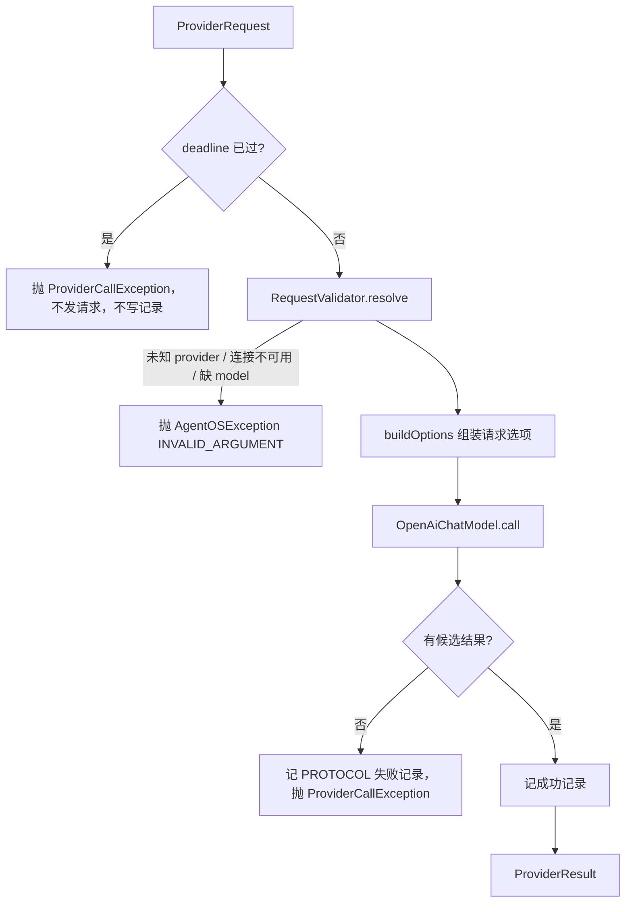
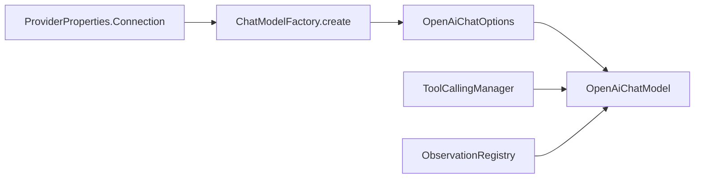

# AgentOS-provider 代码导读

这个模块是外部模型适配层，US1（按名称调用模型）已经完成。它做三件事：

1. 读取 `application.yaml`，校验配置，按名称建好每个模型连接；
2. 实现 core 的 `ProviderService.call`：选连接、组装请求、调用一次模型、写调用记录；
3. 提供离线测试用的假模型服务（`StubModelServer`）。

流式调用（`stream`）、重试、失败分类、向量化、图片统计还没做，分别在后面的 Phase 里。

## 一次 `call` 怎么走



英文词解释：deadline 是“本轮截止时间”；resolve 是“把名字解析成具体对象”；PROTOCOL 指服务端返回的内容不符合协议。

三个要点：

- 校验失败发生在发请求之前，所以不会产生调用记录（`ProviderRoutingTest` 验证请求数为 0）。
- `buildOptions` 只写 Profile 设置过的字段，没设置的温度、推理强度不会出现在请求体里。没有工具时不写 `tools`，`toolContext` 永远不进请求 JSON。
- 模型返回工具调用时只原样带回，不执行工具，也不自动发起下一次调用。

## 类的职责

| 类 | 作用 |
|---|---|
| `ProviderProperties` | 绑定 `agentos.providers.*`，每个连接有类型、地址、密钥、超时 |
| `EmbeddingProperties` | 绑定 `agentos.embedding.*`（向量化，US5 才使用） |
| `ProviderConnectionAssembler` | 启动时校验配置，建出不可变的 `连接名 → ProviderConnection` 映射 |
| `ProviderAutoConfiguration` | 把上面的东西装进 Spring，注册 `ProviderService` 和默认记录器 |
| `ChatModelFactory` | 按一个连接创建 `OpenAiChatModel`，不注册成 Bean |
| `ProviderConnection` | 一个具名连接：类型、超时、是否可用、模型对象 |
| `ConnectionType` | `openai` / `deepseek`，决定输出上限发哪个字段 |
| `RequestValidator` | 外呼前校验：解析连接、检查可用、检查模型名 |
| `DefaultProviderService` | `ProviderService` 的实现，目前只有单次 `call` |
| `LoggingLlmCallRecorder` | 把调用记录写成一条结构化日志 |
| `StubModelServer` | 测试用的本地假 HTTP 服务，支持 JSON、SSE 和挂起响应 |

## 启动校验

`ProviderConnectionAssembler` 把所有问题收集起来一次性报出，错误信息以 `Provider 配置有误：` 开头，各问题用分号隔开。会检查：

- 默认连接（`agentos.default-provider`）必须存在，且 `api-key` 非空；错误里会写连接名和环境变量名，变量名从配置原文的 `${...}` 里取；
- `type` 只能是 `openai` 或 `deepseek`，其他值提示“暂不支持”；
- `base-url` 非空，`timeout` 为正数；
- `retry-min-remaining` 为正数且不大于 `timeout`，`retry-max-wait` 为正数且不小于 `retry-min-remaining`；
- 连接名不区分大小写，`Primary` 和 `primary` 同时出现会报重复。

非默认连接（例如 `deepseek`）的 key 为空时不会阻止启动，只标记为不可用。调用它时会在发请求前报“provider 不可用：deepseek，缺少环境变量 …”。

模块不注册任何 `ChatModel` / `EmbeddingModel` Bean。模型对象只放在连接映射里，调用方只能通过名称使用，不能靠扫描容器来区分 Provider。`ArchitectureRulesTest` 里有两条规则守着这一点。

## 怎么把 US1 跑起来

先说明一点：现在没有命令行入口会调用 `ProviderService`（`chat`、`serve` 要到 US-2 和 US-5 才有）。所以“跑起来”指的是用测试把它跑通。三种方式按需选用，都在仓库根目录执行。

### 方式一：离线验证，不需要任何密钥

```bash
mvn -B verify
```

这条命令会跑格式、Checkstyle、SpotBugs、ArchUnit 和全部测试。provider 模块应有 71 个测试，boot 模块 18 个，全部通过。它不出网，不读 `.env`，不需要数据库和 Docker。

只想看 US1 的三组测试：

```bash
mvn -B test -pl AgentOS-provider -am \
  -Dtest='ProviderRoutingTest,RequestMappingTest,StartupValidationTest' \
  -Dsurefire.failIfNoSpecifiedTests=false
```

`-pl AgentOS-provider -am` 的意思是只构建 provider 模块，加上它依赖的模块（`-am` 即 also-make）。

| 测试 | 看什么 |
|---|---|
| `ProviderRoutingTest` | 两个连接各指向一个假服务，按名称调用时请求只到对应的那个；未知名称、不可用连接、缺模型都在发请求前失败 |
| `RequestMappingTest` | 请求体长什么样：路径、推理强度、输出上限字段、没有温度、没有 `tools`、工具调用原样返回、记录字段 |
| `StartupValidationTest` | 各种错误配置会让启动失败，错误信息里有什么 |

### 方式二：真实模型冒烟测试

冒烟测试（smoke test）指“用真实服务做一次最小调用，确认整条链路没坏”。

1. 在仓库根目录准备 `.env`（模板是 `.env.example`），至少填 `AGENTOS_LLM_BASE_URL`、`AGENTOS_LLM_API_KEY`、`AGENTOS_LLM_MODEL`。
2. `AGENTOS_LLM_BASE_URL` 必须以 `/v1` 结尾。SDK 不会自动补，少了就会请求到错误路径。
3. 运行：

```bash
set -a; source .env; set +a
mvn -B verify -Pllm -pl AgentOS-provider -am \
  -Dtest='PrimarySmokeTest,DeepSeekSmokeTest' -Dsurefire.failIfNoSpecifiedTests=false
```

`set -a` 让 `source` 读进来的变量自动导出给 Maven。没有对应 key 的测试会被跳过，不会失败。`-Pllm` 是只跑带 `@Tag("llm")` 的测试的 Maven profile。

最近一次实测结果：`PrimarySmokeTest` 通过；`DeepSeekSmokeTest` 返回 `402 Insufficient Balance`，是账户余额不足，充值后再跑。

### 方式三：自己写几行代码调用

最好的模板是 [`PrimarySmokeTest`](../../AgentOS-provider/src/test/java/com/agentos/provider/smoke/PrimarySmokeTest.java)，核心就这几步：

```java
Profile profile = new Profile("primary", "模型名", "low", 2048, null);
ProviderRequest request = new ProviderRequest(
        profile, List.of(new UserMessage("你好")), null, null, null, null);
ProviderResult result = providerService.call(request);
String text = result.response().getResult().getOutput().getText();
```

`Profile` 的五个参数依次是：provider 名称、模型、推理强度、输出上限、温度。`null` 表示不发送该字段。`ProviderRequest` 的后四个 `null` 依次是：工具列表、工具上下文、截止时间、关联标识。

## 看到什么算成功

每次调用结束后会有一行 INFO 日志，事件名是 `llm_call`，列出供应商、模型、token 用量、耗时等字段。服务端没返回的字段显示 `null`，明确返回 0 才显示 0。冒烟测试的控制台里能看到这一行；这里面没有密钥、提示词和工具参数。

## 常见问题

| 现象 | 原因和处理 |
|---|---|
| 启动报 `Provider 配置有误：默认连接 primary 的 api-key 为空，缺少环境变量 AGENTOS_LLM_API_KEY` | 变量没设。离线测试不会遇到，它们自带假配置 |
| 请求 404 | `base-url` 没写到 `/v1` |
| `402 Insufficient Balance` | 供应商账户余额不足，不是代码问题 |
| 调用抛出原始的 SDK 异常 | 已知缺口：401、429、5xx、超时还没有被分类和记录，T034、T035 会补上；在此之前不要让其他模块依赖 `call` 的失败行为 |
| 想调流式 | `stream` 目前会抛 `UnsupportedOperationException`，US4 才实现 |

## 当前边界

已完成：按名称路由、请求组装、外呼前校验、成功调用的记录、启动校验。

未完成：重试和失败分类（Phase 4）、完整记录字段如限流余量和 `outputCapHonored`（Phase 5）、流式（Phase 6）、向量化（Phase 7）、图片统计（Phase 8，现在 `imageCount` 固定记 0）。

## `ChatModelFactory` 详解

文件：[`ChatModelFactory.java`](../../AgentOS-provider/src/main/java/com/agentos/provider/chat/ChatModelFactory.java)

它只创建模型对象，不发网络请求，也不把模型注册成全局 `ChatModel` Bean：



工厂固定做三件事：

1. 使用连接配置中的 URL、密钥和超时；
2. 把 SDK 自带重试设为 `maxRetries(0)`，避免和 ProviderService 的重试重复；
3. 注入 Spring 自动配置的 `ToolCallingManager` 和 `ObservationRegistry`。

Spring AI 2.0.2 把 `OpenAiChatModel.Builder.toolCallingManager(...)` 标记为待移除，但没有公开的替代 API。省略它时，`build()` 会内部创建新的 `DefaultToolCallingManager`，绕过项目的工具调用限制、异常处理和观测配置。所以代码继续传入容器里的 Manager，并只在 `create` 方法上压制这个弃用警告。升级 Spring AI 后要检查官方替代 API，再移除这个调用。`ChatModelFactoryTest` 会验证工具回调不会在模型内部执行。

模型名、温度和输出上限属于一次请求的 Profile，不放进连接级默认选项。`ConnectionType.applyOutputLimit` 按协议选字段：`openai` 用 `max_completion_tokens`，`deepseek` 用 `max_tokens`。

## 测试怎么读

| 测试 | 关注点 |
|---|---|
| `ProviderRoutingTest` | 按名称路由、外呼前校验、截止时间已过 |
| `RequestMappingTest` | 请求体字段、工具调用原样返回、成功与协议失败的记录、记录器抛错不重发 |
| `StartupValidationTest` | 启动校验表里的每一行 |
| `FoundationConfigurationTest` | 默认记录器、用户替换记录器、配置绑定、不做包扫描 |
| `ChatModelFactoryTest` | 请求地址、模型名、输出上限、工具定义、观测和 SDK 不重试 |
| `ConnectionTypeTest` | `openai` 与 `deepseek` 输出字段差异 |
| `LoggingLlmCallRecorderTest` | 27 个结构化字段、`null` 与 `0` 的区别 |
| `StubModelServerTest` | 请求快照、SSE 分片、超时、挂起和资源释放 |
| `smoke/PrimarySmokeTest`、`DeepSeekSmokeTest` | 真实服务冒烟，默认不运行 |

测试共用的辅助类在 `src/test/.../support/`：`ProviderContextRunners`（拼装带配置的 Spring 上下文）、`ChatBodies`（固定的响应体）、`StubModelServer`（假服务）。
