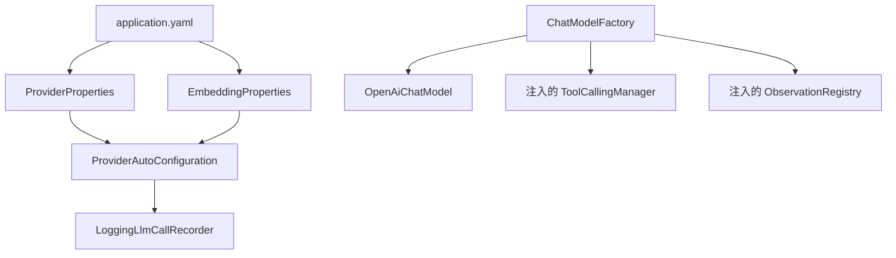
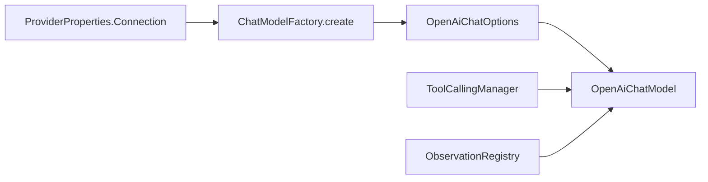

# AgentOS-provider 代码导读

这个模块是外部模型适配层。它读取 `application.yaml`，把配置转换成 Provider 连接，并准备 Spring AI 的 `OpenAiChatModel`。真正的 ProviderService 调用编排仍待后续实现。



## 类的职责

| 类 | 作用 |
|---|---|
| `ProviderProperties` | 绑定 `agentos.providers.*` 配置 |
| `EmbeddingProperties` | 绑定 `agentos.embedding.*` 配置 |
| `ProviderAutoConfiguration` | 注册配置对象和默认 Bean |
| `ConnectionType` | 把 `openai`、`deepseek` 转成枚举 |
| `ChatModelFactory` | 按单个连接配置创建 `OpenAiChatModel` |
| `ProviderConnection` | 保存一个不可变的具名连接 |
| `LoggingLlmCallRecorder` | 把调用摘要写入结构化日志 |
| `StubModelServer` | 测试用的本地假 HTTP 服务，支持 JSON、SSE 和挂起响应 |

`@ConfigurationProperties` 负责“配置文件 → Java 对象”，`@Bean` 负责“Java 对象 → Spring 容器中的 Bean”。自动配置现在只显式注册默认 `LlmCallRecorder`，不再扫描 `com.agentos.provider` 包，避免测试替身或其他组件被意外注册。

## `ChatModelFactory` 详解

文件：[`ChatModelFactory.java`](../../AgentOS-provider/src/main/java/com/agentos/provider/chat/ChatModelFactory.java)

它只创建模型对象，不发网络请求，也不把模型注册成全局 `ChatModel` Bean：



工厂固定做三件事：

1. 使用连接配置中的 URL、密钥和超时；
2. 把 SDK 自带重试设为 `maxRetries(0)`，避免和 ProviderService 的重试重复；
3. 注入 Spring 自动配置的 `ToolCallingManager` 和 `ObservationRegistry`。

### 为什么要调用一个已弃用的方法

Spring AI 2.0.2 把 `OpenAiChatModel.Builder.toolCallingManager(...)` 标记为待移除，但这个版本没有公开的替代注入 API。`build()` 的实际行为是：当 Builder 没有收到 Manager 时，内部执行 `ToolCallingManager.builder().build()`，创建一个新的 `DefaultToolCallingManager`。

所以当前代码的正确处理是：

```text
继续传入 Spring 容器注入的 ToolCallingManager
        ↓
只在 ChatModelFactory.create 方法上 @SuppressWarnings("deprecation")
        ↓
升级 Spring AI 后检查官方替代 API，再移除该调用
```

这不是忽略弃用，而是为了避免 2.0.2 的默认回退绕过项目的工具调用限制、异常处理和观测配置。`ChatModelFactoryTest` 会验证工具定义能够发送给模型、工具回调不会在 `ChatModel` 内部执行，并验证调用经过注入的 `ObservationRegistry`。

模型名、温度和输出上限属于一次请求的 Profile，不放进连接级默认选项。`ConnectionType.applyOutputLimit` 会按协议选择字段：OpenAI 使用 `max_completion_tokens`，DeepSeek 使用 `max_tokens`，并且不发送 `temperature` 默认值。

## 配置默认值

`ProviderProperties.Connection#getRetryMaxWait()` 在没有配置 `retry-max-wait` 时返回当前连接的 `timeout`。这是动态计算的，因此后续绑定 `timeout` 后默认值仍然正确。

Embedding 还新增了 `startup-check`：`async` 表示后台检查，`sync` 表示启动时检查。主 Provider 的地址和密钥缺失时，YAML 占位符解析为空字符串，交给启动校验报告具体连接名和环境变量名。

## 测试怎么读

| 测试 | 关注点 |
|---|---|
| `FoundationConfigurationTest` | 默认 Recorder、用户替换、配置绑定和“不做包扫描” |
| `ChatModelFactoryTest` | 请求地址、模型名、输出上限、工具定义、观测和 SDK 不重试 |
| `ConnectionTypeTest` | OpenAI / DeepSeek 输出字段差异 |
| `LoggingLlmCallRecorderTest` | 27 个结构化字段、`null` 与 `0` 的区别 |
| `StubModelServerTest` | 请求快照、SSE 分片、超时、挂起和资源释放 |

当前 ProviderService 的真正网络调用实现还没有完成；现在主要是配置骨架、连接模型和离线测试支持。

