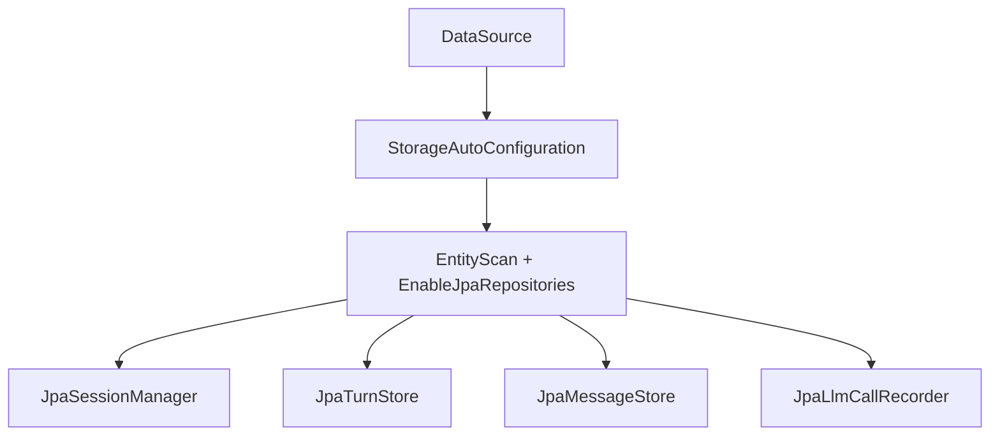
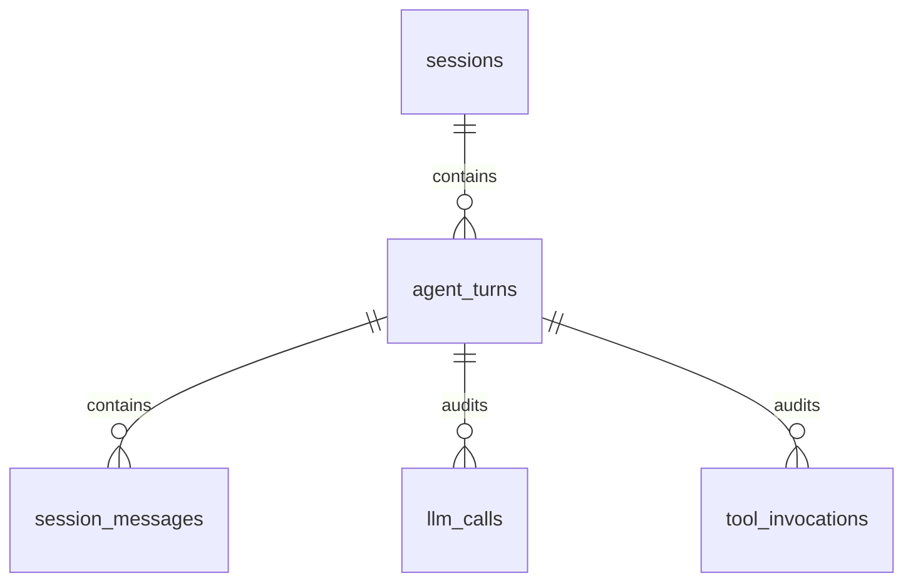

# AgentOS-storage 代码导读

`AgentOS-storage` 把 Core 端口落到 PostgreSQL。它使用 Flyway 建表、JPA 映射实体，并通过显式自动配置向 Core 提供 `SessionManager`、`TurnStore`、`MessageStore` 和 `LlmCallRecorder`。

## 自动配置边界

入口：[StorageAutoConfiguration.java](../../AgentOS-storage/src/main/java/com/agentos/storage/StorageAutoConfiguration.java)



Storage 自动配置只有在 `DataSource` 存在时生效，且排在 DataSource/JPA/Flyway 之后、Provider 之前。实体和 Repository 显式扫描 `com.agentos.storage.session`，不依赖 Boot 应用类所在包的默认扫描。

## 数据表关系

迁移文件：[V1__core_tables.sql](../../AgentOS-storage/src/main/resources/db/migration/V1__core_tables.sql)



| 表 | JPA 实体 | 作用 |
|---|---|---|
| `sessions` | `SessionEntity` | 活跃会话自然键、租约 owner、租约截止时间 |
| `agent_turns` | `AgentTurnEntity` | 一次用户请求的状态、deadline、最终文本 |
| `session_messages` | `SessionMessageEntity` | USER/ASSISTANT/TOOL 消息和 JSON 字段 |
| `llm_calls` | `LlmCallEntity` | 每次 Provider 尝试的完整结构化审计 |
| `tool_invocations` | `ToolInvocationEntity` | 后续工具账本预留表，当前最小链路不执行工具 |

Core 只接收快照和消息值对象，不暴露 JPA 实体或懒加载关系。

## `JpaTurnStore`：租约和轮次

入口：[JpaTurnStore.java](../../AgentOS-storage/src/main/java/com/agentos/storage/session/JpaTurnStore.java)

### 起轮

`startTurn` 在一个短事务内完成：

1. `INSERT ... ON CONFLICT DO NOTHING` 确保自然键只有一个 active session；
2. 对 active session 执行 `SELECT ... FOR UPDATE`；
3. 行锁取得后读取 `clock_timestamp()`；
4. 判断已有租约是否仍有效；
5. 写入新的 lease、轮次和初始 USER 消息。

租约 owner 使用 turn UUID，租约至少覆盖 `max(150s, 本地剩余预算 + 30s)`。任一步失败由事务回滚，不留下半个轮次。

### 续租

`renewLease` 使用 `SessionRepository.findByIdForUpdate` 先锁定 session 行，再读取数据库墙钟。如果 owner 不匹配、租约为空或 `lease_until <= clock_timestamp()`，返回 `false`；只有有效 owner 才会更新租约。

这条顺序是 T022 的关键契约：应用线程可能被暂停、数据库连接可能排队，不能用事务开始时的 `now()` 或无锁的旧快照判断租约。

### 收尾和回收

`finishAndRelease` 写入轮次终态，然后仅在 owner 匹配时清空 session lease。`reapInterrupted` 扫描 RUNNING 轮次，对租约无效或 owner 不一致的轮次写入 `INTERRUPTED`。

## `JpaMessageStore`：只追加和快照读取

入口：[JpaMessageStore.java](../../AgentOS-storage/src/main/java/com/agentos/storage/session/JpaMessageStore.java)

消息按 iteration 追加，不更新历史行。读取时按 session 消息 ID 排序，重新组装成 `HistoryTurn`；当前最小实现按 turn 分组并返回 USER/ASSISTANT 消息，系统提示词从不写入消息表。

## `JpaLlmCallRecorder`：模型审计

入口：[JpaLlmCallRecorder.java](../../AgentOS-storage/src/main/java/com/agentos/storage/audit/JpaLlmCallRecorder.java)

record 入口先校验 `sessionId`、`turnId` 和 `iteration`，然后把 `LlmCallRecord` 映射成 `LlmCallEntity`。`stableWriteId` 根据关联、尝试、时间、Provider、模型、成功状态和错误摘要生成稳定 UUID，用于数据库提交结果不确定时复用同一写入键。

审计表保留 `null` 和 `0` 的区别：没有返回 token 是 `null`，服务端明确返回 0 才是 0；`attempt`、`image_count`、`output_cap_honored`、失败类型和 HTTP 状态均按 data-model 映射。当前实现只生成稳定写入键，写入失败直接抛 `AuditWriteException`，审计重试属于后续阶段。

## 测试怎么读

| 测试 | 关注点 |
|---|---|
| `DatabaseTestEnvironmentTest` | Docker/CI 条件判断，避免 CI 静默跳过数据库测试 |
| `PostgresConnectivityTest` | Testcontainers PostgreSQL 真实连通 |
| `MigrationTest` | Flyway V1 在空库建表 |
| `JsonbMappingTest` | JSONB 编解码边界 |
| `JpaStorageContractTest` | 落库、快照、审计字段、关联校验、数据库时钟和真实行锁竞争 |

运行入口：

```bash
mvn -B -ntp -pl AgentOS-storage -am test
python3 scripts/check_db_test_reports.py
```

测试只使用独立 Testcontainers，不读取 `.env`，不连接共享数据库。
