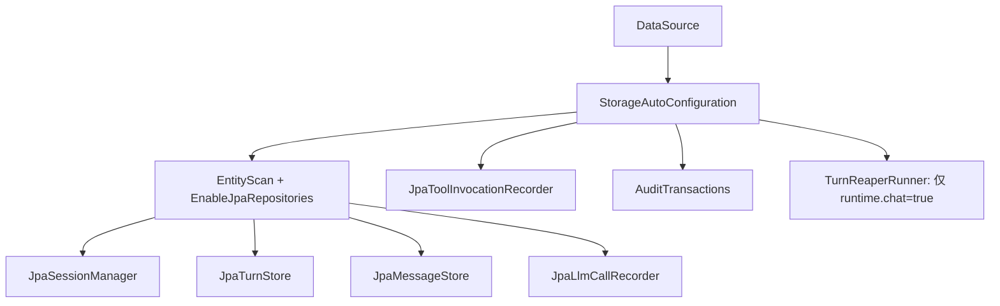
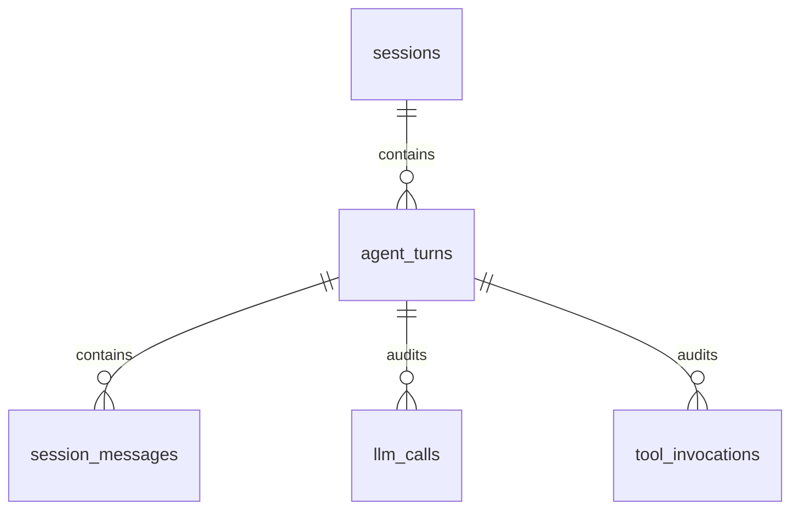

# AgentOS-storage 代码导读

`AgentOS-storage` 把 Core 端口落到 PostgreSQL。它使用 Flyway 建表、JPA 映射实体，并通过显式自动配置向 Core 提供 `SessionManager`、`TurnStore`、`MessageStore`、`LlmCallRecorder` 和 `ToolInvocationRecorder`。源码核对至2026-11-17的US-2完整验收。

## 自动配置边界

入口：[StorageAutoConfiguration.java](../../AgentOS-storage/src/main/java/com/agentos/storage/StorageAutoConfiguration.java)



Storage 自动配置只有在 `DataSource` 存在时生效，且排在 DataSource/JPA/Flyway 之后、Provider 之前。实体和 Repository 显式扫描 `com.agentos.storage.session`，不依赖 Boot 应用类所在包的默认扫描。

## 数据表关系

迁移文件：[V1__core_tables.sql](../../AgentOS-storage/src/main/resources/db/migration/V1__core_tables.sql)



| 表 | JPA 实体 | 作用 |
|---|---|---|
| `sessions` | `SessionEntity` | 活跃会话自然键、租约 owner、租约截止时间 |
| `agent_turns` | `AgentTurnEntity` | 一次用户请求的状态、deadline、最终文本 |
| `session_messages` | `SessionMessageEntity` | USER/ASSISTANT/TOOL 消息和 JSON 字段 |
| `llm_calls` | `LlmCallEntity` | 每次 Provider 尝试的完整结构化审计 |
| `tool_invocations` | `ToolInvocationEntity` | Phase 4 工具意图、终态与脱敏输入/结果 |

Core 只接收快照和消息值对象，不暴露 JPA 实体或懒加载关系。

## `JpaTurnStore`：租约和轮次

入口：[JpaTurnStore.java](../../AgentOS-storage/src/main/java/com/agentos/storage/session/JpaTurnStore.java)

### 起轮

`startTurn` 在一个短事务内完成：

1. `INSERT ... ON CONFLICT DO NOTHING` 确保自然键只有一个 active session；
2. 对 active session 执行 `SELECT ... FOR UPDATE`；
3. 行锁取得后读取 `clock_timestamp()`；
4. 判断已有租约是否仍有效；
5. 先回收该会话失效的旧轮次及遗留工具，再写入新的 lease、轮次和初始 USER 消息。

租约 owner 使用 turn UUID，租约至少覆盖 `max(150s, 本地剩余预算 + 30s)`。任一步失败由事务回滚，不留下半个轮次。

### 续租

`renewLease` 使用 `SessionRepository.findByIdForUpdate` 先锁定session行，再读取父轮次和数据库墙钟。本地预算或数据库deadline已过时抛整轮超时；父轮次非RUNNING、owner不匹配、租约为空或`lease_until <= clock_timestamp()`等情况返回`false`。有效租约不等于可以给已终态或已过轮次deadline的执行续租。

这条顺序是 T022 的关键契约：应用线程可能被暂停、数据库连接可能排队，不能用事务开始时的 `now()` 或无锁的旧快照判断租约。

### 收尾和回收

`finishAndRelease` 先锁 session，再读取 turn，遵守与接管相同的锁顺序。在一个短事务里保存 iterations/终态、把遗留 `in_progress` 工具改为 `interrupted`，最后只清自己的 lease。发现数据库已有终态时返回该终态，迟到的成功不能覆盖 `INTERRUPTED`，也不能清除新 owner。

`reapInterrupted` 不等 deadline：没有匹配 owner 的有效租约即可回收 RUNNING；父轮次已 FAILED/INTERRUPTED 的孤儿工具也会清理。启动与接管都调用 `recoverSession`，重复运行没有新增修改。仅 chat 启动器传入 `agentos.runtime.chat=true`，装配一次性 `TurnReaperRunner → TurnReaper → TurnStore`，纯 Recorder 测试及不带此参数的上下文不启动回收。

启动恢复先查询待恢复会话的 UUID，再逐会话开启独立事务；不会加载全部历史后逐条尝试更新工具。候选包括失去有效租约的 RUNNING、带 `in_progress` 工具的终态轮次、仍占用自身租约的终态轮次。只读 UUID 是为了避免锁前实体进入 JPA 一级缓存；拿到会话锁后重新用数据库时间和当前 owner 判断，保护有效租约。单个会话的父轮次、工具和自身租约仍原子提交，后续会话失败不回滚此前提交。

启动扫描使用独立预算：整次最多 30 秒，候选查询和每个会话事务各最多 5 秒且受剩余总预算限制。外层虚拟线程等待覆盖连接获取；超时/中断会取消任务，事务入口和提交前再次检查预算，不能让迟到写入继续推进。失败仍使启动失败，不宣称全部恢复完成。此预算只用于启动，单轮清理上限仍固定一秒。

轮次启动、续租、查证与结束使用 `AuditTransactions` 的事务/I/O 边界：普通操作采用 `agentos.turn.storage-timeout`（默认5秒），并取整轮剩余预算的较小值。起步和续租取执行余量，收尾及 `find(turnId, budget)` 查证取同一hardStop余量；deadline之后不会重新获得五秒，最多仍共用剩余的一秒。未登记预算的独立存储调用使用普通存储上限。外层虚拟线程等待同样使用操作时限，连接池耗尽也不会拖到整轮结束；取消不等于确认回滚，迟到连接和提交继续由事务入口及提交检查拦住。审计尝试使用独立配置，默认2秒、可配置1ms～5秒，仍扣原轮次预算。startTurn 取得锁后用数据库时间加本地剩余时长生成数据库 deadline，不延长本地单调预算。

## 并发：锁住什么，锁后再判断什么

`startTurn` 的 active 自然键唯一索引只保证一个活跃会话，不负责串行运行轮次。起步、续租、归档和恢复共用 session 行锁；取锁后再读 `clock_timestamp()`、owner、lease 和父轮次状态。起步的冲突插入与后续取锁之间若被 --new 归档，代码重新寻找/创建 active session，不能向已归档会话写 RUNNING。

`JpaSessionManager.archiveIfIdle` 经 `JpaTurnStore.storageOperation` 进入有界短事务，锁后仍有有效租约就报忙，消息/轮次/审计零写入；失效 owner 先在同一事务恢复再归档。归档只改会话状态和时间，正常历史不重写。`JpaMessageStore.append` 同样在锁后核验 owner、父轮次和数据库 deadline，防止等锁期间过期或旧 owner 接管后继续写消息。

读[JpaTurnStoreContractTest.java](../../AgentOS-storage/src/test/java/com/agentos/storage/session/JpaTurnStoreContractTest.java)中的归档/起步竞争、等待行锁后deadline过期、旧owner迟到写入与工具意图测试，再读boot的[SessionConcurrencyIntegrationTest.java](../../AgentOS-boot/src/test/java/com/agentos/boot/SessionConcurrencyIntegrationTest.java)观察模型/工具真实等待期间的竞争。不同会话可推进，不能以进程内全局锁代替数据库契约。

## `JpaMessageStore`：只追加和快照读取

入口：[JpaMessageStore.java](../../AgentOS-storage/src/main/java/com/agentos/storage/session/JpaMessageStore.java)

消息按 iteration 追加，不更新历史行。Phase 4 把 ASSISTANT 的 toolCalls、TOOL 的 responses 分别写入 JSONB；本轮后续模型使用 Manager 的内存完整历史。跨轮恢复时先排除 RUNNING，再按已完成轮次选取最近窗口，最后按 session 消息 ID 顺序重新组装完整 `HistoryTurn`，因此工具请求与结果不会被消息行限制拆开；系统提示词从不写入消息表。

## `JpaLlmCallRecorder`：模型审计

入口：[JpaLlmCallRecorder.java](../../AgentOS-storage/src/main/java/com/agentos/storage/audit/JpaLlmCallRecorder.java)

record 入口为这一次实际模型请求生成随机 `write_id`，校验关联并脱敏全部文本元数据，再映射成 `LlmCallEntity`。只有本次 SQL 重试复用这个 UUID；两个内容完全相同的独立请求也必须各有一行。时间归整到 PostgreSQL 微秒精度，提交响应丢失时读取 write_id 并比较完整 26 字段载荷，不能只看“已有行”。

正常写入直接 INSERT，不先用 `findByWriteId` 查存在性；随机新UUID配合数据库唯一约束已经承担了去重职责。写入异常后才按原键查证：完整载荷一致则确认成功，查到不同载荷立即失败，不能把冲突当成“尚未写入”继续尝试。这个差别减少了每次正常模型审计的一次数据库往返，远程数据库中尤其明显。

审计表保留 `null` 和 `0` 的区别：没有返回 token 是 `null`，服务端明确返回 0 才是 0；`attempt`、`image_count`、`output_cap_honored`、失败类型和 HTTP 状态均按 data-model 映射。Phase 7 已接入 `RetryingAuditWriter`：瞬时故障总计最多三次，事务结束后才等待 200/500ms。约束/参数错误不重试；超时或连接中断等提交未知情况只查证，不重发模型。确认后只打一条完整结构化 `llm_call` 日志；未确认则 ERROR，带 write_id 和 UNCONFIRMED，不能当成数据库记录。

`AuditTransactions` 每次尝试/查证都新建 REQUIRES_NEW，在同一条SQL里设置 PostgreSQL statement_timeout和lock_timeout，并设置 JDBC networkTimeout；提交前再次检查本次截止时间，完成后恢复连接设置。外层 Future 约束连接池等待，迟到拿到连接的任务必须先检查时限，不能再写入。审计失败的控制台正文也带turnId、attemptTimeoutMs和UNCONFIRMED，结构化元数据保持完整。审计默认2秒，允许配置1ms～5秒，包含调度、连接、SQL和提交；最终审计按同一hardStop压短。审计等待超时不再interrupt数据库线程，避免主动关闭JDBC/TLS连接；事务配置往返后与提交前检查原时限。networkTimeout恢复失败则abort连接，不允许污染后续借用者。`Read timed out`意味着本次I/O未及时确认，不能直接推断提交回滚；稳定键查证成功才算CONFIRMED。

## `JpaToolInvocationRecorder`：先确认意图，再允许执行

`begin`、`complete`、`skipped` 分别通过 `TransactionTemplate` 使用 REQUIRES_NEW 短事务。模板覆盖提交过程，因此 flush 和提交失败都转换成固定安全 `AuditWriteException`，不把可能含参数的数据库异常 cause 带回模型。外部 HTTP 执行发生在 begin 提交之后、complete 开始之前，不占用事务连接。

begin/skipped 的新记录直接插入，重复或冲突通过唯一约束和异常后的完整载荷查证处理，不先多发存在性查询。`requireRunning` 用一条SQL中的两个MATERIALIZED CTE依次取会话锁、读取父轮次，最终才按当前数据库时间检查owner/租约/deadline；减少一次往返，同时保留“等锁后重新判断”。complete仍锁住原工具行后更新，不能把回收的interrupted改回成功。

唯一键 `(turn_id, iteration, tool_call_id)` 定位同一行。begin 是 `in_progress`、attempts=0、结果/耗时为 null、truncated=false；complete 只允许更新已有行。重复确认必须身份、脱敏输入和终态载荷一致，冲突会安全失败，不覆盖旧记录。

参数先脱敏再解析：合法 JSON 保持嵌套结构；非法 JSON 作为 JSON 字符串保存，不截断参数。结果和错误在存储边界再次脱敏。记录器只重试审计 SQL；真实工具不重试。begin/skipped 在 session 锁内重新确认 RUNNING、owner、租约及 deadline；complete 锁原工具行，不允许覆盖回收后的 interrupted。执行前写失败提示“未执行本次工具”，执行后写失败提示“操作可能已经执行”。deadline 后最终审计只允许一次有界写入和查证，不退避，与轮次收尾共用最后一秒。

## 测试怎么读

| 测试 | 关注点 |
|---|---|
| `DatabaseTestEnvironmentTest` | Docker/CI 条件判断，避免 CI 静默跳过数据库测试 |
| `PostgresConnectivityTest` | Testcontainers PostgreSQL 真实连通 |
| `MigrationTest` | Flyway V1 在空库建表 |
| `JsonbMappingTest` | JSONB 编解码边界 |
| `JpaToolInvocationRecorderTest` | 同行状态转换、重复 ID、null/false/0、非法 JSON、安全输入与冲突拒绝 |
| `AuditTransactionTest` | 新事务/稳定键、真实提交后丢响应、完整载荷冲突、SQL/锁/连接池故障、无连接退避、最终审计单次尝试、回滚原子性及连接autocommit/networkTimeout/SET LOCAL恢复 |
| `AuditLatencyTest` | 模型连续150～250ms、工具begin/complete/skipped审计50ms逐次往返等待仍能提交；提交响应超时可由另一连接查证；超过预算仍未确认且不重放插入 |
| `TurnReaperTest` / `TurnReaperStartupTest` | 有效 owner 保留、失效/接管/正常结束原子收尾、终态孤儿工具、正常历史不更新、慢 SQL 超过一秒、分会话提交/失败隔离、真实 chat 启动和幂等 |
| `TurnStorageBudgetTest` | 查证超过250ms仍成功、执行预算不足时起步原子回滚、清理/查证不扩大共享hardStop、连接池耗尽按操作时限返回且不迟到续租 |
| `JpaStorageContractTest` | 落库、快照、审计字段、关联校验、数据库时钟和真实行锁竞争 |
| `JpaTurnStoreContractTest` | 归档/起步竞争、锁后deadline、动态lease、接管后工具意图/消息零写入、过期owner拒绝收尾 |

运行入口：

```bash
mvn -B -ntp -pl AgentOS-storage -am test
python3 scripts/check_db_test_reports.py
```

测试只使用独立 Testcontainers，不读取 `.env`，不连接共享数据库。
