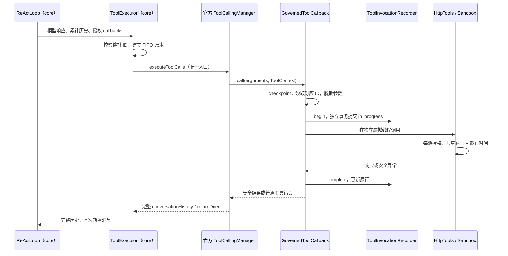

# AgentOS-tool 代码导读

US-2 已完成 `http_get`、域名沙箱、调用治理、安全解析、次数限制与审计恢复验收（2026-11-17）。默认 `main` 的 `tools: []` 仍没有工具权限；要用 HTTP，必须同时在 Agent 的 `tools` 声明 `http_get`，并在应用配置中授权目标域名。004 已补齐受控幂等重试、审计未确认、结果长度与联合预算验收；MCP 和完整策略体系仍属后续范围。当前只有 `http_get` 实际注册，不能把统一扩展契约视为完整工具清单已交付。

## 先看一条完整路径

**为什么不能直接调用 `HttpTools`？** 上面的顺序保证工具没有获得审计许可就不会执行。绕过 Manager 或治理装饰器，还会绕过官方次数限制和错误处理。生产调用只能从 `ToolExecutor` 进入。

## 装配与权限：三个名字不同的角色

`ToolAutoConfiguration` 在官方 `ToolCallingAutoConfiguration` 之前声明唯一的安全 resolver 和异常 processor，Manager 仍由官方自动配置创建。注册表不依赖 Manager，resolver 也不依赖注册表，因此没有 resolver → registry → manager 的循环依赖。

| 类 | 负责什么 | 不应混淆的边界 |
|---|---|---|
| `ToolRegistry` | 固定内置工具集合；按 Agent 名单返回 callbacks | 不扫描任意 Bean，也不把 Agent/Skill 注册为工具 |
| `UnknownToolResolver` | 对请求 callbacks 之外的名字返回治理过的拒绝 callback | 永不解析真实同名 Bean；拒绝也有失败审计 |
| `AgentOsToolExecutionExceptionProcessor` | 决定普通工具错误是否可反馈模型 | 审计失败、租约丢失、整轮超时必须继续抛出 |

启动装配时用官方 `validateToolCallbacks` 拒绝重名。`DefaultAgentService` 在 `startTurn` 前调用名单校验；未知名字报 `agents/<name>/AGENT.md` 的 `tools` 字段错误，零模型请求、零新轮次。

`spring.ai.tools.resolution.fallback.enabled=true` 必须与这里的安全拒绝 resolver 一起使用。请求内已授权 callback 优先，fallback 只会拒绝。官方 `spring.ai.tools.limits.*` 控制工具次数；ReActLoop 的 `maxIterations` 独立限制模型调用次数。Manager 收到累计历史，不能在每次迭代把限次计数重置。

Manager 正常返回后，`ToolExecutor` 扫描账本中未被领取的调用，逐条写 `limit_skipped`，执行次数为0；超限错误已经作为工具结果进入模型历史。致命异常中断整批时不会进入这个补记路径，尚未开始的后续工具不冒充超限。区别见 core 的 `ToolCallLimitsTest`、`ToolExecutorTest` 和 boot 的装配测试。

004 的收敛修复在 Manager 前预检整批参数的 JSON 格式。任一项损坏、不是对象或带尾随内容时，整批均不执行；按原调用 ID 写 failed/attempts=0 并回填安全错误，模型仍可继续修正。此拒绝路径只生成错误消息，不调用任何 callback。语法正确但违反具体工具参数约束的错误仍由统一治理回调处理。

工具执行仍使用原始参数；Manager 返回后，助手工具请求中的参数会脱敏，再进入消息库、下一次模型请求和历史恢复。调用 ID、名称、顺序及消息元数据保留。过程事件与未执行调用的审计摘要则统一先脱敏、再截断至 10000 字符，截断标记计入上限。

内部重试不会在官方历史中增加工具消息，因此 `TurnExecutionBudget.reserveToolAttempt` 补记每次底层尝试，并复用同一官方限次配置；计数跨迭代共享，不跨用户轮次共享。初次尝试被拒绝时记录 `limit_skipped/attempts=0`，重试被拒绝但已有失败尝试时保留 `failed` 与实际次数。

## `GovernedToolCallback`：先记后做

装饰器保留原工具定义和 `returnDirect` 元数据。每次执行按以下顺序走：

1. 从显式 `ToolContext` 取得 `TurnContext`、`ToolCallLedger`、共享预算；检查 deadline 和租约。
2. 从本名字的队列领取 ID。即使模型连续调用两次同名工具，也按模型响应顺序关联，不比较参数或模型文本猜 ID。
3. 参数先脱敏并限制审计摘要为 10000 字符，写入 `in_progress`，`attempts=0`。begin 未确认就抛出 `AuditWriteException`，没有真实执行。存储在会话锁内重新确认 RUNNING、owner、有效租约与数据库 deadline，避免接管后迟到的新意图写入。
4. 只接受一个 JSON 对象，拒绝尾随内容，再创建虚拟线程调用原 callback。仅幂等且 `TransientToolException(executionStarted=false)` 允许最多一次重试；两次尝试共享同一工具 deadline 和调用预算。超时、普通异常和完成状态未知均不重试。
5. 记录原始字符数，先脱敏再截断；默认 10000 字符包含截断标记，极小上限只保留标记前缀，原长仍可查询。实际 attempts 为 0、1 或 2，错误摘要最多 1000 字符。complete 未确认时尽力将原行标为 unconfirmed，说明“操作可能已经执行”，不重跑工具，也不覆盖已确认或回收终态。
6. 普通业务错误、沙箱拒绝、工具自身超时转成安全 `ToolExecutionException`；整轮超时、租约和审计异常直接停止本轮。

已取得的结果先完成脱敏和长度限制，再进行执行后的租约/预算检查；因此该检查即使失败，完成审计也只会接收受限结果，并保留原始长度、截断状态和真实尝试数。原始终止原因继续抛出，不自动重试。

官方 `@Tool` 方法适配器会把方法抛出的异常再包成 `ToolExecutionException`。治理层必须解开这层已知包装，才能把沙箱拒绝记为 `sandbox_denied`，也避免把致命信号错当普通业务失败。Boot 集成测试实际发现并固定了这个边界。

虚拟线程的 MDC 只从 `TurnContext` 重建，`finally` 清理；业务身份不从 MDC 读取。取消使用 `Future.cancel(true)` 和 `shutdownNow()`，不调用可能无限等待的 `ExecutorService.close()`。中断是协作信号，所以 HTTP 本身也必须有截止时间。

## `HttpTools`：一次截止时间覆盖整个请求

`@Tool(name="http_get")` 暴露的模型参数只有 `url`，`ToolContext` 是内部注入，不出现在工具 JSON schema 中。

`HttpClient` 禁止自动跳转。每一跳先检查沙箱，再发送 GET。相对 `Location` 用当前 URI 解析；缺少 Location、无效地址、第四次跳转都安全失败。非 2xx 只返回状态码，不回显响应正文。工具、SDK 异常不会携带含凭证的原始 URL cause。

整个连接、重定向、正文消费共用 `min(HTTP timeout, 剩余整轮预算)` 的一个本地单调截止时间；收到新分片不能续命。自定义 `BodySubscriber` 在接收字节时检查 1 MiB 上限，超限取消订阅，不先把完整大响应读入内存。

`WhitelistSandbox` 只开放 HTTP，`FILE_READ`、`FILE_WRITE`、`SHELL` 一律拒绝。白名单默认空，精确域名不分大小写，`*.example.com` 只授权子域名，不含根域。IP 必须精确授权；不会因为是 localhost 或内网就自动放行。仅允许绝对 http/https URI，拒绝 user-info。当前不做 DNS 解析后的二次地址校验，不能把它当作完整的网络隔离层。

## 配置

| `agentos.tools.http` 字段 | 默认值 / 边界 |
|---|---|
| `allowed-domains` | 空列表，全部拒绝；绑定时去空格和空项 |
| `user-agent` | `AgentOS/0.1` |
| `max-redirects` | 未配置为 3；显式 0 禁止跳转；范围 0～3 |
| `max-response-bytes` | 缺省且最大 1 MiB；超出安全失败 |
| `timeout` | 缺省 30 秒，必须为正 |
| `max-result-chars` | 缺省 10000，必须为正；截断标记计入上限 |

`HttpToolProperties` 的 `@DefaultValue("3")` 区分“没有配置”和“明确配置零”。构造器不再把 0 改成 3。

## 测试与断点

先看 `WhitelistSandboxTest`、`HttpToolsTest`，理解边界，再看 `GovernedToolCallbackTest` 和 `ToolAutoConfigurationTest`。后两者验证先记后做、失败零执行、真正官方 Manager/安全 resolver、名单外 Bean 零调用和官方次数限制。网络测试只用本地 `HttpServer`。

继续读 `HttpToolsDeadlineTest` 看慢正文不能靠持续分片续命；读 `AuditFailureTest` 和 storage 的 `JpaToolInvocationRecorderTest` 看执行前后审计失败；最后读 boot 的 `SessionConcurrencyIntegrationTest` 看工具运行中接管会阻断后续工具和下一次模型。真实天气样本单列在 `ReActWeatherSmokeTest`，不属于普通网络单元测试。

建议断点依次放在 `ToolExecutor.execute`、`ToolCallLedger.next`、`GovernedToolCallback.call`、`JpaToolInvocationRecorder.begin`、`WhitelistSandbox.enforce`、`HttpTools.http_get`。观察 toolCallId、iteration、审计状态和第二次模型历史，不在日志中打印原始参数或密钥。

## 004 验收证据

- `ReActDeadlineIntegrationTest`：真实 Manager、PostgreSQL、本地模型/HTTP；验证内部扩展注册、重试与跨迭代总预算、同批限次、慢正文、超大响应、审计未确认。
- `TurnDeadlineTest`、`GovernanceDeadlineAcceptanceTest`、`HttpToolsDeadlineTest`：五类场景各 20 次并检查 p95，不用真实外部模型。
- `python3 scripts/check_db_test_reports.py --tools`：在连通性门禁之外核对两个 Tool 数据库测试类的七个关键用例，报告缺失、空套件、跳过或失败均拒绝。
- 配置可放在应用 `application.yaml` 或 Spring profile 配置文件中，白名单路径是 `agentos.tools.http.allowed-domains`；Agent 的 `AGENT.md` 当前只声明 `tools: [http_get]`，不能在其中嵌套 HTTP 白名单。
- 详细步骤、FR/SC 覆盖、Demo 结果和真实模型状态见 `specs/004-agentos-tool-system/acceptance-results.md`。
