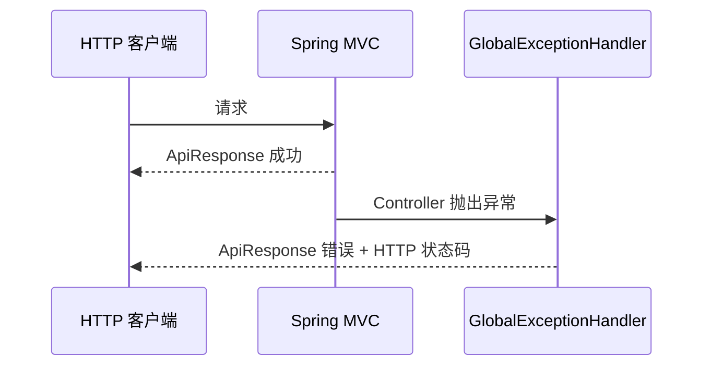

# AgentOS-web 代码导读

Web 模块负责 HTTP 表达，不负责模型推理。核心原则是所有成功和失败响应都使用统一格式。



## 类的职责

| 类 | 作用 |
|---|---|
| `ApiResponse<T>` | 统一的 `code/message/data/timestamp` 响应信封 |
| `GlobalExceptionHandler` | 把业务异常和 Spring MVC 异常转成统一响应 |
| `WebConfig` | 配置 `/api/**` 的 CORS |

例如：

```json
{
  "code": "SESSION_BUSY",
  "message": "会话正有轮次在执行",
  "data": null,
  "timestamp": "..."
}
```

当前还没有真正的 `ApiController`，所以这里是 Web 基础设施，而不是完整 REST API。

