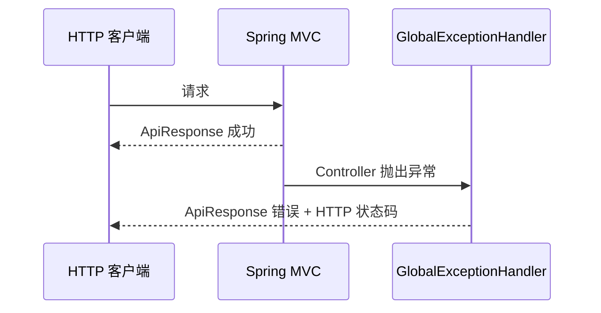

# AgentOS-web 代码导读

Web 模块负责 HTTP 表达，不负责模型推理。正式 API 的成功和失败响应使用统一格式；可删除的临时调试入口使用自己的调试结果结构。



## 类的职责

| 类 | 作用 |
|---|---|
| `ApiResponse<T>` | 统一的 `code/message/data/timestamp` 响应信封 |
| `GlobalExceptionHandler` | 把业务异常和 Spring MVC 异常转成统一响应 |
| `WebConfig` | 配置 `/api/**` 的 CORS |
| `dev.AgentLoopDebugController` | 由开关控制的临时同步/SSE 入口，调用统一 `AgentService`，用于断点调试 |

例如：

```json
{
  "code": "SESSION_BUSY",
  "message": "会话正有轮次在执行",
  "data": null,
  "timestamp": "..."
}
```

当前还没有真正的 `ApiController`，所以这里是 Web 基础设施，而不是完整 REST API。

## 临时调试入口

[AgentLoopDebugController.java](../../AgentOS-web/src/main/java/com/agentos/web/dev/AgentLoopDebugController.java) 的中文注释解释了 JSON 参数、局部事件列表、虚拟线程、SSE 回调和业务终态。启动方式见 [Boot 导读](./AgentOS-boot.md)。它遵循 Controller 位于 web 模块的架构边界，调试主类则位于 boot 模块。

它默认关闭，启用条件为 `agentos.debug.react-loop.enabled=true`。同步请求 `POST /debug/react-loop`，流式请求 `POST /debug/react-loop/stream`，都会真实进入模型与存储链路。HTTP 200 不等于业务成功，应检查 `result.status` 与 `result.persistenceStatus`；SSE 中查看终态事件。调试完成后可删除该 Controller 及 boot 中的临时启动主类。

US-2内部的`TurnSink`已经支持文本、工具调用、工具结果和终结事件；此Controller的`TraceSink`只桥接了部分事件，不能当作完整协议示例。调试SSE也没有正式同步等待202或断连取消契约。2026-11-17的`ReActApplicationTest`确认默认上下文没有该Controller；US-2验收证明核心循环及CLI，正式Web Service仍属后续范围。

