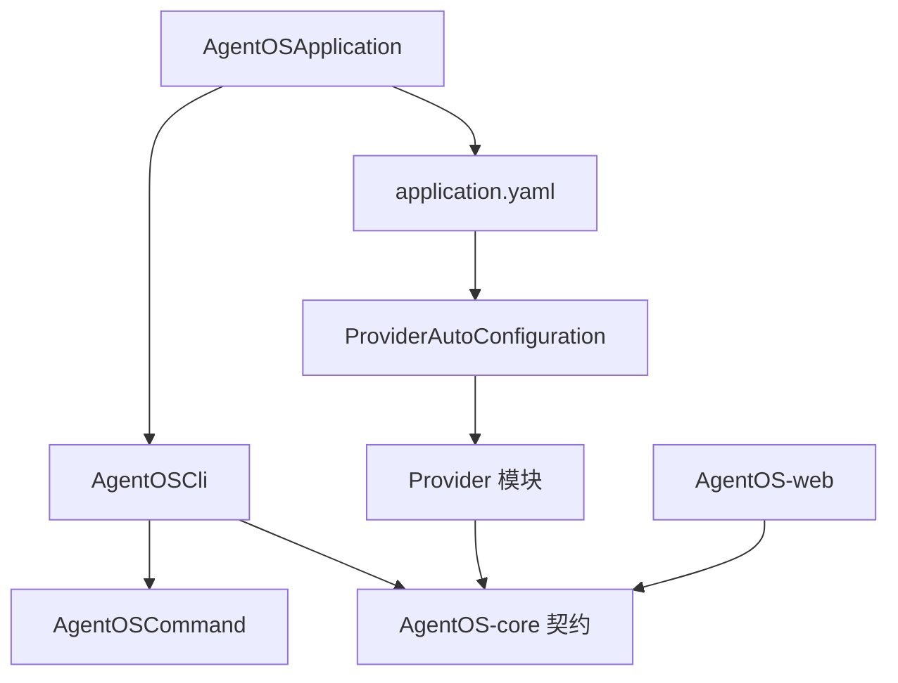
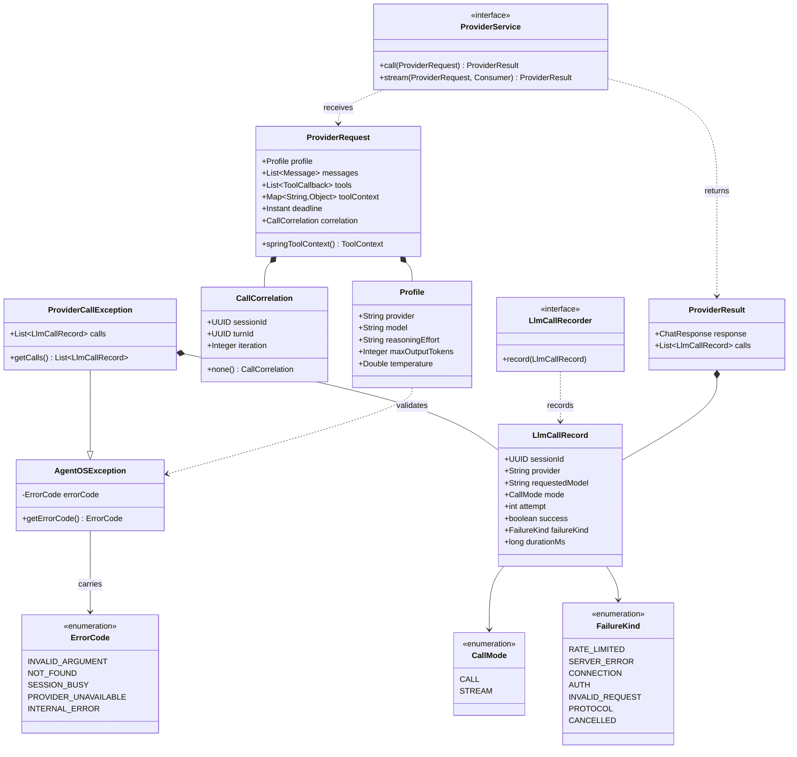
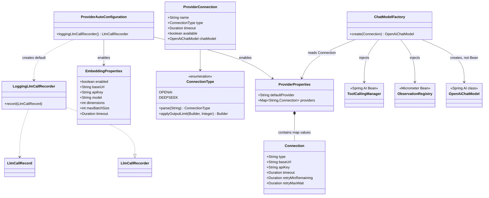
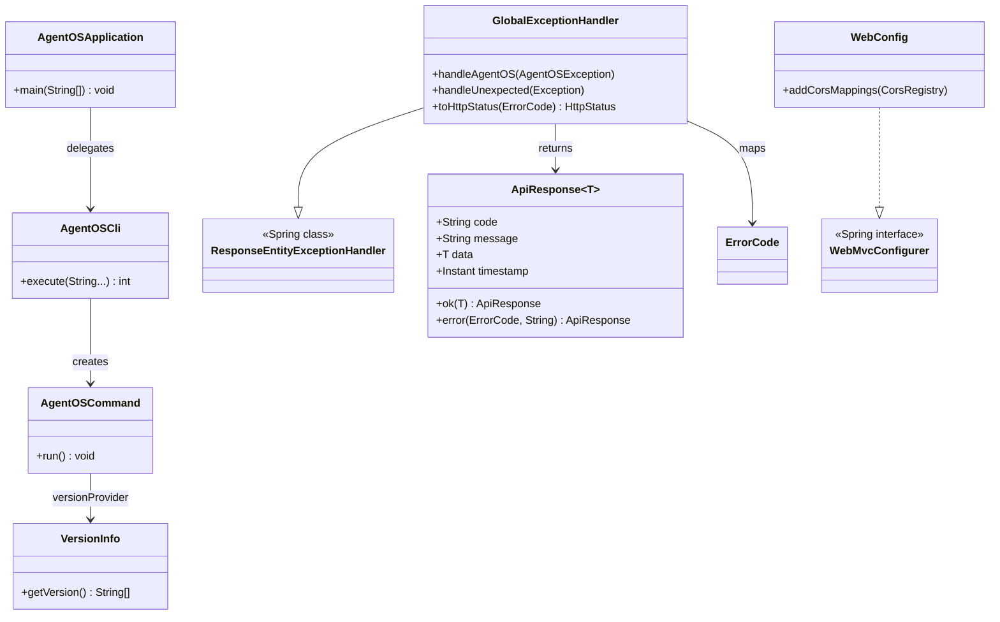

# AgentOS 类结构图

这份文件记录当前仓库里已经存在的 Java 类，以及它们之间的主要关系。图中的关系以当前源码为准；设计文档里提到但源码中尚未出现的类，不放进“当前类图”。

## 一、先看箭头含义

```text
继承：       子类 --|> 父类
实现接口：   实现类 ..|> 接口
使用依赖：   A --> B
组合关系：   A *-- B
```

类图里最重要的是先回答三个问题：

1. 谁负责创建对象？
2. 谁依赖谁？
3. 哪些类只是接口，哪些类是真正实现？

## 二、当前项目总览



当前代码的方向是：

```text
boot 负责组装
cli / web 负责接收请求
core 负责定义契约
provider 负责连接外部模型
```

## 三、AgentOS-core 类图



最核心的阅读顺序是：

```text
Profile
  ↓
ProviderRequest
  ↓
ProviderService
  ↓
ProviderResult
  ↓
LlmCallRecord / LlmCallRecorder
```

`ProviderService` 是接口，所以 `core` 不知道底层到底是 OpenAI、DeepSeek 还是测试服务器。

## 四、Provider 模块类图



这里的关键是：

```text
application.yaml
    ↓
ProviderProperties / EmbeddingProperties
    ↓
ProviderAutoConfiguration
    ↓
Spring 容器中的 Bean
```

## 五、启动、CLI 与 Web 类图



当前实际启动链路仍然是：

```text
AgentOSApplication.main
    ↓
AgentOSCli.execute
    ↓
AgentOSCommand
    ↓
显示帮助或执行子命令
```

`GlobalExceptionHandler` 目前已经可以工作，但真正的 `ApiController` 还没有加入。

## 六、当前不存在的类

以下类在设计文档中出现，但当前源码中还没有实现，因此没有画进“当前类图”：

```text
ReActLoop
AgentService
ToolExecutor
MemoryService
SessionManager
LongTermMemoryStore
ToolRegistry
Sandbox
ApiController
Repository
```

等这些类真正加入源码后，再把它们补进对应模块的类图。

