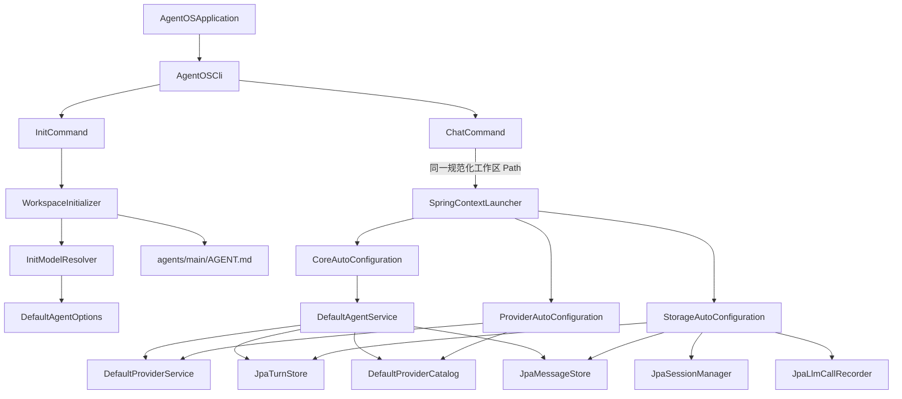
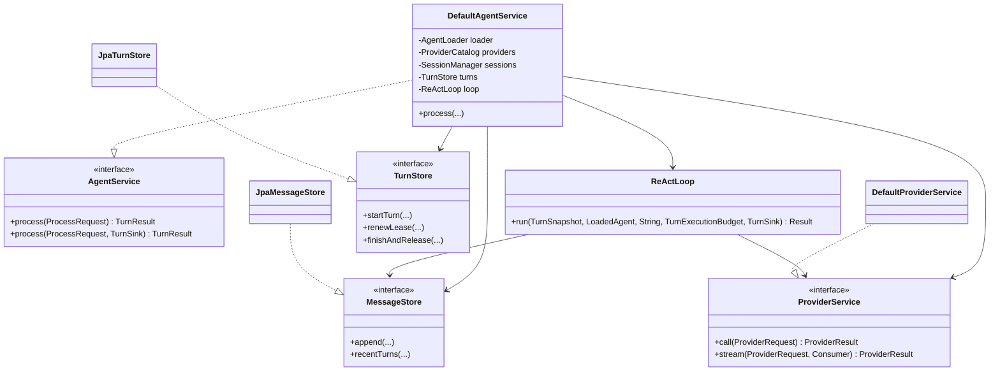
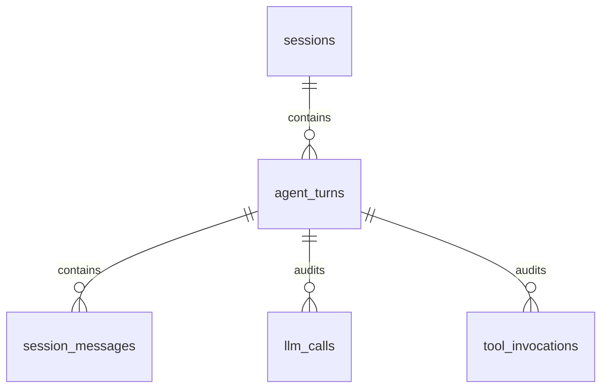
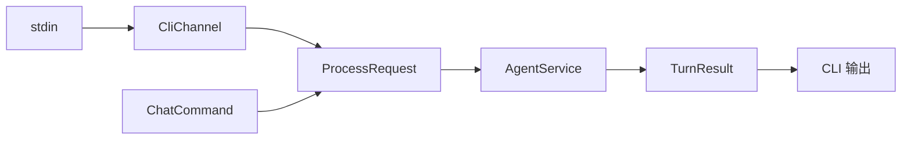
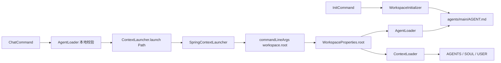
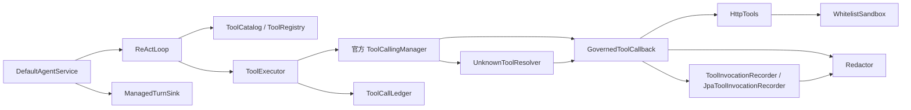

# AgentOS 当前类结构

这份文件只记录源码中已经存在的主要类。阅读时先沿着请求方向看，再回头看各个端口的实现。

## 关系含义

```text
继承：       子类 --|> 父类
实现接口：   实现类 ..|> 接口
使用依赖：   A --> B
组合关系：   A *-- B
```

## 总体结构



依赖方向是：入口依赖 Core，Core 只依赖端口，Provider 和 Storage 实现端口，Boot 通过 Spring 自动配置把它们放在一起。Core 不应该反向依赖 JPA 或具体模型 SDK。

## 一次请求的对象关系



## Core 中的三条关键线

```text
AgentProfile / AgentSettings
  -> LoadedAgent
  -> PromptBuilder
  -> ProviderRequest
```

```text
SessionKey
  -> SessionManager.findActive
  -> TurnStore.startTurn
  -> TurnSnapshot
  -> TurnGuard.renewLease
  -> TurnStore.finishAndRelease
```

```text
ProviderRequest
  -> ProviderService
  -> ProviderResult / ProviderCallException
  -> LlmCallRecord
  -> LlmCallRecorder
```

## Storage 的实体关系



`SessionEntity` 保存租约；`AgentTurnEntity` 保存轮次状态；`SessionMessageEntity` 保存用户和助手消息；`LlmCallEntity` 保存一次模型尝试的结构化审计。Core 只拿 `SessionSnapshot`、`TurnSnapshot` 和 `HistoryTurn`，不拿 JPA 实体。

## 入口模块



`CliIdentity` 把 `cli + 登录用户名 + Agent 名` 组成 `SessionKey`。`CliChannel` 只处理输入、`/exit`、空行和输出，不参与模型调用。

## 默认主 Agent 初始化与加载

`InitModelResolver` 只在 main 缺失时生成 `DefaultAgentOptions(model, providerName)`；WorkspaceInitializer 用 SnakeYAML 写普通 AGENT.md。根部 AGENTS.md 是共享指令，不是 Profile。main 没有独立引擎或数据库表。



选择规则是显式 Agent、main、旧工作区唯一 Agent。文件错误在启动器前失败；真实 Provider 校验仍在统一服务链路里。默认 main 无工具；Phase 4 已接通显式授权的 http_get 工具闭环，Phase 6 的 `--new` 会先归档空闲会话，历史恢复由 ReActLoop/MessageStore/PromptBuilder 完成。


## Phase 4 工具对象关系



Provider 请求阶段只有 TurnContext；响应后才建 ToolCallLedger。全部工具共享同一 TurnExecutionBudget，callback 的参数通过 ToolContext 显式注入，不依赖日志 MDC。具体先后顺序和断点见 AgentOS-tool 导读。
