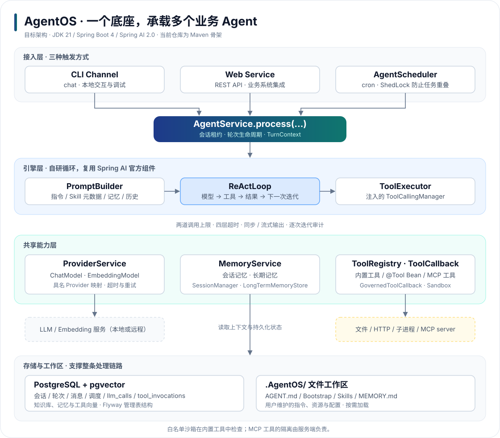
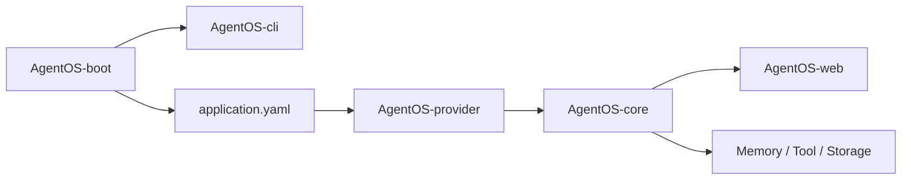

# AgentOS 代码导读

这组文档专门解释代码怎么读。每个 Maven 模块对应一个文件，先看本目录，再打开源代码中的中文注释。

项目类结构总图见：[ClassStructure.md](./ClassStructure.md)

| 模块 | 说明 | 当前状态 |
|---|---|---|
| [AgentOS-core](./AgentOS-core.md) | 核心接口、异常、Provider 请求模型 | 有基础契约，主引擎尚未完成 |
| [AgentOS-provider](./AgentOS-provider.md) | LLM Provider、Embedding、自动配置、模型工厂 | 有配置骨架、`ChatModelFactory` 和测试替身 |
| [AgentOS-web](./AgentOS-web.md) | REST 响应、异常处理、CORS | 有基础 Web 代码，Controller 尚未完成 |
| [AgentOS-cli](./AgentOS-cli.md) | Picocli 命令入口 | 有根命令，子命令尚未完成 |
| [AgentOS-boot](./AgentOS-boot.md) | Spring Boot 组装和启动 | 有启动类和配置 |
| [AgentOS-memory](./AgentOS-memory.md) | 会话记忆、长期记忆 | 当前是设计骨架 |
| [AgentOS-tool](./AgentOS-tool.md) | 工具、MCP、沙箱 | 当前是设计骨架 |
| [AgentOS-storage](./AgentOS-storage.md) | PostgreSQL、Flyway、审计 | 当前是设计骨架 |
| [AgentOS-channel-cli](./AgentOS-channel-cli.md) | CLI 对话渠道 | 当前是设计骨架 |

## 推荐阅读顺序

先理解 `core` 定义的接口，再看 `provider` 如何实现外部模型连接，最后看 `web` 和 `cli` 如何作为入口调用它们。

