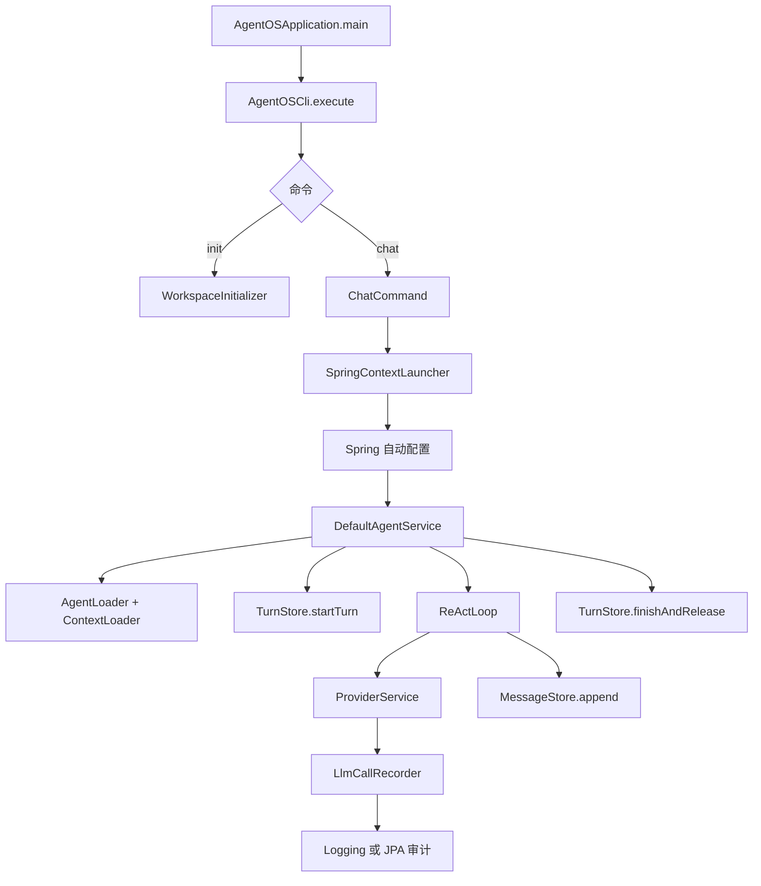

# AgentOS 代码导读

这组文档解释当前源码怎么读。当前仓库已经完成 Phase 1 Setup、Phase 2 Foundational，以及 US1 的无工具最小纵向链路：CLI 可以加载 Agent、创建会话和轮次、调用 Provider、把结果写入 PostgreSQL，并返回最终答案。

项目类结构总图见：[ClassStructure.md](./ClassStructure.md)。本轮新增代码的重点是：核心业务规则放在 `AgentOS-core`，Provider 和 Storage 通过端口接入，CLI/Boot 负责入口和组装。

如果你对 Bean、自动配置、配置绑定、Controller、JPA 或事务代理还不熟悉，先读 [从 AgentOS 代码理解 Spring 与 Spring Boot](./Spring-SpringBoot-Guide.md)。它按当前源码解释概念、装配与请求链路，并提供断点路线和常见问题对照。

| 模块 | 当前代码 | 阅读重点 |
|---|---|---|
| [AgentOS-core](./AgentOS-core.md) | Agent 配置、会话/轮次端口、ReAct 最小循环、预算和终态 | 先读接口，再读 `DefaultAgentService` |
| [AgentOS-provider](./AgentOS-provider.md) | Provider 连接、请求校验、同步/流式调用、失败分类、重试、`ProviderCatalog` | 看一次外呼如何被校验、记录和限制 |
| [AgentOS-storage](./AgentOS-storage.md) | PostgreSQL 表、Flyway、JPA 实体、会话租约、消息和模型审计 | 看短事务、`FOR UPDATE` 和 `clock_timestamp()` |
| [AgentOS-cli](./AgentOS-cli.md) | `init`、`chat`、Agent 选择、单条和交互输入 | 看命令如何进入统一的 `AgentService` |
| [AgentOS-channel-cli](./AgentOS-channel-cli.md) | CLI 输入输出适配和会话身份 | 看交互细节如何留在渠道层 |
| [AgentOS-boot](./AgentOS-boot.md) | Spring 无 Web 启动器和完整装配测试 | 看自动配置顺序和本地模型替身 |
| [AgentOS-tool](./AgentOS-tool.md) | HTTP 工具配置值对象 | 当前只有配置契约，尚无工具执行器 |
| [AgentOS-web](./AgentOS-web.md) | REST 基础响应、异常处理和临时调试 Controller | 正式 Web API 尚未接入；临时入口用于断点观察 AgentService |
| [AgentOS-memory](./AgentOS-memory.md) | 记忆模块骨架 | 本轮没有接入 |

## 推荐阅读顺序



按代码阅读时，建议每一步先问三个问题：谁创建对象、谁依赖哪个端口、一次请求的截止时间和关联 ID 从哪里传到哪里。

源码中的中文注释按这条路线补充了类职责、契约字段、关键步骤与实现边界。调试一次问答时，建议依次停在：

1. `DefaultAgentService.process`：看申请轮次前的校验，以及循环、存储收尾、结果通知的分工。
2. `JpaTurnStore.startTurn`：看短事务如何创建会话、加行锁、申请租约、写入用户消息。
3. `TurnRunner.run` → `ReActLoop.run`：看线程切换、时间预算、续租检查和一次模型调用。
4. `JpaLlmCallRecorder.record` → `JpaMessageStore.append`：分别看外呼审计与助手消息写入。
5. `JpaTurnStore.finishAndRelease`：看终态确认与租约释放，再回到渠道的终态回调。

注释中写明“预留”“尚未接入”的字段或接口，不表示对应功能已实现；例如工具执行、历史恢复、`--new` 和部分配置项。实体的普通 getter 不逐一重复解释，重点放在字段含义、状态变化与事务边界。

## 一次 `chat --message` 的最小路径

```text
AgentOSApplication
  -> AgentOSCli
  -> ChatCommand
  -> SpringContextLauncher
  -> CoreAutoConfiguration / ProviderAutoConfiguration / StorageAutoConfiguration
  -> DefaultAgentService.process(request, TurnSink.NOOP)
  -> AgentLoader.load + ContextLoader.load
  -> ProviderCatalog.validate
  -> JpaTurnStore.startTurn
  -> ReActLoop.run
  -> ProviderService.call 或 stream
  -> JpaMessageStore.append
  -> JpaTurnStore.finishAndRelease
  -> TurnResult
```

当前 US1 仍然是无工具最小链路：模型返回工具调用时，`ReActLoop` 返回失败；工具执行、历史预算、完整工具账本和更高阶恢复属于后续阶段。`chat --new` 已保留参数，但当前没有实现新会话语义。

## 验证入口

```bash
mvn -B -ntp verify
python3 scripts/check_db_test_reports.py
```

数据库测试只连接 Testcontainers 的 `pgvector/pgvector:pg17`，不会读取 `.env` 或连接共享库。Boot 的 `ReActApplicationTest` 使用本地 HTTP 模型替身，不发送真实模型请求。
