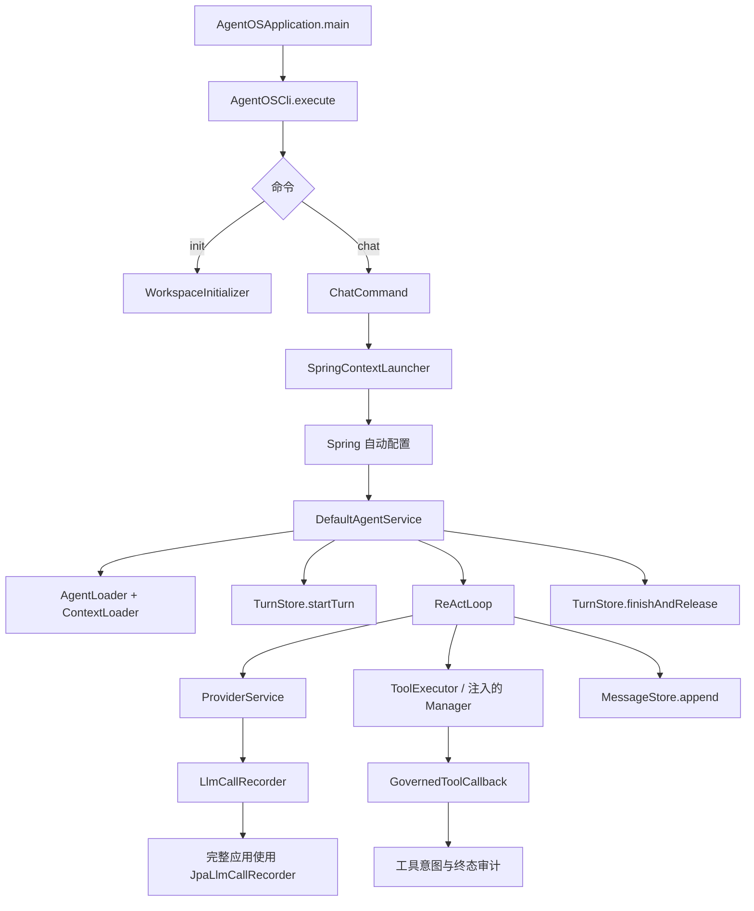

# AgentOS 代码导读

这组文档解释当前源码怎么读。源码核对日期：2026-11-17，基线为 `3228b9d`。US-2 ReAct Spec 已完成：CLI 输入经统一入口进入模型/工具循环，支持完整轮次历史、次数与时间上限、会话并发隔离、审计落库及故障恢复。默认 main 仍是无工具的普通 Agent；天气 Agent 需显式授权 `http_get` 和目标域名。

项目类结构总图见：[ClassStructure.md](./ClassStructure.md)。核心业务规则放在 `AgentOS-core`，Provider、Tool 和 Storage 通过端口接入，CLI/Boot 负责入口和组装。长期记忆、Skill/MCP、完整工具策略、正式 REST/调度/SSE 属于后续范围；目录中出现接口、依赖或临时调试类，不代表这些功能已交付。

如果你对 Bean、自动配置、配置绑定、Controller、JPA 或事务代理还不熟悉，先读 [从 AgentOS 代码理解 Spring 与 Spring Boot](./Spring-SpringBoot-Guide.md)。它按当前源码解释概念、装配与请求链路，并提供断点路线和常见问题对照。

| 模块 | 当前代码 | 阅读重点 |
|---|---|---|
| [AgentOS-core](./AgentOS-core.md) | Agent 配置、ReAct 工具循环、历史预算、输出和终态 | 先读接口，再读 `DefaultAgentService`、`ReActLoop` |
| [AgentOS-provider](./AgentOS-provider.md) | Provider 连接、请求校验、同步/流式调用、失败分类、重试、`ProviderCatalog` | 看一次外呼如何被校验、记录和限制 |
| [AgentOS-storage](./AgentOS-storage.md) | PostgreSQL 五表、会话租约、消息和两类审计、恢复 | 看有界短事务、稳定键查证、锁后数据库时间 |
| [AgentOS-cli](./AgentOS-cli.md) | `init`、`chat`、Agent 选择、单条和交互输入 | 看命令如何进入统一的 `AgentService` |
| [AgentOS-channel-cli](./AgentOS-channel-cli.md) | CLI 输入输出适配和会话身份 | 看交互细节如何留在渠道层 |
| [AgentOS-boot](./AgentOS-boot.md) | Spring 无 Web 启动器、启动回收、装配与真实天气测试 | 看自动配置顺序和分层验收 |
| [AgentOS-tool](./AgentOS-tool.md) | HTTP 工具、域名沙箱、治理与安全 resolver | 看先记后做、官方 Manager 限次、工具超时 |
| [AgentOS-web](./AgentOS-web.md) | REST 基础响应、异常处理和临时调试 Controller | 正式 Web API 尚未接入；临时入口用于断点观察 AgentService |
| [AgentOS-memory](./AgentOS-memory.md) | 记忆模块骨架 | 本轮没有接入 |

## 推荐阅读顺序



按代码阅读时，建议每一步先问三个问题：谁创建对象、谁依赖哪个端口、一次请求的截止时间和关联 ID 从哪里传到哪里。

源码中的中文注释按这条路线补充了类职责、契约字段、关键步骤与实现边界。调试一次问答时，建议依次停在：

1. `DefaultAgentService.process`：看申请轮次前的校验，以及循环、存储收尾、结果通知的分工。
2. `JpaTurnStore.startTurn`：看短事务如何创建会话、加行锁、申请租约、写入用户消息。
3. `TurnRunner.run` → `ReActLoop.run`：看线程切换、时间预算、续租检查和一次模型调用。
4. `JpaLlmCallRecorder.record` → `ToolExecutor.execute` → `GovernedToolCallback.call`：看模型返回后审计、唯一工具入口和先记后做，再看 `JpaMessageStore.append` 追加本次消息。
5. `JpaTurnStore.finishAndRelease`：看终态确认与租约释放，再回到渠道的终态回调。

Phase 5–9 已完成上限/超时、历史/归档、审计恢复、数据库竞争与真实天气验收。阅读旧注释时以实际调用者和测试为准，例如 Provider 日志记录器的旧 US-2 TODO 不表示正式应用仍只写日志。实体的普通 getter 不逐一重复解释，重点放在字段含义、状态变化与事务边界。

## 一次 `chat --message` 的最小路径

```text
AgentOSApplication
  -> AgentOSCli
  -> ChatCommand
  -> SpringContextLauncher
  -> CoreAutoConfiguration / ProviderAutoConfiguration / StorageAutoConfiguration
  -> DefaultAgentService.process(request, TurnSink.NOOP)
  -> AgentLoader.load + ContextLoader.load
  -> ProviderCatalog.validate
  -> JpaTurnStore.startTurn
  -> ReActLoop.run
      -> 历史读取与 PromptBuilder
      -> ProviderService.call 或 stream -> JpaLlmCallRecorder.record
      -> 有工具时 ToolExecutor -> Manager -> GovernedToolCallback -> http_get
      -> JpaMessageStore.append（只追加本次新增消息）
      -> 按完整历史继续，直到文本回答、returnDirect 或限制/故障终止
  -> JpaTurnStore.finishAndRelease
  -> TurnResult
```

每条新消息从 active 会话恢复已完成历史，PromptBuilder 按完整轮次和 token 预算截断；`chat --new` 先归档空闲旧会话，再开始新 UUID 会话。同会话忙时拒绝且零写入，不同会话可以推进；接管后旧 owner 不得追加消息或释放新 owner 的租约。上述竞争由真实数据库测试固定，不依赖单 JVM 锁。

## 失败路径与测试阅读入口

| 想理解的行为 | 先看实现 | 再看测试 |
|---|---|---|
| 一次工具闭环、ID 和结果回填 | `ReActLoop`、`ToolExecutor`、`ToolCallLedger` | `ToolExecutorTest`、`ReActApplicationTest` |
| 两道次数上限、共享 deadline + 1s | `TurnExecutionBudget`、`TurnRunner`、`GovernedToolCallback` | `ReActLoopLimitsTest`、`ToolCallLimitsTest`、`TurnDeadlineTest` |
| 历史完整性、失败轮次重建、--new | `PromptBuilder`、`JpaMessageStore`、`JpaSessionManager` | `PromptHistoryTest`、`DefaultAgentCliIntegrationTest` |
| 审计 SQL 重试与未知提交 | `RetryingAuditWriter`、`AuditTransactions` | `AuditTransactionTest`、`AuditLatencyTest` |
| 同会话竞争、租约丢失和接管 | `JpaTurnStore`、`TurnGuard` | `JpaTurnStoreContractTest`、`SessionConcurrencyIntegrationTest` |
| 崩溃与关闭恢复 | `TurnReaper`、`TurnReaperRunner`、`DefaultAgentService.close` | `TurnReaperStartupTest`、`AgentServiceFailureTest` |

先区分业务状态与持久化确认：`SUCCEEDED/FAILED/TIMED_OUT/INTERRUPTED/MAX_ITERATIONS` 描述执行结果，`CONFIRMED/UNCONFIRMED` 描述必要审计、终态和租约清理是否已确认。数据库持续故障时返回 turnId 和 UNCONFIRMED，不能把日志当作成功落库。

## 验证入口

```bash
mvn -B -ntp verify
python3 scripts/check_db_test_reports.py
```

普通验证不启用 `llm`，数据库测试连接 Testcontainers 的 `pgvector/pgvector:pg17`，测试关闭真实 `.env` 导入。Boot 的 `ReActApplicationTest` 使用本地 HTTP 模型替身，不发送真实模型请求。

2026-11-17 的默认完整质量门为 **463 tests / 0 failures / 0 errors / 0 skipped**；另行显式运行 `ReActWeatherSmokeTest` 的真实模型专项 **2 项通过**，包含本地天气替身及真实 met.no + 两次独立 CLI/--new。模型调用需要安全注入环境变量，真实天气另需 `AGENTOS_WEATHER_DEMO=true`；跳过只算 NOT_RUN。这是指定样本的本地验收，不表示发布或生产验证。命令、计数和42条FR/22条SC证据见[Phase 9 验证记录](../testing/phase9-validation-2026-11-17.md)及[quickstart 第14节](../../specs/002-react-loop/quickstart.md)。
