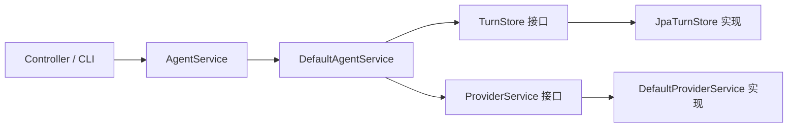
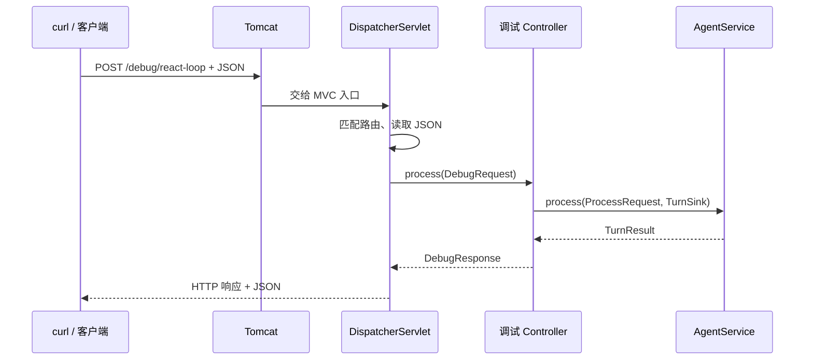
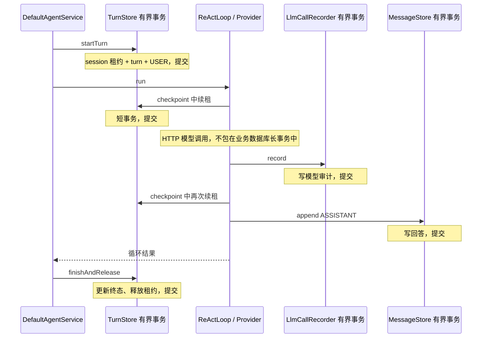

# 从 AgentOS 代码理解 Spring 与 Spring Boot

本文面向已经能看懂 Java 类、接口和方法，但对 Spring 的“自动发生”还不熟悉的读者。我们从当前 AgentOS 源码出发，解释对象如何创建、配置如何生效、请求如何分发、数据库事务如何提交。

源码核对日期：2026-11-17，US-2验收基线 `3228b9d`。项目使用 Spring Boot **4.1.2**、Spring AI **2.0.2**、JDK **21**。当前已实现工具循环、历史预算、审计恢复及并发隔离；文中的临时调试 Controller、测试替身和后续功能边界会分别说明。

## 阅读路线

第一次建议按顺序读第 1～6 节，建立容器、装配和配置的概念。跟 HTTP 请求时读第 7～9 节；跟数据库时读第 10～12 节；最后读生命周期、线程、测试和调试。

| 你遇到的问题 | 对应章节 |
|---|---|
| 类没有 `@Service`，为什么能注入？ | 2、3、4 |
| YAML 怎么变成 Java 字段？ | 5 |
| 为什么 `main` 执行了却没有 HTTP 服务？ | 6 |
| JSON 怎么变成 `DebugRequest`？ | 7 |
| `@Transactional` 到底在哪里起作用？ | 11 |
| 为什么 chat 启动会建表，init 却不会？ | 6、12、13 |
| 虚拟线程、Reactor、SSE 是什么关系？ | 14 |
| 怎么验证自动配置，又不连真实数据库？ | 16 |
| 该在哪些地方下断点？ | 17 |

## 1. 先分清这些技术各自负责什么

可以把整个应用理解为一家餐厅：业务代码负责做菜，Spring 负责安排人员和协作，Spring Boot 负责按约定把厨房、设备和营业入口准备好。

| 技术 | 通俗解释 | 本项目中的作用 |
|---|---|---|
| Spring Framework | 管对象、接请求、管事务的基础框架 | IoC/DI、Spring MVC、事务、事件 |
| Spring Boot | 在 Spring 基础上提供启动、自动配置和运维约定 | `SpringApplicationBuilder`、属性绑定、内嵌服务器、Actuator |
| Spring Data JPA | 根据接口提供常见数据库访问能力 | `SessionRepository` 等 Repository |
| Jakarta Persistence / JPA | Java 对象和关系表映射的标准 | `@Entity`、`@Id`、`@Column` |
| Hibernate | 实现 JPA 标准的 ORM 框架 | 把实体读写转换成 SQL，映射 PostgreSQL JSONB |
| JDBC / `JdbcTemplate` | 更直接地执行 SQL | 查询数据库时钟，测试中核对行数 |
| Spring AI | 访问聊天模型、向量模型和工具的组件 | `ChatModel`、`Prompt`、`ToolCallingManager` |
| Reactor | 表达和处理异步数据流的库 | `Flux<ChatResponse>`、流式聚合与超时 |
| Flyway | 数据库版本迁移工具 | 执行 `V1__core_tables.sql` |
| Picocli | Java 命令行参数解析工具 | `init`、`chat`；它本身不负责启动 Spring |
| Maven | 构建和依赖管理工具 | 多模块构建、依赖版本、可执行 JAR |

例如，`@Entity` 是 JPA 注解，`@Transactional` 是这里使用的 Spring 事务注解，`@RestController` 是 Spring MVC 注解，`@ConfigurationProperties` 是 Spring Boot 注解。它们可以一起工作，但解决的是不同层面的问题。

项目是 Maven 多模块**单体**。一个模块目录不等于一个进程，也不等于一个 Spring 容器。Boot 启动后，多个模块中的类通常在同一个 `ApplicationContext` 里协作。

### 1.1 Starter、parent、BOM 与自动配置的关系

入口：[根 pom.xml](../../pom.xml)、[Storage pom.xml](../../AgentOS-storage/pom.xml)、[Web pom.xml](../../AgentOS-web/pom.xml)。

这几个名字经常一起出现，但各有分工：

| 名称 | 当前项目里的例子 | 实际作用 |
|---|---|---|
| parent | `spring-boot-starter-parent:4.1.2` | 继承常用构建约定、版本管理与插件设置 |
| BOM | 导入 `spring-ai-bom:2.0.2` | 统一相关依赖的推荐版本 |
| starter | `spring-boot-starter-data-jpa` | 把某项能力常用的依赖组合引进来 |
| 自动配置 | `HibernateJpaAutoConfiguration` 等 | 运行时根据条件决定创建哪些基础设施 Bean |

**管理版本不等于引入依赖。** `dependencyManagement` 主要规定“如果使用它，该用什么版本”，真正添加到模块 classpath 通常还需要 `<dependencies>` 声明。

Starter 可以理解为配套工具箱。例如 Storage 引入 Data JPA、Flyway 的 Starter，Web 引入 WebMVC、Validation 的 Starter，Boot 再聚合这些模块。

工具箱进来了，不代表每项功能都会启用：运行环境、Bean、配置开关等条件仍然要满足。项目就是用 `spring.ai.model.chat=none` 等配置关闭了不需要的默认模型创建。

## 2. IoC、DI、Bean 和 ApplicationContext

### 2.1 从普通 Java 的 `new` 开始

如果不用框架，你可能自己写：

```java
ProviderService provider = new DefaultProviderService(validator, recorder);
```

谁需要 `provider`，就把它传给谁。对象多了以后，要处理创建顺序、共享实例、替换实现和关闭资源，工作量就会上升。

Spring 把这部分组织工作集中放到一个容器中。你告诉容器“这个对象怎么创建、依赖谁”，容器负责把它们连起来。

- **IoC（控制反转）**：对象的创建和组装主要交给容器组织。
- **DI（依赖注入）**：对象所需的其他对象由外部传入。
- **Bean**：注册给 Spring 容器管理的对象。
- **ApplicationContext**：应用级容器，保存 Bean 定义，完成创建、注入、事件和生命周期管理。

依赖注入本身是普通 Java 也能使用的设计方式；Spring 让大量依赖的组装更方便。

### 2.2 本项目通过 `@Bean` 创建业务对象

入口：[CoreAutoConfiguration.java](../../AgentOS-core/src/main/java/com/agentos/core/config/CoreAutoConfiguration.java)。

```java
@Bean
AgentLoader agentLoader(WorkspaceProperties properties) {
    return new AgentLoader(properties.root().resolve("agents"));
}
```

逐行看：

1. `@Bean` 告诉 Spring：这个工厂方法的返回对象需要交给容器管理。
2. 方法参数 `WorkspaceProperties` 由容器查找并提供。
3. 方法里的 `new` 仍然负责构造 Java 对象。
4. 返回后，Spring 还可以对对象做初始化、代理等处理。
5. 默认 Bean 名称是方法名 `agentLoader`；默认作用域是单例，即通常一个容器内一个实例。

所以，**看到 `new` 不能直接判断对象有没有被 Spring 管理**。关键是对象有没有通过 `@Bean` 等方式注册。

本项目的 `DefaultAgentService` 没有 `@Service`，但在配置类的 `agentService(...)` 方法中返回，所以它仍然是 Bean。

### 2.3 构造器注入：把依赖写在明面上

入口：[AgentLoopDebugController.java](../../AgentOS-web/src/main/java/com/agentos/web/dev/AgentLoopDebugController.java)。这是 web 模块的临时调试入口。

```java
private final AgentService agentService;

public AgentLoopDebugController(AgentService agentService) {
    this.agentService = Objects.requireNonNull(agentService, "agentService");
}
```

Spring 创建 Controller 时，需要先取得一个 `AgentService`。因为这里只有一个构造器，不需要再写 `@Autowired`。

这样的好处是：看构造器就知道依赖；字段可以是 `final`；单元测试可以直接传替身，不必启动容器。

默认主要按类型查找依赖。找不到候选，通常会导致创建失败；有多个同类型候选且无法进一步区分，也可能失败。Spring 还支持 `@Primary`、`@Qualifier` 等选择方式，但当前这条装配链主要通过条件配置确保候选明确。

### 2.4 接口负责约定，配置类负责选实现



Core 可以依赖 `TurnStore` 接口，而不必知道 JPA、PostgreSQL 或 Repository 的细节。Storage 自动配置负责把 `JpaTurnStore` 接到接口上。这就是依赖倒置在本项目里的具体用法。

### 2.5 不在容器里，也能使用 Spring AI

`ChatModelFactory` 创建的 `OpenAiChatModel` 被保存在 Provider 的连接映射里，**没有单独注册为 `ChatModel` Bean**。它仍然可以被普通 Java 代码调用。

这是项目的明确设计：用 Provider 名称选择连接，避免靠容器里有几个 `ChatModel` 来判断使用哪个模型。Spring AI 的类不必全部成为 Bean；但其需要的官方 `ToolCallingManager`、观测组件会先由容器提供，再传入工厂。

### 2.6 一张表分清哪些对象由容器管理

| 对象 | 当前如何创建 | 是否单独注册为 Bean |
|---|---|---|
| `DefaultAgentService` | Core 的 `@Bean` 工厂方法返回 | 是，注册的端口类型是 `AgentService` |
| `JpaTurnStore` | Storage 的 `@Bean` 工厂方法返回 | 是，主链路经AuditTransactions建立程序式事务 |
| 调试 Controller | 组件扫描且开关匹配 | 是 |
| `ReActLoop` | 创建 AgentService 时直接 `new`，作为参数传入 | 否 |
| `OpenAiChatModel` | 模型工厂创建，保存在连接映射中 | 否 |
| `ProcessRequest`、`TurnResult` | 每次业务处理按需构造 | 否 |
| `SessionEntity` | 业务创建或由 Hibernate 读取 | 不是容器单例；有自己的 JPA 管理状态 |

“这个对象的依赖来自容器”和“这个对象自己就是 Bean”也不是同一件事。`ReActLoop` 虽然接收了容器里的 Provider、存储端口，但它自己只是普通 Java 对象。

## 3. 组件扫描、配置类和三种“扫描”

### 3.1 `@SpringBootApplication` 是组合入口

入口：[AgentOSApplication.java](../../AgentOS-boot/src/main/java/com/agentos/boot/AgentOSApplication.java)。

```java
@SpringBootApplication(scanBasePackages = "com.agentos")
public class AgentOSApplication {
    // ...
}
```

可以把它理解为组合了三项主要能力：

- 把这个类作为应用配置来源；
- 开启 Spring Boot 自动配置；
- 从指定包扫描 Spring 组件。

`scanBasePackages = "com.agentos"` 覆盖多个模块共有的包前缀。所以位于 `com.agentos.web` 的 Advice、配置类，以及临时 Controller，都有机会被扫描到。

**注解不会自己执行启动。** 普通 Java 调用 `main` 时，仍然要实际创建 Spring 应用，才会处理这些配置。

### 3.2 `@Component`、`@Service`、`@RestController` 与 `@Bean`

| 方式 | 可以理解成 | 当前例子 |
|---|---|---|
| `@Component` | 把类标记为扫描候选 | Controller、配置类所基于的组件机制 |
| `@Service` | 用于业务服务的组件标记 | 当前 `DefaultAgentService` 走 `@Bean` 注册 |
| `@RestController` | 可接收 HTTP 请求并把返回值写进响应的组件 | 临时 `AgentLoopDebugController` |
| `@Configuration` | 定义装配规则的配置类 | `WebConfig` |
| `@Bean` | 明确声明一个对象工厂 | `turnStore(...)`、`providerService(...)` |

二者不是“高级、低级”的区别。扫描适合直接发现组件；`@Bean` 适合显式选择实现、传参数或构造第三方对象。

### 3.3 `proxyBeanMethods = false` 到底是什么

入口：[WebConfig.java](../../AgentOS-web/src/main/java/com/agentos/web/config/WebConfig.java)。

```java
@Configuration(proxyBeanMethods = false)
public class WebConfig implements WebMvcConfigurer {
    // ...
}
```

配置类通常可以被代理，让配置类内部的 `@Bean` 方法互相调用时仍返回容器管理的对象。`false` 表示不做这种方法调用拦截。

在这种配置里，直接写 `anotherBean()` 就是普通 Java 调用，可能额外创建对象。更清楚的方式是把依赖写成 `@Bean` 方法参数，让容器传入。

本项目的 `WebConfig` 没有需要互调的 `@Bean` 方法，关闭这种代理很自然。

注意这里关闭的是**配置类 Bean 方法代理**，不是关闭整个应用的 AOP，也不会使 Storage 中的事务代理失效。

### 3.4 组件、实体、Repository 是三套发现机制

Storage 自动配置同时写了：

```java
@EntityScan("com.agentos.storage.session")
@EnableJpaRepositories("com.agentos.storage.session")
```

| 机制 | 寻找什么 | 找到之后做什么 |
|---|---|---|
| 组件扫描 | Controller、配置类等组件 | 注册普通 Spring Bean |
| `@EntityScan` | `@Entity` 实体 | 告诉 JPA 对象如何映射表 |
| `@EnableJpaRepositories` | Repository 接口 | 由 Spring Data 创建数据库访问代理 |

`@Entity` 不等于“实体是单例 Bean”；Repository 也不需要你手写实现类。`@SpringBootApplication` 的 `scanBasePackages` 不能简单替代这里的实体和 Repository 包配置。

## 4. Spring Boot 自动配置与条件装配

### 4.1 自动配置不是猜测业务逻辑

自动配置的核心是：框架根据 classpath、配置属性和已有 Bean，决定加载哪些装配规则。

例如，数据库相关依赖和连接配置齐全时，Boot 可以创建 DataSource、JPA 等基础设施；项目自己的 Storage 自动配置再用它们创建 `TurnStore`、`MessageStore`。

业务流程仍然是 `DefaultAgentService`、`ReActLoop` 中明确写出来的代码。

### 4.2 项目自己的自动配置怎么被发现

Core、Provider、Storage 各自带有同名资源文件，路径必须是：

```text
META-INF/spring/org.springframework.boot.autoconfigure.AutoConfiguration.imports
```

例如 Core 的文件内容是：

```text
com.agentos.core.config.CoreAutoConfiguration
```

Boot 从 classpath 上读取候选名单，再结合条件装配。**配置类只写 `@AutoConfiguration`，却没有被正确导入或列入发现文件，不代表一定会生效。**

这也解释了为什么多个 Maven 模块可以各自提供装配能力，而 Boot 只负责把依赖聚合起来。

### 4.3 三个常用条件

| 注解 | 通俗解释 | 当前用法 |
|---|---|---|
| `@ConditionalOnBean` | 已经有依赖组件，才装配我 | Storage 需要 DataSource；AgentService 需要 Provider 和存储端口 |
| `@ConditionalOnMissingBean` | 没有同类实现，才提供默认值 | 默认日志审计、ProviderService |
| `@ConditionalOnProperty` | 配置开关符合要求，才装配我 | 临时调试 Controller |

Controller 的实际开关：

```java
@ConditionalOnProperty(
    name = "agentos.debug.react-loop.enabled",
    havingValue = "true")
```

没设置这个属性时，默认不匹配，因为没有启用 `matchIfMissing`。Controller 不会注册，请求该路径通常只能得到找不到路由的结果。

条件主要在上下文构建期间判断，不是每个请求重新判断。启动后修改配置文件，也不会自动让 Controller 注册或消失。

### 4.4 自动配置为什么需要排序

入口：[StorageAutoConfiguration.java](../../AgentOS-storage/src/main/java/com/agentos/storage/StorageAutoConfiguration.java)、[ProviderAutoConfiguration.java](../../AgentOS-provider/src/main/java/com/agentos/provider/config/ProviderAutoConfiguration.java)、[CoreAutoConfiguration.java](../../AgentOS-core/src/main/java/com/agentos/core/config/CoreAutoConfiguration.java)。

Storage 声明在数据库基础配置之后、Provider之前处理；Tool在Storage之后、官方ToolCalling自动配置之前声明安全resolver和异常processor；Core排在Storage、Provider、Tool及官方工具配置之后。

```text
数据库相关自动配置
  → Storage 自动配置
  → Provider 自动配置
  → Tool / 官方 ToolCalling 自动配置
  → Core 自动配置
```

这里尤其重要的是 `LlmCallRecorder`：

1. 完整应用有 DataSource，Storage 先提供 `JpaLlmCallRecorder`。
2. Provider 检查已存在 `LlmCallRecorder`，便不再提供日志默认实现。
3. ProviderService 注入数据库审计实现。
4. 仅装配 Provider 的小型上下文可以使用日志记录器或测试替身。

`afterName`、`beforeName` 主要控制自动配置定义的处理顺序，**不等于强制每个 Bean 都按文字顺序实例化**。实例创建还受到依赖关系等因素影响。

`@ConditionalOnMissingBean` 也不是所有实现都创建后再自动投票。判断时能看到哪些定义，和配置顺序有关。

### 4.5 可选依赖 `ObjectProvider`

Provider 自动配置的参数里有：

```java
ObjectProvider<ObservationRegistry> observationRegistry
```

使用时：

```java
observationRegistry.getIfAvailable(() -> ObservationRegistry.NOOP)
```

意思是：有观测注册表就用，没有就提供不做事的实现。这样缩小版测试上下文也能装配模型工厂。

“可选”不等于自动解决多个候选冲突；多个候选仍需有明确的选择规则。

### 4.6 为什么引入 Spring AI Starter 后还要关闭模型自动配置

当前 `application.yaml` 显式配置：

```yaml
spring:
  ai:
    model:
      chat: none
      embedding: none
    chat:
      client:
        tool-calling:
          enabled: false
    mcp:
      client:
        enabled: false
```

完整文件还关闭了图像、语音等默认模型。目的分别是：聊天和 Embedding 由项目自己的工厂按显式配置创建；工具不进入 Advisor 自带的另一套循环；后续 MCP 按项目治理要求接入。

项目仍需要 Starter 带来的部分公共基础设施，例如官方 `ToolCallingManager`。它由容器提供，再注入模型工厂；不能因为自己创建模型，就顺手再自己创建一套 Manager，绕过官方装配的策略和观测。

这是 Boot 常见用法：保留合适的自动配置，明确关闭或替换不符合业务边界的部分。

## 5. 外部化配置：从 YAML 到 Java 对象

### 5.1 配置不是一个文件，而是多个来源

Spring 的 `Environment` 可以把应用 YAML、导入文件、操作系统环境变量、JVM 系统属性、启动参数等组织成统一属性视图。

普通应用运行时，可以先记住这个常见的简化关系：

```text
Spring 应用命令行参数
  > JVM 系统属性
  > 操作系统环境变量
  > application.yaml 等配置数据
  > SpringApplicationBuilder 的默认属性
```

这不是涵盖测试和所有启动场景的完整排序；测试属性、导入文件以及多个配置文件还有各自的覆盖规则。排查时应看实际 `Environment`，但只检查必要字段，不展开包含密钥的整个对象。

### 5.2 `.env` 为什么能生效

当前 [application.yaml](../../AgentOS-boot/src/main/resources/application.yaml) 写了：

```yaml
spring:
  config:
    import: optional:file:.env[.properties]
```

拆开解释：

- `file:`：从文件系统读取，而不是 JAR 内的 classpath。
- `.env`：相对于 Java 进程工作目录。
- `[.properties]`：提示 Boot 按 properties 格式理解这个没有标准扩展名的文件。
- `optional:`：文件不存在时，导入动作本身不直接报错。

`optional` 不保证应用能启动：后面的数据库配置或 Provider 必填项仍可能缺失。

这个文件由 Spring 当作属性源加载，不等于里面的变量已经变成操作系统环境变量。因而 `Environment.getProperty(...)` 可能读得到，而 `System.getenv(...)` 读不到。

### 5.3 占位符与默认值

```yaml
spring:
  datasource:
    url: ${AGENTOS_DB_URL}

agentos:
  embedding:
    enabled: ${AGENTOS_EMBEDDING_ENABLED:true}
```

`${名称}` 表示从属性视图取值；`${名称:默认值}` 表示不存在时用默认值；`${名称:}` 表示默认空字符串。

本项目主 Provider 地址和凭证使用空字符串缺省，再由自定义校验给出清晰错误。空字符串并不代表连接可用。

### 5.4 `@ConfigurationProperties` 做成组绑定

入口：[WorkspaceProperties.java](../../AgentOS-core/src/main/java/com/agentos/core/config/WorkspaceProperties.java)。

```java
@ConfigurationProperties("agentos.workspace")
public record WorkspaceProperties(Path root) {
    public WorkspaceProperties {
        root = root == null ? Path.of(".AgentOS") : root;
    }
}
```

配置：

```yaml
agentos:
  workspace:
    root: .AgentOS
```

绑定后就能在 Java 中调用 `properties.root()`。Boot 帮我们把文本转换成 `Path`，record 的构造器再处理缺省值。

本项目还有两种典型形式：

| 形式 | 当前例子 | 怎么赋值 |
|---|---|---|
| record 构造器绑定 | `WorkspaceProperties`、`TurnProperties`、`AuditProperties` | 通过构造参数建立对象 |
| 可变 JavaBean 绑定 | `ProviderProperties`、`EmbeddingProperties` | 通过属性 setter 等绑定规则赋值 |

不要直接打印配置对象：record 的默认 `toString()`、IDE 自动展示字段等都可能暴露不应公开的配置值。

### 5.5 属性类还需要注册

Core 自动配置通过下面的注解启用属性对象：

```java
@EnableConfigurationProperties({
    WorkspaceProperties.class,
    TurnProperties.class,
    AuditProperties.class
})
```

它告诉 Boot 创建这些属性 Bean 并完成绑定。单独声明一个 `@ConfigurationProperties` 类，并不意味着任何应用都会自动注册它。

当前[ToolAutoConfiguration.java](../../AgentOS-tool/src/main/java/com/agentos/tool/ToolAutoConfiguration.java)通过`@EnableConfigurationProperties(HttpToolProperties.class)`注册HTTP属性，再注入`WhitelistSandbox`和`HttpTools`。工具定义经官方`ToolCallbacks.from`转成callback，外层套`GovernedToolCallback`，由`ToolRegistry`按Agent名单提供。这条实际使用链和绑定测试共同证明配置已接入，单看注解不够。

### 5.6 命名转换、时间类型和具名 Map

```text
retry-min-remaining → retryMinRemaining
max-batch-size     → maxBatchSize
150s               → Duration.ofSeconds(150)
250ms              → Duration.ofMillis(250)
```

这是 Boot 的宽松绑定和类型转换能力。写 YAML 时推荐使用小写加连字符的键名。

`ProviderProperties` 的前缀是 `agentos`，内部有 `Map<String, Connection> providers`，所以：

```yaml
agentos:
  providers:
    primary:
      type: openai
      timeout: 120s
    deepseek:
      type: deepseek
      timeout: 60s
```

对应 `providers.get("primary")`、`providers.get("deepseek")`，不需要为每个名称单独定义 Java 字段。

### 5.7 绑定、校验和业务使用是三步

Boot 把 `turn_timeout` 或其他文本转换成 Java 类型，不代表它会自动理解业务约束。

本项目的配置校验主要通过 record 构造器、自定义 Provider 组装器和 `validate(...)` 方法完成。例如不允许负数超时、缺省 Provider 不可用时拒绝装配。

同时，**能绑定成功也不等于所有字段都已影响执行**。当前 `TurnProperties` 有时间配置，但 `JpaTurnStore` 的租约计算仍使用代码中的 150 秒和 30 秒；`agentos.web.sync-wait` 的配置也不能证明正式 HTTP 等待机制已实现。

排查配置要沿着“属性来源 → 属性对象 → 谁读取字段 → 实际执行位置”追踪。

### 5.8 `AGENT.md` 不走 Spring 属性绑定

`.AgentOS/agents/answer/AGENT.md` 由项目的 `AgentLoader` 用 SnakeYAML 解析。它和 Boot 的 `application.yaml` 是两条不同的配置读取路径。

因此当前把 `${AGENTOS_LLM_MODEL}` 写进 Agent 的 `provider.model`，不会自动得到 Spring 的占位符替换；它会被当作普通字符串。应按当前实现填写可用的模型名。

同理，运行工作区的 Bootstrap Markdown 每轮从文件读取；修改后能立即影响下一轮，不代表 Spring 配置 Bean 也支持这种动态刷新。

## 6. 启动方式、上下文与运行模式

### 6.1 正式入口先解析命令

```text
AgentOSApplication.main
  → AgentOSCli.execute
  → Picocli 选择子命令
```

`init` 直接使用 `WorkspaceInitializer`，不需要 Spring，也不应为了创建目录而连接数据库。

`chat` 通过 `SpringContextLauncher` 才真正启动 Spring：

```java
new SpringApplicationBuilder(AgentOSApplication.class)
    .web(WebApplicationType.NONE)
    .run("--agentos.workspace.root=" + workspaceRoot,
         "--agentos.runtime.chat=true");
```

这里传入的 `AgentOSApplication.class` 是**配置来源**。它不会递归调用该类的 `main`，所以不会再次进入 Picocli。

workspaceRoot是CLI已规范化的绝对Path，以commandLineArgs进入同一个上下文，优先于普通文件/环境配置；候选选择、AgentLoader和ContextLoader因此使用同根。`agentos.runtime.chat=true`还会启用一次性`TurnReaperRunner`，启动回收失败会阻止launcher返回，不能把它当作后台定时任务。

### 6.2 `NONE`、`SERVLET`、`REACTIVE`

| 模式 | 含义 | 当前用途 |
|---|---|---|
| `NONE` | 创建 Spring 容器，不启动 Web 服务器 | `chat` |
| `SERVLET` | 使用 Servlet Web 环境，例如 Spring MVC + Tomcat | 临时 `DebugReactLoopApplication` |
| `REACTIVE` | 使用响应式 Web 环境 | 当前主链路没有采用这种服务器模式 |

项目带了 WebFlux 依赖用于模型流式相关能力，同时 HTTP 服务采用 MVC。**依赖中出现 WebFlux，不代表 Controller 已经运行在响应式 Web 服务器上。**

调试启动类的 `.properties("agentos.debug.react-loop.enabled=true")` 添加的是默认属性；更高优先级来源仍可以覆盖它。

### 6.3 `ApplicationContext` 的取得与关闭

`SpringContextLauncher` 启动后取得 `ConfigurableApplicationContext`，通过：

```java
context.getBean(AgentService.class)
```

取业务入口；CLI 结束时调用 `context.close()`。

这是启动适配层的职责。普通业务代码继续使用构造器注入，避免到处写 `getBean`，否则依赖关系会被藏起来。

关闭上下文会触发 Bean 的销毁回调和基础设施关闭，不是只把某个变量赋为 `null`。

### 6.4 Maven 参数与 Spring 参数有区别

入口：[AgentOS-boot/pom.xml](../../AgentOS-boot/pom.xml)。

| 参数 | 谁读取 | 用途 |
|---|---|---|
| `-Dagentos.boot.main-class=...` | 当前 POM / Maven 插件 | 选择运行主类 |
| `-Dspring-boot.run.workingDirectory=...` | Boot Maven 插件 | 设置子进程工作目录 |
| `-Dspring-boot.run.jvmArguments=...` | Boot Maven 插件 | 给应用 JVM 传调试等参数 |
| 应用参数 `--agentos.workspace.root=...` | Spring Boot | 覆盖工作区配置 |
| `-Pllm` | Maven | 选择本项目真实模型测试 profile |

`-Pllm` 不是 Spring profile。当前主链路没有因此自动激活名为 `llm` 的 Spring 环境。

Maven 使用模块内的 `target/classes` 和本地仓库依赖。只构建 `package` 会更新 `target`，`install` 才把新 JAR 安装进本地 Maven 仓库。单独运行 Boot 模块却加载旧 CLI JAR，就可能出现 `NoClassDefFoundError`。

打包时，Boot 插件的 `repackage` 会把应用类放入 `BOOT-INF/classes`，依赖放入 `BOOT-INF/lib`，配合启动器形成可执行 JAR。当前 Boot 主产物是 `AgentOS.jar`；CLI 模块额外生成带 `exec` classifier 的可执行包，同时保留普通 JAR 供 Boot 依赖。普通 Java classpath 加载依赖时，不能随意把只有嵌套布局的可执行包当作普通库 JAR 替代。

当前调试命令在仓库根目录运行：

```bash
mvn -B -ntp -pl AgentOS-boot -am install -DskipTests
mvn -pl AgentOS-boot spring-boot:run \
  -Dagentos.boot.main-class=com.agentos.boot.dev.DebugReactLoopApplication \
  "-Dspring-boot.run.workingDirectory=$PWD"
```

不要直接给 `spring-boot:run` 加 `-am` 来解决旧依赖：这个目标可能也在父模块等上执行，而父模块没有待运行的主类。先安装依赖，再运行 Boot 更明确。

启动完整应用会执行数据库迁移；启用且配置完整的 Embedding 也可能进行真实外呼。它不同于仅创建文件的 `init`。

## 7. Spring MVC：HTTP 怎样进入一个 Java 方法

### 7.1 从客户端到 Controller

入口：[AgentLoopDebugController.java](../../AgentOS-web/src/main/java/com/agentos/web/dev/AgentLoopDebugController.java)。它是可删除的临时接口，不代表正式 Web API 已完成。临时启动主类仍在 boot 模块，Controller 位于 web 模块，以遵循 REST 入口的模块边界。



`DispatcherServlet` 可以理解为 MVC 的总接待员：它找对应处理方法、准备参数，再把结果交给合适的响应转换器。

### 7.2 路由注解怎么组合

```java
@RestController
@RequestMapping("/debug/react-loop")
public final class AgentLoopDebugController {
    @PostMapping
    public DebugResponse process(@RequestBody DebugRequest request) {
        // ...
    }
}
```

- `@RequestMapping` 给类设置公共路径前缀。
- `@PostMapping` 限定 HTTP 方法为 POST；这里没有额外子路径。
- `@GetMapping("/info")` 对应 GET `/debug/react-loop/info`。
- `@RestController` 组合了 Controller 和响应体语义，返回对象通常会写成 JSON，而不是当作页面名。

路由存在与否，还取决于 Controller 是否被扫描、条件是否匹配、当前是否启动了 Web 环境。

### 7.3 `@RequestBody` 和 JSON 转换

`@RequestBody` 让 MVC 使用 HTTP 消息转换器读取请求体，例如通过 Jackson 把 JSON 转为 Java record。

请求头 `Content-Type: application/json` 告诉服务器请求体的格式；`Accept` 则表达客户端希望接收什么格式，它们作用不同。

当前：

```json
{"agent":"answer","message":"你好","userId":"debug-user"}
```

变成 `DebugRequest`，再由 Controller 转换为 `ProcessRequest`。缺少 JSON 字段可能得到 `null`，**成功反序列化并不代表业务参数合法**。当前调试 DTO 没有 `@Valid`，主要校验在 `ProcessRequest`、`DefaultAgentService` 和 Agent 加载流程中。

### 7.4 `ResponseEntity` 负责响应的外层信息

普通对象返回值主要表达响应体；`ResponseEntity<T>` 可以同时设置 HTTP 状态码、响应头和响应体。

例如流式接口：

```java
return ResponseEntity.ok().contentType(SSE_UTF8).body(emitter);
```

含义是 HTTP 200、`text/event-stream` 内容类型、由 `SseEmitter` 继续写数据。

### 7.5 临时 SSE 与正式 API 的边界

`SseEmitter` 是 **Spring MVC 的异步响应机制**。Controller 返回后，后台线程仍能向这个响应发送事件。

当前 `/debug/react-loop/stream` 会发送 `delta`、`complete`、`error`，并可能发送 `exception`。文本增量和业务终态通过 `TurnSink` 桥接；ReActLoop 依赖的是 `TurnSink` 接口，不直接依赖 Servlet。

这不是 WebSocket，也不意味着整个服务变成 WebFlux。同步接口则等待 `AgentService.process` 返回后，再一次性给出结果。

SSE 的 300 秒 emitter 超时、Agent 单轮超时和 Provider HTTP 超时是不同层面的限制。一个超时设置不会自动替代其他限制。

## 8. 异常处理、HTTP 状态和参数校验

入口：[GlobalExceptionHandler.java](../../AgentOS-web/src/main/java/com/agentos/web/api/GlobalExceptionHandler.java)、[ApiResponse.java](../../AgentOS-web/src/main/java/com/agentos/web/api/ApiResponse.java)。

### 8.1 `@RestControllerAdvice` 统一接住 MVC 异常

Controller 调用的方法抛出异常后，MVC 可以把异常交给 Advice，而不是让每个接口重复写 `try/catch`。

```java
@ExceptionHandler(AgentOSException.class)
public ResponseEntity<ApiResponse<Void>> handleAgentOS(AgentOSException ex) {
    // 根据 ErrorCode 转换 HTTP 响应
}
```

项目当前映射：

| 业务错误码 | HTTP 状态 | 含义 |
|---|---|---|
| `INVALID_ARGUMENT` | 400 | 参数错误 |
| `NOT_FOUND` | 404 | 资源不存在 |
| `SESSION_BUSY` | 409 | 当前会话正忙 |
| `PROVIDER_UNAVAILABLE` | 503 | 模型连接不可用 |
| `INTERNAL_ERROR` | 500 | 内部错误 |

`ApiResponse<T>` 是项目自己定义的响应格式，不是 Spring 自带的业务约定。Advice 也不会自动给每个成功返回对象套 `ApiResponse`。

### 8.2 不是所有失败都会走 Advice

`DefaultAgentService` 会捕获一部分轮次运行异常，把它们转换成 `TurnResult(status=FAILED/TIMED_OUT)`。异常没有再抛给 MVC，Advice 自然不会处理。

因此临时同步接口可能返回 HTTP 200，但 `result.status` 是 `FAILED`。看调试结果要同时看 HTTP 状态和业务状态。

另外，SSE 后台虚拟线程中抛出的异常不会自然回到原来的同步 Controller 调用栈。当前 Controller 自己处理这部分错误；响应已经开始写出后，也不能指望再换成一个新的普通 JSON 错误响应。

### 8.3 框架异常和业务异常不同

非法 JSON、请求方法不支持等，可能在进入业务方法前就失败。当前 Advice 继承 `ResponseEntityExceptionHandler`，覆盖 `handleExceptionInternal(...)`，保留框架原来的 HTTP 状态并转换响应格式。

`@Valid`、`@NotBlank` 的例子目前在 [GlobalExceptionHandlerTest.java](../../AgentOS-web/src/test/java/com/agentos/web/api/GlobalExceptionHandlerTest.java) 的测试 Controller 中：

```java
record EchoRequest(@NotBlank String text) {}

// 测试代码中的方法参数示意
// echo(@Valid @RequestBody EchoRequest request)
```

`@NotBlank` 声明约束，`@Valid` 让 MVC 在相应入口触发对象校验。测试证明的是这个校验与错误格式机制，不能据此认为所有生产 DTO 都已经有相同校验。

## 9. WebMvcConfigurer 与 CORS

入口：[WebConfig.java](../../AgentOS-web/src/main/java/com/agentos/web/config/WebConfig.java)。

`WebMvcConfigurer` 是扩展 MVC 配置的接口。本项目用 `addCorsMappings(...)` 配置浏览器跨域访问：

```java
registry.addMapping("/api/**")
    .allowedOriginPatterns("*")
    .allowedMethods("*");
```

跨域指浏览器页面的来源与请求目标的协议、主机或端口不同。CORS 告诉浏览器哪些跨域调用可以被页面使用，它不提供登录认证，也不阻止所有非浏览器客户端。

两个实际排查点：

- 当前规则只匹配 `/api/**`，不包含临时 `/debug/react-loop/**`。
- `curl` 通常不执行浏览器的同源限制，所以 curl 成功不能证明前端页面跨域调用一定成功。

项目通过 `WebMvcConfigurer` 增补配置，没有用 `@EnableWebMvc` 接管整套 MVC。后者会改变 Boot MVC 自动配置的适用条件，通常不应为加一个跨域规则就贸然添加。

## 10. JPA、Hibernate 与 Spring Data Repository

### 10.1 从一张表到一个实体

入口：[SessionEntity.java](../../AgentOS-storage/src/main/java/com/agentos/storage/session/SessionEntity.java)。

```java
@Entity
@Table(name = "sessions")
public class SessionEntity {
    @Id
    @Column(name = "session_id", nullable = false)
    private UUID sessionId;

    protected SessionEntity() {}
}
```

| 标记 | 意义 |
|---|---|
| `@Entity` | 这个类参与 JPA 对象与表映射 |
| `@Table` | 指定表名 |
| `@Id` | 指定主键字段 |
| `@Column` | 指定列名、可空等映射信息 |
| 无参构造器 | 让 JPA 在读取数据库时创建实体对象 |

`@Id` 放在字段上时，JPA 默认使用字段访问方式，不要求每个持久化字段都提供 setter。业务可以通过 `lease(...)`、`archive(...)` 等有语义的方法修改状态。

实体是“某行数据对应的对象”，Controller 的请求 DTO 是“HTTP 输入”，Core 的 `TurnSnapshot` 是“业务所需快照”。三者分开，能减少框架和表结构对业务接口的影响。

### 10.2 UUID、数据库自增与 JSONB

`SessionEntity` 的 UUID 在 Java 代码中生成；`SessionMessageEntity` 的 `Long id` 使用：

```java
@GeneratedValue(strategy = GenerationType.IDENTITY)
```

后者表示依赖数据库生成标识。主键策略不同，执行 INSERT 和取得 ID 的时机也可能不同。

消息实体里的 JSONB 映射使用：

```java
@JdbcTypeCode(SqlTypes.JSON)
@Column(columnDefinition = "jsonb")
private Map<String, Object> metadata;
```

`@JdbcTypeCode` 是 Hibernate 的能力，指定按 JSON JDBC 类型处理；`jsonb` 是 PostgreSQL 的列类型。Flyway 脚本里仍需建立对应列，注解不会在当前 `ddl-auto=validate` 模式下代替迁移建表。

### 10.3 Repository 为什么只有接口

入口：[SessionRepository.java](../../AgentOS-storage/src/main/java/com/agentos/storage/session/SessionRepository.java)。

```java
public interface SessionRepository
        extends JpaRepository<SessionEntity, UUID> {
    Optional<SessionEntity> findByChannelAndUserIdAndProfileNameAndStatus(
        String channel, String userId, String profileName, String status);
}
```

两个泛型分别表示实体类型和主键类型。Spring Data 会创建代理，提供 `save`、`findById` 等方法，并解析派生查询方法名。

例如上面的名字对应按实体的 `channel`、`userId`、`profileName`、`status` 属性筛选。解析的是 Java 属性名，不能把数据库列名中的下划线随意塞进方法名。

`SessionMessageRepository.findBySessionIdOrderByIdAsc` 则表达按会话查询并按 ID 升序排序。

### 10.4 自定义 SQL、`@Query`、`@Param`、`@Modifying`

```java
@Query(
    value = "SELECT * FROM sessions WHERE session_id = :sessionId FOR UPDATE",
    nativeQuery = true)
Optional<SessionEntity> findByIdForUpdate(@Param("sessionId") UUID sessionId);
```

- `@Query` 声明查询内容。
- `nativeQuery = true` 表示写数据库原生 SQL，不是面向实体的 JPQL。
- `@Param` 把 Java 参数绑定到命名参数，避免手工拼接值。
- `FOR UPDATE` 是 PostgreSQL 行锁语义，不是 Spring 自己发明的锁。

`insertActiveIfAbsent(...)` 用原生 INSERT 和 `ON CONFLICT ... DO NOTHING`，还标注了 `@Modifying`。它告诉 Spring Data：这不是一个返回实体列表的查询，而是修改数据的语句。

`@Modifying` 不等于自动建立完整业务事务。这里由`JpaTurnStore.startTurn → bounded → AuditTransactions.execute`中的`TransactionTemplate`把INSERT、行锁和轮次创建放在同一事务里。

### 10.5 `save`、flush、commit 不是一回事

可以把它们理解为三个不同动作：

| 动作 | 意义 |
|---|---|
| `save` | 让实体通过 persist/merge 等机制进入保存流程 |
| flush | 把持久化上下文中的待处理变更同步到数据库 |
| commit | 提交事务，让这个事务的修改正式生效并释放相应锁 |

不能认为 `save` 后一定没有 SQL，也不能认为调用 `save` 就代表业务事务已提交。实体状态、ID 策略、查询和 flush 时机会影响 SQL 发送时间。

`JpaLlmCallRecorder.record(...)` 使用 `saveAndFlush(...)`，让一部分数据库错误尽早暴露。但即使 flush 成功，提交时仍可能出错。

在普通 JPA 事务内，从 Repository 读出的实体可能处于受管理状态，Hibernate 会在 flush 时检查变化，这叫脏检查。事务结束后的对象不应被当作随时可写回数据库的“活连接”。

### 10.6 `JdbcTemplate` 为什么与 JPA 同时存在

`JpaTurnStore` 和 `JpaSessionManager` 用：

```java
jdbc.queryForObject(
    "select clock_timestamp()",
    (rs, rowNum) -> rs.getTimestamp(1).toInstant());
```

JPA 适合读写实体；这一行直接从数据库取时间，SQL 反而更清楚。

租约判断以数据库时钟为依据，可以减少不同应用实例本机时间不一致带来的问题。这里用 PostgreSQL `clock_timestamp()` 取得调用时的实际时钟。

`JdbcTemplate` 帮忙处理 JDBC 资源和异常转换。在当前同一 DataSource、相应 JPA 事务管理器的常规配置下，它也能参与已有事务；“混用两种访问方式”不代表天然变成两套独立事务。

## 11. 事务、AOP 代理与有界存储：最值得下断点的一节

### 11.1 事务解决的是哪些操作一起成功

入口：[JpaTurnStore.java](../../AgentOS-storage/src/main/java/com/agentos/storage/session/JpaTurnStore.java)、[AuditTransactions.java](../../AgentOS-storage/src/main/java/com/agentos/storage/audit/AuditTransactions.java)。

```text
startTurn(...)
  → bounded(普通存储上限与整轮余量的较小值, ...)
  → AuditTransactions.execute(...)
  → TransactionTemplate(REQUIRES_NEW)
  → 确保active会话、取锁、检查owner/lease/deadline、保存轮次和USER
  → 提交
```

上面是当前调用路线的伪代码，使用程序式事务，不是给`startTurn`加`@Transactional`。这些动作应该作为一个整体：要么成功创建本轮，要么在异常时按事务规则回滚。连接中断/COMMIT响应超时可能使提交结果未知，此时按原turnId查证，不把“调用报错”直接等同于“已回滚”。

关系数据库事务可以提供原子性、一致性、隔离性、持久性等保证，但它不会自动管理已经发到模型服务的 HTTP 请求。

### 11.2 `@Transactional` 的效果来自代理

可以把 Spring 代理理解为套在目标对象外面的服务窗口：

```text
业务代码调用 SessionManager.findActive
  → Spring 事务代理
  → 开启事务或加入已有事务
  → 调用 JpaSessionManager.findActive
  → 方法返回后提交 / 异常时按规则回滚
  → 返回业务调用方
```

事务不是注解字符在运行时“自己生效”。Spring 发现事务元数据后，通过基础设施对 Bean 做代理。

这解释了两种常见误区：

- `JpaSessionManager.findActive`当前有`@Transactional(readOnly = true)`，经`@Bean`注册后可由事务代理增强。
- 单元测试直接`new JpaSessionManager(...)`调用这个方法，没有经过代理，不能据此证明声明式事务生效。

`JpaTurnStore.startTurn`、消息追加和审计写入的主要事务边界则在`AuditTransactions`的`TransactionTemplate`回调内。没有方法注解或没有经过业务Bean的AOP代理，不等于没有事务；程序式入口仍调用同一个`PlatformTransactionManager`管理资源。

具体代理可能是接口代理或类代理，受配置影响。调试时看到代理对象或 `TransactionInterceptor` 调用栈是正常的。

### 11.3 同类内部调用可能绕过事务代理

假设有这样的示意代码：

```java
public void outer() {
    this.inner();
}

@Transactional
public void inner() {
    // 示例：写数据库
}
```

默认代理模式下，`this.inner()` 不会从外部再次经过代理。因此不能只靠 `inner` 的注解，保证这次调用会开启一个新事务。

这条规则适用于依赖声明式代理的调用。当前`JpaTurnStore`的同类私有方法`start/renew/finish`在`bounded → AuditTransactions.execute`回调里执行，事务已经由模板建立；不能看到同类调用就判断事务失效。要追踪“在哪个线程进入哪个事务回调”，而不是只数注解。

### 11.4 默认传播、回滚和只读的含义

| 设置 | 当前应理解的含义 |
|---|---|
| 默认 `REQUIRED` | 有事务则加入，没有则新建 |
| 默认回滚规则 | 通常对 `RuntimeException`、`Error` 回滚；受检异常不默认全部回滚 |
| `readOnly = true` | 给事务与持久化层的只读提示，可以用于优化；不能当成数据库权限边界 |
| 隔离级别未显式指定 | 采用底层默认或已有事务设置，不能假设自动变成最高隔离级别 |

如果在事务方法里把异常吞掉并正常返回，事务拦截器不一定会按你想的方式回滚；如果底层已标记 rollback-only，后续正常返回仍可能在提交时抛错。

### 11.5 为什么不能把 `process` 整体加事务

一次模型回答可能等待很久。如果 Controller 或 `DefaultAgentService.process` 开一个大事务：

```text
开事务 → 查表 → 等模型几十秒 → 写表 → 提交
```

数据库资源、持久化上下文或行锁可能随整个等待被长时间占用。并发越高，连接池和锁竞争越容易出问题。

而且数据库回滚也无法“撤回”模型服务已经完成的请求或费用。

当前代码把数据操作拆成多个短事务：



图中表示纯文本成功路径；工具分支还会在外呼前提交begin、外呼后提交complete，二者之间不持有数据库连接。这些短事务由`AuditTransactions`建立，不会因为同属一次请求自动合成一个大事务。静态架构规则只能辅助检测注解事务里的外呼和等待；`LlmAuditIntegrationTest`、`ReActApplicationTest`、`AuditTransactionTest`实际检查模型/工具HTTP与审计退避期间无连接占用。

### 11.6 行锁和租约为什么同时需要

`FOR UPDATE` 行锁只在数据库事务期间保护竞争操作，事务结束就释放。

模型调用又必须在事务之外等待，所以需要把 `lease_owner`、`lease_until` 保存到 session 中，作为跨越多个短事务的执行占用凭据。

可以理解为：

- 行锁：办理手续时，只允许一个人改柜台里的记录。
- 租约：手续办完后，记录上仍写着“这段时间由某轮次使用”。

`TurnGuard.checkpoint` 续租失败会终止执行。Java `synchronized` 只能保护特定 JVM 内对象，不能替代这里的数据库并发协调。

### 11.7 跨线程不会自动携带普通事务

本项目 `TurnRunner` 会用虚拟线程执行 ReActLoop。Spring 常规声明式事务的资源上下文通常和执行线程关联，不能假设新建线程自动继承调用线程事务。

新线程仍可经声明式代理或`TransactionTemplate`建立自己的短事务。当前有界存储和审计等待会另起虚拟线程，事务在实际执行回调的线程里创建；调用方等待结果时不应已经持有外层事务或连接。`JpaSessionManager.archiveIfIdle`也先进入有界存储入口再取锁，没有用外层注解事务包住Future等待。

项目禁止用 `ThreadLocal` 传递业务轮次上下文，指的是业务设计；Spring 内部如何关联事务资源属于框架机制。业务代码依然通过 `TurnSnapshot`、`ProviderRequest` 等参数明确传递数据。

### 11.8 `open-in-view=false` 控制什么

配置：

```yaml
spring:
  jpa:
    open-in-view: false
```

它关闭在 Web 请求范围内延长 EntityManager 使用期的机制，促使数据库访问在明确的服务/事务边界内完成。

它不表示每个请求自动有事务，也不保证整个请求期间绝不会持有连接。实际连接使用仍取决于事务和查询行为。

如果将来加入懒加载关系，事务外访问未初始化的数据可能失败。通常应在适当事务内读取需要的数据并转换成 DTO，而不是为方便 Controller 遍历实体就重新打开这个开关。

### 11.9 为什么事务模板还需要SQL、socket和外层等待预算

`TransactionTemplate.setTimeout`只能表示整秒，不能独自证明整个调用满足毫秒级时限。[AuditTransactions.execute](../../AgentOS-storage/src/main/java/com/agentos/storage/audit/AuditTransactions.java)同时设置事务局部`statement_timeout`、`lock_timeout`和JDBC`networkTimeout`，在取得连接、设置完成后及提交前检查同一个单调截止时间，提交/回滚后恢复连接设置；恢复失败淘汰连接，防止下一个借用者继承错误时限。

| 操作 | 当前预算 | 如何读 |
|---|---|---|
| 起步/续租等普通存储 | 默认5秒，与轮次余量取小 | 外层有界等待覆盖连接池获取，迟到工作再查截止时间 |
| 一次审计尝试 | 默认2秒，配置1ms～5秒 | 包含调度、连接、SQL与提交，不只是INSERT耗时 |
| 最终审计、终态、释放租约、通知 | deadline后共用1秒 | 不逐项重置计时，最终审计不再退避重放 |
| chat启动恢复 | 总30秒，候选查询/逐会话事务最多5秒 | 分会话独立提交，不延长普通轮次清理 |

模型重试、工具执行和数据库审计重试是三个不同边界：Provider最多两次外呼尝试；当前工具不自动重试；`RetryingAuditWriter`仅对瞬时审计SQL故障作有限重试，退避在事务外。稳定write_id/工具唯一键负责查证未知提交，不能重复外呼“补偿”。必要持久化未确认时返回turnId + UNCONFIRMED；数据库恢复后回收失效轮次，不承诺自动补齐丢失的模型审计。

## 12. DataSource、连接池、Flyway 与建表

### 12.1 DataSource 不等于一条固定连接

`DataSource` 是取得数据库连接的入口，当前 Boot 常规装配使用 HikariCP 连接池。池会管理和复用物理连接，避免每次查询都重新完成连接建立过程。

`JdbcTemplate`、JPA 等基础设施可以通过相同的 DataSource 访问数据库。连接池大小决定可同时使用的连接资源，虚拟线程数量很多也不会让数据库连接自动无限增加。

### 12.2 Flyway 与 Hibernate 的分工

迁移入口：[V1__core_tables.sql](../../AgentOS-storage/src/main/resources/db/migration/V1__core_tables.sql)。

当前配置：

```yaml
spring:
  jpa:
    hibernate:
      ddl-auto: validate
```

职责分工是：

1. Flyway 发现版本化脚本，检查迁移历史，对未执行的迁移进行应用。
2. Hibernate 按实体映射校验现有数据库是否满足要求。
3. 业务代码开始使用 Repository 和存储端口。

`validate` 不会替你自动修好缺列问题。需要变更结构时，应增加适当的新迁移，而不是把已在其他环境执行的历史脚本随意改掉。

### 12.3 迁移里的占位符也是独立的一层

```yaml
spring:
  flyway:
    placeholders:
      embeddingDimensions: ${AGENTOS_EMBEDDING_DIMENSIONS:1024}
```

这里先由 Spring 解析外部配置，再把 `embeddingDimensions` 交给 Flyway，在迁移脚本中替换。不要把这个机制与 Agent Markdown 的解析混为一谈。

### 12.4 启动成功之前就可能写数据库

Boot 在准备上下文时就可能运行 Flyway。因此“我只是启动一下，还没请求 Controller”不等于数据库没有变化。

阅读测试时也要确认 DataSource 来源。当前集成测试使用 Testcontainers 的独立 PostgreSQL；手工调试完整应用则会使用你配置的数据库。二者的验证结论不能互相替代。

## 13. 应用事件、后台任务与销毁回调

入口：[EmbeddingStartupValidator.java](../../AgentOS-provider/src/main/java/com/agentos/provider/embedding/EmbeddingStartupValidator.java)。

### 13.1 Bean 创建完成与应用就绪不同

```text
创建 Spring 应用
  → 读取配置、处理 Bean 定义
  → 创建和初始化 Bean、准备基础设施
  → 完成启动流程
  → 发布 ApplicationReadyEvent
```

这是一条帮助理解的简化时序，不是所有底层启动阶段的完整清单。

`ApplicationReadyEvent` 表示 Boot 启动流程已到就绪阶段，不保证某个外部模型服务永远可用。

### 13.2 监听事件不要求 `@EventListener`

当前类实现：

```java
ApplicationListener<ApplicationReadyEvent>
```

Spring 也能识别这样的 Bean 并向它发送匹配事件。这里使用接口监听，没有采用方法上的 `@EventListener` 写法。

事件监听方法默认不会因为名字叫“事件”就自动变成后台线程。当前代码自己执行：

```java
Thread.ofVirtual().name("embedding-validator").start(this::run);
```

因此慢校验才被放到后台。这里也没有使用 `@Async`。

### 13.3 为什么有 `AtomicBoolean`

代码用 `started.compareAndSet(false, true)` 防止重复启动后台校验。父子上下文等情况下事件可能重复到达，监听器需要保证只创建一次工作线程。

这也是单例 Bean 常见的并发问题：单例只说明共享实例，不说明字段操作天然线程安全。

### 13.4 `DisposableBean` 在关闭时做什么

类还实现了 `DisposableBean`，其 `destroy()` 方法会：

1. 标记关闭状态；
2. 中断后台工作线程；
3. 有界等待线程退出。

容器管理对象的价值不止在创建和注入，还包括结束时回收资源。

### 13.5 服务器优雅停机与业务收尾不是同一个开关

```yaml
server:
  shutdown: graceful
spring:
  lifecycle:
    timeout-per-shutdown-phase: 70s
```

这是服务器/生命周期层面的停机设置。`agentos.shutdown.turn-grace: 60s` 是项目自定义配置，当前不能仅凭它出现在 YAML，就断言所有轮次都已有相应业务收尾管理器。

同样，当前虽然有 `TurnStore.reapInterrupted()` 方法，也不应仅凭方法存在就认定定时回收任务已经接好。

## 14. 虚拟线程、Reactor 和 SSE 的关系

当前调试可能遇到三类线程边界：

```text
Tomcat 处理请求
  → 同步 Controller / SSE 自建虚拟线程
  → TurnRunner 自建虚拟线程
  → 模型流的 Reactor 回调
```

实际线程调度由调用方式与底层实现决定，不能只靠某个线程名称推断完整执行路径。

### 14.1 Boot 的虚拟线程开关

```yaml
spring:
  threads:
    virtual:
      enabled: true
```

在 JDK 21 和支持的 Boot 自动配置组件下，这个设置使相应基础设施使用虚拟线程。它不会把任意手写线程池都自动替换，也不会让阻塞等待消失。

虚拟线程是 JDK 的能力，可以用较低成本承载大量阻塞式任务。数据库连接、外部接口配额、CPU 和内存仍然有限。

### 14.2 `TurnRunner` 是项目自己的 deadline 执行器

入口：[TurnRunner.java](../../AgentOS-core/src/main/java/com/agentos/core/turn/TurnRunner.java)。

它使用 `Executors.newVirtualThreadPerTaskExecutor()` 和 `Future.get(...)`，在期限内等待本轮任务，超时后尝试中断任务并收尾。

这是显式 Java 并发代码，不是 `@Async` 或 Spring 调度器自动生成的行为。中断也不保证所有外部 I/O 都立即停止，所以 Provider 仍需设置自己的请求超时。

### 14.3 `Flux` 表示“随时间到达的一串结果”

入口：[StreamCollector.java](../../AgentOS-provider/src/main/java/com/agentos/provider/chat/StreamCollector.java)。

同步调用主要拿一个 `ChatResponse`；流式调用返回 `Flux<ChatResponse>`，其间会不断到达分片。

当前收集链主要使用：

| API | 可以理解为 |
|---|---|
| `doOnNext(...)` | 每来一个分片，执行观察或输出动作 |
| `MessageAggregator.aggregate(...)` | 用 Spring AI 组件拼出完整结果 |
| `timeout(...)` | 在剩余预算内约束等待 |
| `blockLast()` | 当前调用线程阻塞，等待流结束 |

因此项目是“内部使用响应式流，再桥接回阻塞式轮次编排”的一种实现。不能把有 `Flux` 理解成所有层都已经非阻塞。

`SseEmitter` 处理的是**服务器到 HTTP 客户端的输出**；`Flux` 处理的是**模型服务返回的流**。`TurnSink.onDelta` 把两侧连起来。

### 14.4 单例 Bean 为什么要避免保存请求数据

Controller、ProviderService、AgentService 等 Bean 默认通常是共享的。同一时间可以有多个请求调用它们。

当前同步 Controller 把 `events` 列表放在方法局部变量里，而不是共享字段里；轮次信息通过参数传递；每次模型尝试创建独立 `StreamCollector`。

如果把“当前用户”“当前 turnId”“本次回复列表”直接存成单例服务的可变成员，多个请求就可能相互覆盖。

MDC 也是线程关联的日志上下文，不能假设自动跨虚拟线程和 Reactor 回调传播，更不应用它读取业务身份。排查缺少日志关联字段时，要检查在哪里写入、清理以及在哪里切线程。

## 15. 日志、Actuator 与 Observation

### 15.1 日志门面与 Boot 日志配置

业务代码使用 SLF4J，具体日志输出由 Logback 等实现和 Boot 配置协作完成。

```java
log.warn("Bootstrap 文件缺失：{}", file);
```

`{}` 是参数占位符，和手工字符串拼接不同。日志级别通常从细到粗是 TRACE、DEBUG、INFO、WARN、ERROR。

本项目配置了：

- 控制台可读日志；
- `.AgentOS/logs/agentos.log` 文件日志；
- 文件 ECS JSON 结构化格式；
- 文件滚动大小和保留策略。

`agentos.workspace.root` 和 `logging.file.name` 是两个独立配置项。只更改工作区根目录，当前不会自动把日志文件路径也改到新工作区。

### 15.2 Actuator 健康检查

Actuator 是 Boot 的运维端点组件。当前配置只暴露 `health`，并开启健康探针；在 Web 环境中可以使用相应健康路径，例如：

```text
/actuator/health
/actuator/health/liveness
/actuator/health/readiness
```

它们分别用于整体健康以及存活、就绪等检查。具体结果由已注册的健康贡献组件等决定。

健康接口成功不能直接证明“answer 已加载、真实模型能回答、消息已持久化”都成功；这些需要对应业务链路验证。`WebApplicationType.NONE` 模式也没有 HTTP 服务器供你访问这些 URL。

### 15.3 `ObservationRegistry` 管观测

`ObservationRegistry` 是 Micrometer 的观测入口，模型工厂把它传给 Spring AI 模型。它可以让相关操作被指标或链路观测基础设施捕获，是否导出以及导出到哪里仍取决于额外组件和配置。

`ObservationRegistry.NOOP` 表示不做实际观测。存在 Registry 不等于已经部署了 Prometheus 或链路追踪平台。

日志、观测和审计分工不同：

| 信息 | 用途 | 当前例子 |
|---|---|---|
| 日志 | 给开发与运维排查事件 | 缺文件、启动状态、错误摘要 |
| 观测 | 操作耗时、指标和追踪关联 | Spring AI 模型观测 |
| 业务审计 | 结构化、可查询的业务事实 | PostgreSQL `llm_calls` |

项目关闭了模型 prompt/completion 和工具内容的观测记录，避免把用户数据或凭证带入遥测。审计仍由 `LlmCallRecorder` 明确写库，不能用“有日志”替代。

## 16. Spring 测试：按验证范围选择工具

### 16.1 直接 `new` 的单元测试

例如 `AgentServiceTest`、`ReActLoopTest` 使用内存存储、脚本 Provider 等替身验证业务行为。

优点是快、不依赖容器；局限是不能证明自动配置、Spring AOP 事务或真实数据库约束有效。

普通 Java 单元测试里，对象上的 Spring 注解不会因为被写在源码中就自动执行。

### 16.2 `ApplicationContextRunner` 验证小型装配

入口：[ProviderContextRunners.java](../../AgentOS-provider/src/test/java/com/agentos/provider/support/ProviderContextRunners.java)、[FoundationConfigurationTest.java](../../AgentOS-provider/src/test/java/com/agentos/provider/config/FoundationConfigurationTest.java)。

```java
new ApplicationContextRunner()
    .withConfiguration(AutoConfigurations.of(ProviderAutoConfiguration.class))
    .withUserConfiguration(TestSpringAiConfiguration.class);
```

可以额外提供 `withPropertyValues(...)` 或 `withBean(...)`，再观察上下文能否启动、实际用了哪个实现。

它适合回答：“提供一个自定义审计实现后，默认日志审计是否退让？”

它不启动完整 Web 服务器，也不等同于 `SpringApplication.run` 的完整生命周期。特别是不能仅靠刷新这个上下文，就认为 `ApplicationReadyEvent` 已经像真实 Boot 启动那样发布。

### 16.3 `MockMvc` 验证 MVC 行为

入口：[GlobalExceptionHandlerTest.java](../../AgentOS-web/src/test/java/com/agentos/web/api/GlobalExceptionHandlerTest.java)。

```java
MockMvcBuilders.standaloneSetup(new StubController())
    .setControllerAdvice(new GlobalExceptionHandler())
    .build();
```

测试用模拟请求走 Controller、JSON 转换和异常处理，不需要真正监听 8080。

`standaloneSetup` 只装配指定组件，不证明整个应用中的 CORS、自动配置、网络服务器都正常。当前测试并没有使用 `@WebMvcTest` 切片，应按真实构建方式理解其验证范围。

### 16.4 `@SpringBootTest` 验证完整装配

入口：[ReActApplicationTest.java](../../AgentOS-boot/src/test/java/com/agentos/boot/ReActApplicationTest.java)。

```java
@SpringBootTest(
    classes = AgentOSApplication.class,
    webEnvironment = SpringBootTest.WebEnvironment.NONE,
    properties = {
        "spring.main.web-application-type=none",
        "spring.config.import="
    })
```

这里使用应用配置来创建完整业务上下文，但不启动 Web 服务器，也不要求像正常运行那样执行主入口的 Picocli 流程。

`spring.config.import=` 清空真实 `.env` 导入，防止测试误用手工调试连接。

纯文本方法验证一个session、一个turn、USER/ASSISTANT两条消息及一条模型审计；同类还测试工具闭环、限次、慢工具和数据库连接边界。装配断言确认只有一个模型审计记录器，没有额外`ChatModel` / `EmbeddingModel` Bean，默认未注册调试Controller。`DefaultAgentCliIntegrationTest`进一步经过真实init/chat和SpringContextLauncher，验证默认main、自定义工作区、历史及资源关闭。

### 16.5 Testcontainers 和 `@DynamicPropertySource`

Testcontainers 提供独立 PostgreSQL，端口、账号等值是在运行时决定的。因此测试用：

```java
@DynamicPropertySource
static void properties(DynamicPropertyRegistry registry) {
    registry.add("spring.datasource.url", POSTGRES::getJdbcUrl);
}
```

把动态配置交给 Spring。这不同于在测试源码中写死某个开发数据库地址。

普通Boot纵向测试使用真实PostgreSQL容器和本地HTTP模型替身；它证明模型协议桥接和持久化装配。`SessionConcurrencyIntegrationTest`额外用可控等待和数据库连接竞争固定忙时零写入、不同会话推进及接管后的迟到执行限制。

### 16.6 YAML 绑定测试甚至不需要容器

[ProviderConfigurationYamlTest.java](../../AgentOS-boot/src/test/java/com/agentos/boot/ProviderConfigurationYamlTest.java) 使用 `YamlPropertySourceLoader`、`StandardEnvironment`、`Binder` 和替身属性验证 YAML。

它重点验证配置文件能否正确转换和绑定，不会读取真实凭证或连接数据库。

完整源码中的测试依赖版本由 POM 管理；编写新测试时应以当前依赖和已有测试 API 为准，不照搬旧版 Boot 教程中的包路径。

### 16.7 真实模型验收单独启用

[ReActWeatherSmokeTest.java](../../AgentOS-boot/src/test/java/com/agentos/boot/smoke/ReActWeatherSmokeTest.java)标记`llm/db`，要求显式`-Pllm`及主模型环境变量；真实met.no方法还要求`AGENTOS_WEATHER_DEMO=true`和可执行JAR。它使用独立Testcontainers、临时Agent/Bootstrap和进程工作目录，不加载用户共享库配置。两个CLI进程分别调用天气，第二个--new后旧轮次/消息/审计逐行不变。

2026-11-17默认完整质量门463项通过，真实模型专项2项另行通过，失败/错误/跳过均0。真实样本不等于保证任意外部服务一直可用，测试跳过也不能记PASS。复验开关和数据证据见[Phase 9 验证记录](../testing/phase9-validation-2026-11-17.md)。运行真实服务需安全注入环境变量，不能把properties格式`.env`作为shell脚本source。

## 17. 用一次 Debug 把知识点连起来

### 17.1 启动阶段断点

| 断点 | 看什么 | 对应知识点 |
|---|---|---|
| `SpringContextLauncher.launch` | NONE、规范化workspace参数、runtime.chat开关 | 正式CLI启动与属性优先级 |
| `DebugReactLoopApplication.main` | `.web(SERVLET)`、默认属性 | 启动模式 |
| `CoreAutoConfiguration.agentLoader` | `WorkspaceProperties.root()` | 配置绑定、`@Bean` 参数注入 |
| `StorageAutoConfiguration.turnStore` | Repository、JdbcTemplate 参数 | 自动装配、存储端口实现 |
| `ProviderAutoConfiguration.providerService` | `recorder` 的实际实现类型 | 条件装配、默认实现退让 |
| `ToolAutoConfiguration.toolCatalog` | ToolCallbacks、治理装饰器和注册表 | 官方组件适配与权限 |
| `TurnReaperRunner.run` | 启动一次性回收 | ApplicationRunner与启动失败传播 |
| `EmbeddingStartupValidator.onApplicationEvent` | 就绪事件后如何创建线程 | 生命周期、后台任务 |

观察配置时只查看工作区路径、超时、实现类型等必要信息；不要整体展开或截图带有凭证的配置对象。

### 17.2 请求阶段断点

| 断点 | 看什么 | 对应知识点 |
|---|---|---|
| `AgentLoopDebugController.process` | JSON 绑定后的 `DebugRequest` | MVC 参数解析 |
| `DefaultAgentService.process` | Agent 加载、统一业务输入 | 业务与框架边界 |
| `JpaTurnStore.startTurn` → `AuditTransactions.execute` | 有界线程和模板回调、租约、USER入库 | 程序式事务、JPA、原生SQL |
| `ReActLoop.run` | 新线程、构造 ProviderRequest | 显式上下文、线程切换 |
| `DefaultProviderService.call/stream` | 同步/流式选择 | Provider 适配 |
| `JpaLlmCallRecorder.record` → `RetryingAuditWriter.write` | write_id、重试/查证和确认状态 | 短事务与未知提交 |
| `ToolExecutor.execute` → `GovernedToolCallback.call` | Manager、调用ID、begin/complete | 单一入口与先记后做 |
| `JpaMessageStore.append` | 新增ASSISTANT/TOOL、owner/deadline校验 | JSON映射与并发保护 |
| `JpaTurnStore.finishAndRelease` | 终态更新、释放租约 | 事务收尾 |
| `TraceSink.onComplete/onError` | 回调发生在持久化收尾之后 | 输出适配 |

`ReActLoop` 运行在另一条线程时，Step Into 不一定能像普通同步调用那样直接跟过去。应在目标方法单独下断点，再 Resume。

IDEA 默认全线程暂停会让整个应用停住；只暂停当前线程则可能让超时监控继续运行。两种方式都会受到真实时间预算影响，停留过久可能触发 deadline、HTTP 或数据库连接超时。

### 17.3 可选的框架断点

业务流程读顺后，再进入框架层，避免第一次调试就陷进大量内部方法：

| 框架位置 | 用途 |
|---|---|
| `DispatcherServlet.doDispatch` | 看路由如何选择并调用 Handler |
| `TransactionInterceptor.invoke` | 看findActive等声明式事务方法如何进入代理 |
| `TransactionTemplate.execute` / `AuditTransactions.execute` | 看主链路短事务在实际执行线程开始、提交和恢复设置 |
| `TransactionSynchronizationManager.isActualTransactionActive()` | 在断点评估中检查当前线程是否有实际事务 |

事务检查方法是诊断工具，不应变成业务判断身份或轮次的手段。

### 17.4 常见现象对照

| 现象 | 先检查 |
|---|---|
| Controller 返回 404 | 是否 SERVLET 模式、开关是否为 true、路径是否匹配 |
| 缺少 `AgentService` Bean | Core 条件所需端口是否已注册、上游配置是否失败 |
| 有两个审计实现导致注入冲突 | 自动配置顺序、自定义 Bean、条件是否写对 |
| 工作区文件找不到 | 实际工作目录与 `agentos.workspace.root` |
| 配置对象有值但行为没变 | 字段是否已被实际执行代码使用 |
| `NoClassDefFoundError` | 运行 classpath、模块依赖、本地仓库是否还是旧 JAR |
| `save` 成功但请求仍失败 | flush、事务提交或后续业务操作是否出错 |
| HTTP 200 但没有正常回答 | `TurnResult.status`和`persistenceStatus`、异常被业务捕获的位置 |
| 模型已返回但CLI报持久化未确认 | 稳定键查证、审计/终态/租约是否确认；不能重发模型当作补记 |
| 第二条消息或--new被拒绝 | session行锁后的owner/lease/数据库时间；忙时零写入是预期行为 |
| 日志线程变化且部分 MDC 丢失 | 自建虚拟线程、Reactor 回调边界 |
| 同一次请求两组 Bootstrap 缺失警告 | Service 与 PromptBuilder 当前各读取一次，不代表模型调用两次 |

## 18. 当前实现边界与容易混淆的概念

### 18.1 目前已经有源码的部分

- CLI 延迟启动 Spring、无 Web 上下文、临时 Servlet 调试入口。
- Core / Provider / Storage 自动配置和属性绑定。
- JPA 实体、Repository、短事务、会话行锁和租约。
- 同步与流式 Provider、MVC 临时 SSE 桥接。
- 全局异常处理与 CORS 基础配置。
- Embedding 就绪事件监听、后台校验和销毁回调。
- 分层的单元测试、装配测试、MVC 测试和 PostgreSQL 纵向测试。
- 默认main初始化、同根工作区、CLI交互/单消息、--new归档及跨进程历史恢复。
- 注入官方Manager的工具循环、两道次数上限、共享deadline与完整轮次历史预算。
- 模型/工具审计、先记后做、稳定键查证、失败UNCONFIRMED、启动/接管/关闭恢复。
- 数据库并发竞争验收、真实primary+met.no天气CLI样本。

### 18.2 不应从配置或依赖推断成已完成的部分

- 正式 REST Agent API、同步等待后返回 202 的完整流程。
- 长期记忆注入、Skill元数据/正文读取、MCP和其他内置工具。
- 工具幂等重试、完整工具策略、工具并行、上下文总结压缩。
- Agent定时调度、正式SSE端点、多租户与容器沙箱。
- SIGKILL后即时清理、持续数据库故障时保证全部审计落库、或外部模型/气象数据永远正确。
- 仅因引入 ShedLock、WebFlux、Spring AI Starter 就宣称对应全部业务能力已实现。

### 18.3 注解与概念速查

| 名称 | 来自哪里 | 一句话解释 |
|---|---|---|
| `@SpringBootApplication` | Boot | 应用配置、扫描和自动配置的组合入口 |
| `@AutoConfiguration` | Boot | 为模块声明自动装配规则 |
| `@Configuration` | Spring | 配置类 |
| `@Bean` | Spring | 把方法返回对象注册进容器 |
| `@ConditionalOnBean` | Boot | 依赖 Bean 已存在时再装配 |
| `@ConditionalOnMissingBean` | Boot | 没有指定候选时提供默认实现 |
| `@ConditionalOnProperty` | Boot | 属性匹配时再装配 |
| `@ConfigurationProperties` | Boot | 一组配置绑定到类型 |
| `@EnableConfigurationProperties` | Boot | 启用指定属性类型的注册和绑定 |
| `@EntityScan` | Boot | 指定 JPA 实体发现位置 |
| `@EnableJpaRepositories` | Spring Data | 发现 Repository 接口并创建代理 |
| `@Entity` / `@Table` / `@Id` | Jakarta Persistence | 声明实体、表和主键映射 |
| `@Query` / `@Modifying` / `@Param` | Spring Data | 自定义查询、数据修改与参数绑定 |
| `@Transactional` | Spring | 通过事务基础设施管理方法调用边界 |
| `@RestController` | Spring MVC | HTTP Controller，返回值进入响应体 |
| `@RequestMapping` / `@GetMapping` / `@PostMapping` | Spring MVC | 匹配 URL 和 HTTP 方法 |
| `@RequestBody` | Spring MVC | 把请求体转换成 Java 对象 |
| `@RestControllerAdvice` / `@ExceptionHandler` | Spring MVC | 集中转换 MVC 异常 |
| `@Valid` / `@NotBlank` | Jakarta Validation | 当前测试中的参数校验示例 |
| `@SpringBootTest` | Boot Test | 用 Boot 配置建立测试上下文 |
| `@DynamicPropertySource` | Spring Test | 提供测试运行时决定的属性 |

### 18.4 三种 Profile、三个目录规则

项目里“Profile”可能指三个不同概念：

| 名称 | 当前含义 |
|---|---|
| Maven profile `llm` | 控制构建测试筛选，使用 `-Pllm` |
| Spring profile | 选择 Spring 环境配置的框架机制；当前不等于 Maven `llm` |
| Agent Profile | 从 `AGENT.md` 解析出来的模型、参数和 Agent 设置；CLI `--profile answer` 选择 Agent |

路径也有三个常见来源：

| 路径种类 | 例子 | 依据 |
|---|---|---|
| classpath 资源 | `application.yaml`、自动配置发现文件、迁移 SQL | 编译资源与依赖 JAR |
| 文件系统相对路径 | `.env`、`.AgentOS`、默认日志路径 | Java 进程工作目录 |
| Agent 配置路径 | `agents/answer/AGENT.md` | `agentos.workspace.root` 下的 agents 目录 |

理解“谁创建对象、谁读取配置、谁接收请求、谁提交事务”，再去看框架调用栈，会更容易把每一行代码放回它所属的位置。

## 19. 继续阅读的源码入口

| 主题 | 源码或模块导读 |
|---|---|
| 总体装配 | [AgentOS-boot 导读](./AgentOS-boot.md) |
| 核心业务和配置 | [AgentOS-core 导读](./AgentOS-core.md) |
| Provider 工厂与连接 | [AgentOS-provider 导读](./AgentOS-provider.md) |
| JPA 与数据库 | [AgentOS-storage 导读](./AgentOS-storage.md) |
| 工具治理与官方Manager | [AgentOS-tool 导读](./AgentOS-tool.md) |
| Web 基础设施 | [AgentOS-web 导读](./AgentOS-web.md) |
| 容器创建位置 | [SpringContextLauncher.java](../../AgentOS-boot/src/main/java/com/agentos/boot/SpringContextLauncher.java) |
| Prompt 与工作区读取 | [PromptBuilder.java](../../AgentOS-core/src/main/java/com/agentos/core/turn/PromptBuilder.java) |
| JPA 审计入口 | [JpaLlmCallRecorder.java](../../AgentOS-storage/src/main/java/com/agentos/storage/audit/JpaLlmCallRecorder.java) |
| 有界事务模板 | [AuditTransactions.java](../../AgentOS-storage/src/main/java/com/agentos/storage/audit/AuditTransactions.java) |
| 并发端到端证据 | [SessionConcurrencyIntegrationTest.java](../../AgentOS-boot/src/test/java/com/agentos/boot/SessionConcurrencyIntegrationTest.java) |

核实框架细节时，应选择与当前版本对应的官方资料，而不是直接套用旧项目示例：

- [Spring Framework 参考文档](https://docs.spring.io/spring-framework/reference/)
- [Spring Boot 参考文档](https://docs.spring.io/spring-boot/)
- [Spring Data JPA 参考文档](https://docs.spring.io/spring-data/jpa/reference/)
- [Spring AI 参考文档](https://docs.spring.io/spring-ai/reference/)

以上为官方资料入口；本文的项目使用情况以所链接的仓库源码为依据。
