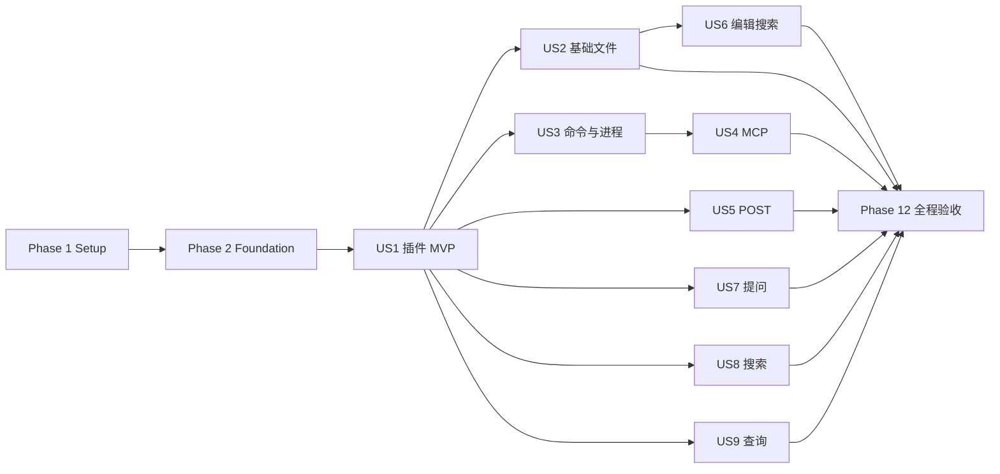

# Tasks：Tool 能力补齐与插件接入

**Input**：`specs/005-expand-tool-capabilities/` 下的 [spec.md](./spec.md)、[plan.md](./plan.md)、[research.md](./research.md)、[data-model.md](./data-model.md)、[contracts/](./contracts/) 与 [quickstart.md](./quickstart.md)。

**Branch**：`specs/005-expand-tool-capabilities` · **生成日期**：2026-11-18 · **状态**：实施中，按阶段验证后勾选。

**Tests**：规格FR-045–048与SC-001–014明确要求全程行为证据，仓库要求测试先行，因此包含测试任务。每组测试先写并确认针对目标行为的红灯，测试fixtures和必要最小签名骨架先串行建立，不用编译失败冒充行为红灯；随后实现并确认绿灯。测试替身不代替真实Manager和PostgreSQL闭环。

**Organization**：Phase1/2为共享基础，Phase3–11按US1–9及P1→P2排序，Phase12为跨故事门禁。全部路径相对仓库根；未来新文件在实施时创建。本文件不触发实现、外部联调或提交。

## 格式与执行约定

- 每个任务采用 `- [ ] Tnnn [P?] [USn?] 描述 + 精确文件路径`；仅故事阶段有US标签。
- `[P]` 只标出同组可独立编写的不同文件，前提是此前阶段和列明依赖已完成；不代表自动启用多代理。
- 默认按编号串行；同组[P]可并行。共用ToolAutoConfiguration/WhitelistSandbox/AgentProfile/循环等文件的实现任务串行。
- 每个故事末任务负责定向验证、可重放Demo及证据；每个任务完成并通过其适用验证后即标[X]，故事Demo完成后再宣告US完成。跨阶段依赖以末尾依赖表为准。
- 保留用户/前序改动，当前checkout工作，不建worktree；不读/打印.env，凭证只用环境引用；不改constitution和checklist勾选，不自动提交/推送/合并/发布。
- 核心约束：只经注入Manager执行；先审计后副作用；共享10/10/30默认调用限制、30s整轮/工具默认预算与1s清理；不因重试/重连重置预算。所有来源的错误、历史、事件和结果都要脱敏/有界。
- 每个新增工具都覆盖正常、未授权、参数错误、资源上限、超时/取消、租约与审计路径，记录实际动作次数和下一次模型回填。临时工作区/本地服务/独立PostgreSQL是默认验收环境；缺真实外部依赖为NOT_RUN。
- 文件保证为用户确认的可信单机协作写入：外部写方遵守同一稳定sidecar协议、管理员维持目录结构；不声称抵御任意非协作进程的最后检查竞态。
- 项目既有模块/版本/迁移/质量门直接沿用；不创建H2/SQLite或额外Tool模块，不提前实现记忆、通知、调度、完整会话API或通用策略引擎。

## Phase 1: Setup — 基线与隔离验证基础

**目标**：保留当前 checkout 的改动，建立005验证输入和安全证据格式，不新增模块或工作树。

**独立验证/完成标准**：配置/依赖仍遵守JDK21、Central和原质量门；测试基础不触发真实外部请求。

- [X] T001 在当前检出目录核对 git status、constitution、CLAUDE.md、005设计与004回归入口，把JDK21/Maven/Docker可用性和未提交文件基线记录到 `specs/005-expand-tool-capabilities/implementation-baseline.md`；不读取.env、不改checklist。

- [X] T002 在 `AgentOS-tool/pom.xml` 显式声明直接使用的官方MCP Jackson3校验器依赖并沿用BOM；在 `pom.xml` 增加 external-tools profile/tag，普通verify排除llm,external-tools、显式profile只选对应标签，保留现有质量规则；显式依赖：T001。

- [X] T003 [P] 在 `AgentOS-boot/src/test/java/com/agentos/boot/support/ToolAcceptanceModel.java` 增加脚本化模型与请求捕获替身，暴露可见定义、原tool_call_id和下一次模型回填；不外呼、不记录原始敏感参数；显式依赖：T002。

- [X] T004 [P] 在 `AgentOS-tool/src/test/java/com/agentos/tool/support/ToolContractFixtures.java` 建立临时目录、本地HTTP计数器、可控时钟/取消及进程测试入口；确保测试只回收自己创建的资源，不能把外层清理当工具清理成功；显式依赖：T002。

- [X] T005 [P] 在 `specs/005-expand-tool-capabilities/fixtures/acceptance-evidence.schema.json` 定义PASS/FAIL/NOT_RUN、Asia/Shanghai时间、命令、实际动作/审计/清理计数、20次样本、p95和安全证据位置；未执行不得填PASS；显式依赖：T002。

**Checkpoint**：完成本阶段定向验证并保存证据后再推进；测试未运行/失败不可写PASS。

## Phase 2: Foundational — 快照、scope与原治理链

**目标**：为所有故事建立一次解析的授权快照、来源身份、有界I/O和先审计执行；不提前实现具体工具。

**独立验证/完成标准**：未知本地名在建轮次前失败；同一轮次定义/执行绑定一致；先审计零绕过；004语义不退化。

### 测试先行

- [X] T006 [P] 先在 `AgentOS-core/src/test/java/com/agentos/core/tool/ToolCatalogSnapshotTest.java` 测试不可变快照、声明顺序、可见/执行集合分离及原source绑定，禁止模型迭代重新解析目录。

- [X] T007 [P] 先在 `AgentOS-core/src/test/java/com/agentos/core/tool/ToolExecutionScopeTest.java` 测试工具/整轮较小deadline、取消/租约checkpoint、资源登记幂等清理和共享1s窗口，不能按资源续时。

- [X] T008 [P] 先在 `AgentOS-tool/src/test/java/com/agentos/tool/govern/GovernedScopeContractTest.java` 覆盖schema拒绝、真实来源、审计begin失败零动作、complete未知不重放、结构化结果合法截断及非合作委托的状态不确定。

- [X] T009 [P] 先在 `AgentOS-boot/src/test/java/com/agentos/boot/ToolSnapshotBeforeTurnIntegrationTest.java` 用PostgreSQL和假模型验证创建轮次前仅resolve一次，模型集合和执行集合来自同快照，未授权/非法批次/限次路径均关联原调用身份。

- [X] T010 [P] 先在 `AgentOS-tool/src/test/java/com/agentos/tool/http/HttpIoScopeContractTest.java` 覆盖连接/响应头/持续正文同一deadline、字节超限、实际取消及敏感异常不外泄，并保留既有GET跳转逐跳授权回归。

### 实现、集成与演示

- [X] T011 在 `AgentOS-core/src/main/java/com/agentos/core/tool/ToolDescriptor.java`、`AgentOS-core/src/main/java/com/agentos/core/tool/ToolSourceDescriptor.java`、`AgentOS-core/src/main/java/com/agentos/core/tool/ToolCatalogSnapshot.java` 和现有`AgentOS-core/src/main/java/com/agentos/core/tool/ToolCatalog.java`定义端口/模型；落实“唯一公开名，`[A-Za-z0-9_-]{1,64}`；本地禁止 `mcp_` 前缀”“非空，查询/模型共享，最大 4000 字符，先脱敏”，source为builtin/java:<safe-bean-id>/mcp:<server-id>/unknown，metadata“官方 ToolMetadata，保留 returnDirect”，callback“不序列化到查询”；availability为AVAILABLE/UNAVAILABLE/UNCONFIGURED，非法注册不发布。 字段inputSchema约束原文：“object schema，缺省/2020-12，≤64 KiB、深度≤64，只允许本地引用”。 字段source约束原文：“`builtin`、`java:<safe-bean-id>`、`mcp:<server-id>`；未知请求为 `unknown`”。 字段originalName约束原文：“MCP 原始工具名，仅内部映射，不能凭名称回退其他来源”。 字段policy约束原文：“现有 ToolPolicy：idempotent、timeout、maxResultChars”。 字段callback约束原文：“内部原始 callback，发布执行集合时只给治理后的回调，不序列化到查询”。 字段registrationIdentity约束原文：“Bean/方法/回调对象身份，用于同对象重复发现去重”。 字段availability约束原文：“AVAILABLE / UNAVAILABLE / UNCONFIGURED；非法注册不作为可用项发布”。 字段generation约束原文：“MCP 客户端代次；本地为固定注册版本”；显式依赖：T006。

- [X] T012 在 `AgentOS-core/src/main/java/com/agentos/core/tool/ToolExecutionScope.java` 和 `AgentOS-core/src/main/java/com/agentos/core/turn/ToolContextKeys.java` 实现“turn/call 身份、有效 deadlineNanos、共享 TurnExecutionBudget 引用、checkpoint、资源取消登记、执行状态 NOT_STARTED / POSSIBLY_STARTED / COMPLETED、cleanupConfirmed 与安全原因”；“该对象不作为模型参数、不持久化、不传 MCP”，只用内部显式键；显式依赖：T007, T011。

- [X] T013 在 `AgentOS-tool/src/main/java/com/agentos/tool/registry/ToolDefinitionValidator.java` 和`AgentOS-tool/src/main/java/com/agentos/tool/registry/ToolRegistry.java`实现“object schema，缺省/2020-12，≤64 KiB、深度≤64，只允许本地引用”；显式复用DefaultJsonSchemaValidator，递归拒绝外部$ref/$dynamicRef等资源解析；最终调用validateToolCallbacks，校验失败不能覆盖旧目录；显式依赖：T008, T011。

- [X] T014 同步 `AgentOS-storage/src/main/java/com/agentos/storage/audit/JpaToolInvocationRecorder.java` 的来源校验（沿用既有字段，无迁移），在 `AgentOS-tool/src/main/java/com/agentos/tool/govern/GovernedToolCallback.java` 注入descriptor/scope，begin确认后才允许参数校验和委托动作，执行/清理/审计共享原budget；保持“同一 begin/complete 更新”“attempts 记录真实尝试”，状态保留“in_progress/success/failed/timeout/sandbox_denied/limit_skipped/interrupted/unconfirmed”；默认模型10/单工具10/总工具30/整轮30秒/结果10000字符，只有明确未开始的幂等瞬时失败最多重试一次；显式依赖：T012, T013。

- [X] T015 在 `AgentOS-core/src/main/java/com/agentos/core/turn/ToolExecutor.java` 和 `AgentOS-tool/src/main/java/com/agentos/tool/govern/UnknownToolResolver.java` 从本轮binding取得来源及拒绝回调，覆盖非法整批JSON、未授权及Manager跳过限次的审计；unknown只拒绝，禁止解析同名Bean/Function或另建Manager；显式依赖：T014。

- [X] T016 在 `AgentOS-core/src/main/java/com/agentos/core/turn/DefaultAgentService.java` 和`AgentOS-core/src/main/java/com/agentos/core/turn/ReActLoop.java`建轮次前一次resolve并显式传递“version / capturedAt”“所有有效注册与来源安全状态的不可变视图”“本轮已加载 Profile 的授权副本”；modelCallbacks按声明顺序可见，executionCallbacks含拒绝回调，bindingByName固定原source/generation，不按下一迭代刷新。 字段version / capturedAt约束原文：“一次原子目录读取的版本和时间”。 字段modelCallbacks约束原文：“按 tools 声明顺序的已授权且可用治理回调”。 字段executionCallbacks约束原文：“同一授权集合的治理回调，包含不可用/未配置的拒绝回调”。 字段bindingByName约束原文：“原公开名到 descriptor/source/generation 的固定绑定”；显式依赖：T015, T009。

- [X] T017 在 `AgentOS-tool/src/main/java/com/agentos/tool/http/BoundedHttpIo.java` 提取可复用的受限正文、同一scope截止时间与取消能力，接回`AgentOS-tool/src/main/java/com/agentos/tool/http/HttpTools.java`既有GET；最大响应1MiB且错误无原正文/URL，不改变004逐跳白名单语义；显式依赖：T012, T010。

- [X] T018 在 `AgentOS-tool/src/main/java/com/agentos/tool/registry/ToolRegistry.java` 和 `AgentOS-tool/src/main/java/com/agentos/tool/ToolAutoConfiguration.java` 分离描述目录/来源维护与可执行治理回调创建，保留最小工具授权、单个注入Manager、异常处理器和空工具集合；目录快照版本原子发布，不为只读模式预留假审计器；显式依赖：T016, T017。

- [X] T019 执行core/tool定向测试、ToolSnapshotBeforeTurnIntegrationTest及ArchitectureRulesTest，记录真实红绿灯、PostgreSQL执行/跳过情况和004回归到 `specs/005-expand-tool-capabilities/foundation-results.md`；失败先修复，不进入故事实现；显式依赖：T018。

**Checkpoint**：完成本阶段定向验证并保存证据后再推进；测试未运行/失败不可写PASS。

## Phase 3: User Story 1 — 接入企业自定义工具 (P1，MVP)

**目标**：企业Spring @Tool及显式回调进入相同授权/治理路径，不修改循环。

**独立验证/完成标准**：查询类和副作用插件授权可执行、未授权/审计begin失败零执行；重名/非法定义被拒绝且无双重注册。

### 测试先行

- [X] T020 [P] [US1] 先在 `AgentOS-tool/src/test/java/com/agentos/tool/registry/ToolPluginRegistrationTest.java` 覆盖@Tool Bean、显式callback、代理Bean、同对象重复发现、不同对象重名/保留前缀/schema错误，断言旧目录不被覆盖。

- [X] T021 [P] [US1] 先在 `AgentOS-tool/src/test/java/com/agentos/tool/registry/ToolPluginPolicyTest.java` 覆盖注解/显式策略、默认非幂等/30s/10000、ToolContext隐参、returnDirect、结果上限/超时、幂等但已开始失败不重试。

- [X] T022 [P] [US1] 先在 `AgentOS-boot/src/test/java/com/agentos/boot/PluginToolAcceptanceIntegrationTest.java` 加测试查询/副作用插件，使用真实Manager/PostgreSQL验证授权矩阵、审计失败零动作、callId与下一次模型结果、受控重试/审计终态未知，源码不更改循环。

### 实现、集成与演示

- [X] T023 [US1] 在 `AgentOS-tool/src/main/java/com/agentos/tool/annotation/ToolPolicy.java` 和 `AgentOS-tool/src/main/java/com/agentos/tool/registry/ToolRegistration.java` 定义治理元数据；保持core同名record不变，registrationIdentity为“Bean/方法/回调对象身份，用于同对象重复发现去重”，无声明“默认非幂等、30s、10000 字符”；显式依赖：T021。

- [X] T024 [US1] 在 `AgentOS-tool/src/main/java/com/agentos/tool/registry/ToolPolicyResolver.java` 合并内置/Java显式策略与安全默认值，校验正超时/有效结果长度，拒绝不支持的Optional/异步/reactive/Function签名，不把内部ToolContext写入模型schema；显式依赖：T023。

- [X] T025 [US1] 在 `AgentOS-tool/src/main/java/com/agentos/tool/registry/JavaToolDiscovery.java` 基于Spring实际目标类型发现方法，经ToolCallbacks.from生成并保留代理调用，收集显式callback，按注册身份去重而非按名字吞冲突；禁止扫描Agent/Skill或创建备用执行器；显式依赖：T020, T024。

- [X] T026 [US1] 在 `AgentOS-tool/src/main/java/com/agentos/tool/ToolAutoConfiguration.java` 将Java发现结果和固定内置描述一次校验发布，避免扫描自己的治理callback造成二次包装；每个条目携带java安全来源，schema错误只报告来源/名；显式依赖：T025。

- [X] T027 [US1] 运行插件契约和PluginToolAcceptanceIntegrationTest并在 `specs/005-expand-tool-capabilities/us1-demo.md` 交付新增Spring Bean/显式callback的接入步骤、重放命令及动作/审计证据；证明无循环修改，MVP仅到US1，不称其他10工具已支持；显式依赖：T026, T022。

**Checkpoint**：完成本阶段定向验证并保存证据后再推进；测试未运行/失败不可写PASS。

## Phase 4: User Story 2 — 在授权目录内读写文件 (P1)

**目标**：交付read_file/write_file/list_dir及协作锁下的原子文件提交。

**独立验证/完成标准**：允许根内读写可读回；读写权限独立，软链接最终目标授权；拒绝和提交前故障不破坏原文、不留下半成品。

### 测试先行

- [X] T028 [P] [US2] 先在 `AgentOS-tool/src/test/java/com/agentos/tool/file/FileToolsContractTest.java` 覆盖严格UTF-8/普通文件/读取增长、create/显式overwrite、父目录缺失、仅写不读、直接子项排序及200项截断、合法JSON结果和原始1MiB字节边界。

- [X] T029 [P] [US2] 先在 `AgentOS-tool/src/test/java/com/agentos/tool/file/FileWriteAtomicityTest.java` 注入临时写/force/复核/发布故障、创建碰撞、协作并发、父目录/目标版本变化、硬链接/原子move不支持；断言拒绝原文不变且提交后清理失败不重放。

- [X] T030 [P] [US2] 先在 `AgentOS-tool/src/test/java/com/agentos/tool/sandbox/FileAccessSandboxTest.java` 覆盖默认拒绝、组件同名前缀、相对/绝对穿越、最终允许/越界软链接、新文件真实父目录和受保护锁根；核对越界内容/路径零泄漏。

- [X] T031 [P] [US2] 先在 `AgentOS-boot/src/test/java/com/agentos/boot/FileToolsAcceptanceIntegrationTest.java` 经假模型→真实Manager→PostgreSQL验证三工具可见/调用、审计拒绝/终态未知、取消/租约/上限及原callId回填，真实磁盘内容按预期改变或保持。

### 实现、集成与演示

- [X] T032 [US2] 在 `AgentOS-tool/src/main/java/com/agentos/tool/file/FileToolProperties.java` 和`AgentOS-tool/src/main/java/com/agentos/tool/file/FileAccessPolicy.java`落实“工作根、读允许根、写允许根、管理员维护的锁根；默认读写根均空”“工作根不是自动授权”；max-file-bytes=1048576/max-results=200/max-scan-entries=1000/timeout=30s，正数且只可收紧；显式依赖：T028, T030。

- [X] T033 [US2] 在 `AgentOS-tool/src/main/java/com/agentos/tool/file/FileTargetResolver.java`、`AgentOS-tool/src/main/java/com/agentos/tool/file/FileTargetVersion.java`和现有`AgentOS-tool/src/main/java/com/agentos/tool/sandbox/WhitelistSandbox.java`实现canonical组件授权及FILE_READ/FILE_WRITE分支；保存“真实父目录/fileKey、目标是否存在、fileKey、size、mtime”，新目标真实父目录先授权，“不能为仅写授权读取旧正文”，实际I/O前再核对；显式依赖：T032。

- [X] T034 [US2] 在 `AgentOS-tool/src/main/java/com/agentos/tool/file/FileWriteCoordinator.java` 实现“规范目标的进程内锁 + 稳定 sidecar FileLock”；sidecar为“真实绝对目标路径 UTF-8 SHA-256 的十六进制加 `.lock`”，同部署锁根，“锁文件不随每次释放删除”“锁顺序固定按路径排序”，等待受scope，禁止模型读写锁根；显式依赖：T033, T029。

- [X] T035 [US2] 在 `AgentOS-tool/src/main/java/com/agentos/tool/file/AtomicFileCommitter.java` 实现“同父目录不可预测临时文件、待提交字节数、预期版本、提交状态”“UTF-8 正文和编辑后的结果各≤1 MiB，父目录必须存在”；0600临时写全+force，复核后createLink默认不覆盖、显式覆盖ATOMIC_MOVE，不支持安全失败，COMMITTED后不能报未执行；显式依赖：T034。

- [X] T036 [US2] 在 `AgentOS-tool/src/main/java/com/agentos/tool/file/FileTools.java` 实现read_file(path)和list_dir(path,limit)，严格解码有界读至上限+1检测增长，列表只直接子项且有界枚举后排序；返回安全path/name/type和truncated/incomplete/skipped，不披露锁/临时文件；显式依赖：T033。

- [X] T037 [US2] 在 `AgentOS-tool/src/main/java/com/agentos/tool/file/FileTools.java` 实现write_file(path,content,overwrite=false)，默认存在冲突零覆盖，调用协作锁/原子提交并在动作/提交前checkpoint；不隐式建目录，不把写授权等同读授权，报告bytesWritten/committed或安全错误；显式依赖：T036, T035。

- [X] T038 [US2] 在 `AgentOS-tool/src/main/java/com/agentos/tool/ToolAutoConfiguration.java` 装配文件策略和三工具，read_file/list_dir幂等、write_file不重试，均30s/10000字符；与现有HTTP白名单共存且默认文件权限仍空；显式依赖：T037。

- [X] T039 [US2] 运行文件单元/契约/应用级测试，在 `specs/005-expand-tool-capabilities/us2-demo.md` 记录临时工作区重放命令、能力检测、软链接及创建/覆盖证据；明确可信单机协作写入前提，不能宣传防任意外部竞态；显式依赖：T038, T031。

**Checkpoint**：完成本阶段定向验证并保存证据后再推进；测试未运行/失败不可写PASS。

## Phase 5: User Story 3 — 执行明确授权的本地命令 (P1)

**目标**：交付shell及供MCP复用的宿主进程治理。

**独立验证/完成标准**：特殊argv不产生额外命令，未授权零启动；环境白名单生效，洪泛无堵塞，超时/取消的受控进程树退出或明确未确认。

### 测试先行

- [X] T040 [P] [US3] 先在 `AgentOS-tool/src/test/java/com/agentos/tool/process/ShellToolsContractTest.java` 覆盖独立argv/特殊字符、非法程序/cwd/PATH替换、非零退出、stdout/stderr合计64KiB和截断、无NUL/≤128参数/参数UTF-8≤64KiB以及默认不重试。

- [X] T041 [P] [US3] 先在 `AgentOS-tool/src/test/java/com/agentos/tool/process/ManagedProcessTest.java` 覆盖持续输出、根/子进程、未授权宿主秘密env不可读/显式业务env可读、提前取消和未确认清理；超时与取消各20次在预算+1s内确认受控树退出。

- [X] T042 [P] [US3] 先在 `AgentOS-boot/src/test/java/com/agentos/boot/ShellToolsAcceptanceIntegrationTest.java` 经真实Manager/PostgreSQL验证拒绝/审计失败零启动、source/callId、上限/租约中止、取消后无新动作及下一次模型回填。

### 实现、集成与演示

- [X] T043 [US3] 在 `AgentOS-tool/src/main/java/com/agentos/tool/process/ShellToolProperties.java` 和`AgentOS-tool/src/main/java/com/agentos/tool/sandbox/WhitelistSandbox.java`实现真实executable精确授权、allowed-cwds组件授权，commands及inherit-environment默认空、输出64KiB/timeout30s；shell动作不改变文件/HTTP分支，解释器须显式授权；显式依赖：T040。

- [X] T044 [US3] 在 `AgentOS-tool/src/main/java/com/agentos/tool/process/ProcessEnvironmentPolicy.java` 用environment().clear()重建仅允许基础变量和按程序/服务显式业务变量；不从模型接收env，不因PATH换程序，“配置/argv/env 不进入目录投影”，敏感引用仅解析配置指定项；显式依赖：T043, T041。

- [X] T045 [US3] 在 `AgentOS-tool/src/main/java/com/agentos/tool/process/ManagedProcess.java` 持有真实executable/cwd、argv、最小env、根句柄/可识别后代；启动/等待/持续I/O checkpoint，scope取消时停止等待并有界强杀，cleanupConfirmed未确认明确报告，不承诺脱离后代；显式依赖：T044。

- [X] T046 [US3] 在 `AgentOS-tool/src/main/java/com/agentos/tool/process/BoundedProcessOutput.java` 并发排空stdout/stderr，共享64KiB保留预算，超额丢弃但继续排空；输出“按 UTF-8 替换解码处理进程字节”，返回exitCode/truncated，不混用文件严格解码；显式依赖：T045。

- [X] T047 [US3] 在 `AgentOS-tool/src/main/java/com/agentos/tool/process/ShellTools.java` 实现shell(executable,args=[],cwd=工作根)，直传ProcessBuilder参数、不隐式sh -c；取得授权后用ManagedProcess/scope执行，返回契约字段，失败或超时绝不自动重跑；显式依赖：T046。

- [X] T048 [US3] 在 `AgentOS-tool/src/main/java/com/agentos/tool/ToolAutoConfiguration.java` 注册shell非幂等30s/10000字符并装配进程资源关闭；不得仅靠Future.cancel声称已结束OS动作；显式依赖：T047。

- [X] T049 [US3] 运行shell/进程/应用级测试，将实际启动数、env隔离、输出截断、各20次清理样本和不确定结果写入 `specs/005-expand-tool-capabilities/us3-demo.md`；明确白名单不限制已授权程序内部文件/网络行为；显式依赖：T048, T042。

**Checkpoint**：完成本阶段定向验证并保存证据后再推进；测试未运行/失败不可写PASS。

## Phase 6: User Story 4 — 接入和维护外部MCP工具 (P1)

**目标**：交付STDIO/SSE/Streamable HTTP、稳定来源授权和后台恢复，不阻塞本地就绪。

**独立验证/完成标准**：三种传输均发现/调用/关闭；失联隐藏/零调用、恢复不增权、当前轮次不换代；无内部上下文/宿主环境泄漏。

### 测试先行

- [X] T050 [US4] 在 `AgentOS-tool/src/test/java/com/agentos/tool/support/LocalMcpServers.java` 和 `specs/005-expand-tool-capabilities/fixtures/mcp_test_server.py` 实现受控三transport协议替身、请求计数、断线/慢响应/恶意端点/清单变更开关；脚本提供三种transport模式供tool/boot各自启动，不跨模块导入测试类；服务外层清理前必须能观测客户端自身关闭。

- [X] T051 [P] [US4] 先在 `AgentOS-tool/src/test/java/com/agentos/tool/mcp/McpConfigurationContractTest.java` 覆盖三transport字段互斥、name规则、环境引用缺失/同名/YAML重复key、精确策略和未知服务，错误仅来源/字段，不泄漏地址/env；显式依赖：T050。

- [X] T052 [P] [US4] 先在 `AgentOS-tool/src/test/java/com/agentos/tool/mcp/McpTransportContractTest.java` 参数化真实本地STDIO/SSE/Streamable HTTP协议替身，覆盖initialize/list/call/close、1MiB消息上限、SSE同源相对端点/默认端口等价、跨scheme/host/有效端口的恶意message endpoint（含通用白名单内另一服务）请求与凭证接收均0、跳转拒绝、断线不重发及分页共享预算；显式依赖：T050。

- [X] T053 [P] [US4] 先在 `AgentOS-tool/src/test/java/com/agentos/tool/mcp/McpLifecycleContractTest.java` 覆盖来源state/generation、双服务同名、旧轮次不换绑、失联新轮次定义0/执行0、恢复缺失/新增工具不增权、退避上限和shutdown停止重连；永不响应来源使本地就绪增量≤1s；显式依赖：T050。

- [X] T054 [P] [US4] 先在 `AgentOS-tool/src/test/java/com/agentos/tool/mcp/McpContextIsolationTest.java` 用参数/metadata/未知内部键哨兵和远端isError/stderr/URL秘密验证noOp+空上下文双防线、原协议日志不泄漏、STDIO最小env及取消共享generation不影响其他来源；显式依赖：T050。

- [X] T055 [P] [US4] 先在 `AgentOS-boot/src/test/java/com/agentos/boot/McpToolAcceptanceIntegrationTest.java` 用PostgreSQL、脚本化模型及三transport本地替身验证服务+工具双声明、原source/callId、审计begin失败零动作、已发送未知不重放及结果回填；显式依赖：T050。

### 实现、集成与演示

- [X] T056 [US4] 在 `AgentOS-tool/src/main/java/com/agentos/tool/mcp/McpServerConfig.java`、`AgentOS-tool/src/main/java/com/agentos/tool/mcp/McpConfigurationLoader.java`落实server-id“`[a-z0-9-]{1,20}`”、transport“STDIO / SSE / STREAMABLE_HTTP”、name唯一/互斥字段/SnakeYAML安全构造，缺文件为无来源、非法YAML不能当空；逐项解析引用、env默认不继承、错误固定分类，单来源错不阻本地；显式依赖：T051。

- [X] T057 [US4] 在 `AgentOS-core/src/main/java/com/agentos/core/agent/AgentProfile.java` 和`AgentOS-core/src/main/java/com/agentos/core/agent/AgentLoader.java`解析“有序、去空白、拒绝重复的 `mcpServers`”，映射mcp_servers；“既有 tools 仍为精确公开名列表；空列表合法。旧构造器兼容为 mcpServers 空集合”，移除该字段旧unsupported提示并回归已有Agent加载；显式依赖：T056。

- [X] T058 [US4] 在 `AgentOS-tool/src/main/java/com/agentos/tool/mcp/ToolSourceState.java` 和`AgentOS-tool/src/main/java/com/agentos/tool/mcp/McpClientGeneration.java`落实“CONFIGURED、CONNECTING、AVAILABLE、UNAVAILABLE、CLOSING、CLOSED”“成功连接实例的单调版本，不复用旧实例身份”“上次验证通过的定义；失联保留；未发现时允许为空”“一旦失效不可复活；恢复必须新建 generation”；safeReason只固定分类，client/ownedProcess/streams“仅内部；不得出现在日志、模型或查询”。 字段sourceId / transport约束原文：“配置稳定 server-id；STDIO / SSE / STREAMABLE_HTTP”。 字段safeReason约束原文：“固定分类：CONNECT_FAILED、TIMEOUT、INVALID_DEFINITION、DENIED、CLOSED 等”。 字段nextReconnectAt / failures约束原文：“1s 指数退避，上限 300s，成功清零”。 字段initDeadline约束原文：“整个初始化及分页发现的 10s 预算”；显式依赖：T056, T053。

- [X] T059 [US4] 在 `AgentOS-tool/src/main/java/com/agentos/tool/mcp/ManagedStdioTransport.java` 复用ManagedProcess及官方transport端口/mapper实现STDIO管道，持有进程与最小env、stdin/stdout消息上限1MiB、受控stderr和有界关闭；不反射SDK私有Process、不尝试覆写final ProcessBuilder、不重写MCP会话/JSON-RPC；显式依赖：T058, T046, T050。

- [X] T060 [US4] 在 `AgentOS-tool/src/main/java/com/agentos/tool/mcp/McpHttpTransportFactory.java` 构建官方JDK SSE与Streamable HTTP transport，所有实际请求及SSE message endpoint重新域名授权，并在发请求/附加凭证前按规范化scheme/host/有效端口校验与来源配置URL同源；跨源即使命中通用白名单也拒绝，本期无跨源例外，凭证只附同源配置头；禁userinfo/非法协议/fragment/跳转、resumableStreams(false)、响应≤1MiB和connectTimeout；显式依赖：T058, T050。

- [X] T061 [US4] 在 `AgentOS-tool/src/main/java/com/agentos/tool/mcp/McpClientService.java` 编程式创建SYNC客户端，每来源虚拟线程initialize+完整分页list共享“整个初始化及分页发现的 10s 预算”，最多1000工具/单响应1MiB，requestTimeout默认30s仅作上界；启动只调度，不等待远端就绪；显式依赖：T059, T060。

- [X] T062 [US4] 在 `AgentOS-tool/src/main/java/com/agentos/tool/mcp/McpReconnectScheduler.java` 和`AgentOS-tool/src/main/java/com/agentos/tool/mcp/McpClientService.java`实现“1s 指数退避，上限 300s，成功清零”，每次重连重新授权、完整候选验证后发布新generation；关闭CLOSING→CLOSED且不再重连，任何恢复不能重放旧调用；显式依赖：T061。

- [X] T063 [US4] 在 `AgentOS-tool/src/main/java/com/agentos/tool/mcp/McpToolRegistration.java` 用官方SyncMcpToolCallbackProvider/prefix扩展映射“mcp_<server-id>__<remote-name>”，remote-name `[A-Za-z0-9_-]+`/公开名≤64；originalName“仅内部映射，不能凭名称回退其他来源”，默认非幂等30s/10000，可按工具覆盖，noOp转换器及最终重名/schema校验；显式依赖：T061。

- [X] T064 [US4] 在 `AgentOS-tool/src/main/java/com/agentos/tool/registry/ToolRegistry.java` 实现服务+公开名双授权，仅已配置/声明且不可用来源允许延迟存在性验证；未知本地/服务在建轮次前失败，已知不可用工具保留执行拒绝回调且modelCallbacks排除，恢复缺失工具新轮次前失败，固定binding不切新generation；显式依赖：T057, T063, T062。

- [X] T065 [US4] 在 `AgentOS-tool/src/main/java/com/agentos/tool/mcp/McpInvocationGuard.java` 及`AgentOS-tool/src/main/java/com/agentos/tool/mcp/McpClientService.java`按scope短deadline/取消有界中止该generation；SDK无单次timeout重载，不改共享timeout/不重发；同来源在途安全失败、其他来源正常，清理/审计共享原1s并明确远程动作未知；显式依赖：T064。

- [X] T066 [US4] 在 `AgentOS-tool/src/main/java/com/agentos/tool/mcp/McpSafeDiagnostics.java`、`AgentOS-boot/src/main/resources/application.yaml` 关闭官方MCP原始callback/session/transport内容日志，替换stderr处理，仅输出安全来源/分类/关联ID；凭证加入Redactor已知秘密集，调用前另建默认空远程上下文，不采用内部键黑名单；显式依赖：T065, T054。

- [X] T067 [US4] 在 `AgentOS-tool/src/main/java/com/agentos/tool/ToolAutoConfiguration.java` 装配来源配置、官方callback、后台维护和关闭生命周期，保持spring.ai.mcp.client.enabled=false，不重复自动创建客户端或Manager，来源失败不阻本地注册；显式依赖：T066。

- [X] T068 [US4] 运行三transport契约/生命周期/隐私及McpToolAcceptanceIntegrationTest，将发现/调用/关闭计数、就绪差、失联隐藏/恢复/缺失/新工具/旧代次及env哨兵证据写入 `specs/005-expand-tool-capabilities/us4-demo.md`；外部MCP未跑单列NOT_RUN；显式依赖：T067, T055。

**Checkpoint**：完成本阶段定向验证并保存证据后再推进；测试未运行/失败不可写PASS。

## Phase 7: User Story 5 — 向授权地址提交数据 (P2)

**目标**：交付http_post的一次提交与未知完成状态。

**独立验证/完成标准**：合法正文原目标收到一次；前置拒绝0请求，跳转下一跳0；send后超时/断线或完成审计未知均不重发并说明可能生效。

### 测试先行

- [X] T069 [P] [US5] 先在 `AgentOS-tool/src/test/java/com/agentos/tool/http/HttpPostContractTest.java` 覆盖text/plain/application/json及默认值、非法JSON/协议/userinfo/域名/请求超限零请求、2xx传输成功与业务正文区别、非2xx/超大响应不回显以及30x下一跳0次。

- [X] T070 [P] [US5] 先在 `AgentOS-tool/src/test/java/com/agentos/tool/http/HttpPostDeadlineTest.java` 覆盖接收正文后断线/慢头/慢正文/取消/租约失效，检查原目标实际请求≤1和提交可能生效；验证底层客户端无隐式POST重发，而非只断言policy=false。

- [X] T071 [P] [US5] 先在 `AgentOS-boot/src/test/java/com/agentos/boot/HttpPostAcceptanceIntegrationTest.java` 验证真实Manager/PostgreSQL、授权可见/拒绝、审计begin失败0请求、complete未确认不重发、原callId下一次模型回填与秘密脱敏。

### 实现、集成与演示

- [X] T072 [US5] 在 `AgentOS-tool/src/main/java/com/agentos/tool/http/HttpToolProperties.java` 增加max-request-bytes默认且最大1048576，保留现有GET配置/构造兼容；POST请求/响应各1MiB，内容只UTF-8文本或JSON，不向模型开放任意headers/认证；显式依赖：T069。

- [X] T073 [US5] 在 `AgentOS-tool/src/main/java/com/agentos/tool/http/HttpTools.java` 实现http_post(url,body,content_type="application/json")，前置schema/JSON/授权/大小/scope检查，复用BoundedHttpIo，固定禁跳转/重发；send后失败保守“提交可能已生效”，成功返回status/body/truncated/completion，错误无原正文/敏感异常；显式依赖：T072, T070。

- [X] T074 [US5] 在 `AgentOS-tool/src/main/java/com/agentos/tool/ToolAutoConfiguration.java` 按方法为http_get与http_post分别设置幂等策略，POST恒非幂等/30s/10000，不因与GET同Bean而误用可重试策略；显式依赖：T073。

- [X] T075 [US5] 运行POST契约/截止时间/应用级测试，将前置0次、原目标≤1、跳转0次、已发故障/审计未知的计数和重放命令写入 `specs/005-expand-tool-capabilities/us5-demo.md`；不把HTTP2xx等同业务成功；显式依赖：T074, T071。

**Checkpoint**：完成本阶段定向验证并保存证据后再推进；测试未运行/失败不可写PASS。

## Phase 8: User Story 6 — 精确编辑和搜索工作区文件 (P2)

**目标**：复用文件授权/协作提交，新增edit_file/grep/glob。

**独立验证/完成标准**：唯一匹配只改一处，空/零/多/重叠匹配、版本变化及失败不改原文；搜索区分完整空、截断和不完整，越界内容0。

### 测试先行

- [X] T076 [P] [US6] 先在 `AgentOS-tool/src/test/java/com/agentos/tool/file/EditFileContractTest.java` 覆盖读写双授权、空旧文本拒绝、纯空格/换行/缩进旧文本唯一匹配可替换且不trim/重叠起点计数、零/多匹配、原文/结果1MiB、协作并发摘要变化与提交故障，断言失败原文不变。

- [X] T077 [P] [US6] 先在 `AgentOS-tool/src/test/java/com/agentos/tool/file/FileSearchContractTest.java` 覆盖字面grep/1起行号、glob的*/?/**及非法模式、200结果/1000扫描/单文件1MiB、非UTF8/超大/目录软链/越界、排序及完整空与不完整区别。

- [X] T078 [P] [US6] 先在 `AgentOS-boot/src/test/java/com/agentos/boot/FileSearchAcceptanceIntegrationTest.java` 经真实Manager/PostgreSQL验证三工具授权/审计零动作、取消/租约/上限/原callId和下轮回填；安全抽样不含越界路径/文件内容。

### 实现、集成与演示

- [X] T079 [US6] 在 `AgentOS-tool/src/main/java/com/agentos/tool/file/FileEditTools.java` 实现edit_file，复用FileWriteCoordinator/AtomicFileCommitter，“编辑另有原内容摘要”且提交前复核，“UTF-8 正文和编辑后的结果各≤1 MiB”；old_text长度>0（纯空白合法、不trim）且恰好一次才替换，绝不自动重试；显式依赖：T076, T039。

- [X] T080 [US6] 在 `AgentOS-tool/src/main/java/com/agentos/tool/file/BoundedFileScanner.java` 实现逐项授权/checkpoint和不跟随目录软链接的有界枚举，扫描含枚举本身≤1000、读取每文件≤1MiB、结果≤200；跳过只安全计数，不收集全目录后才截断，排除锁/临时文件；显式依赖：T077, T039。

- [X] T081 [US6] 在 `AgentOS-tool/src/main/java/com/agentos/tool/file/FileSearchTools.java` 基于scanner实现grep(path,text,limit)，字面且区分大小写、每行一次匹配、行号1起，输出相对path/line/受限content并排序；truncated/incomplete/skipped相互独立；显式依赖：T080。

- [X] T082 [US6] 在 `AgentOS-tool/src/main/java/com/agentos/tool/file/FileSearchTools.java` 实现glob(path,pattern,limit)，/分隔、仅*/?/**、pattern≤1000字符；拒绝绝对模式/../NUL/字符类/大括号，返回安全相对路径排序，不把零命中不完整说成无结果；显式依赖：T081。

- [X] T083 [US6] 在 `AgentOS-tool/src/main/java/com/agentos/tool/ToolAutoConfiguration.java` 注册edit_file非幂等、grep/glob幂等，使用相同文件策略/30s/10000；结构化条目先有界裁剪再统一治理，保持JSON和不完整标记；显式依赖：T082, T079。

- [X] T084 [US6] 运行编辑/搜索/应用级测试，在 `specs/005-expand-tool-capabilities/us6-demo.md` 记录唯一替换、并发拒绝、扫描截断/跳过分类/越界零泄漏和安全重放命令；核对read/write/list回归；显式依赖：T083, T078。

**Checkpoint**：完成本阶段定向验证并保存证据后再推进；测试未运行/失败不可写PASS。

## Phase 9: User Story 7 — 在支持交互的入口询问用户 (P2)

**目标**：新增ask_user和显式入口能力，统一CLI输入所有权。

**独立验证/完成标准**：支持交互回答只回原调用，不支持20次均<1s；EOF/BUSY/超长明确，取消后迟到误交付0，无无限输入线程。

### 测试先行

- [X] T085 [P] [US7] 先在 `AgentOS-core/src/test/java/com/agentos/core/interaction/InteractionPortContractTest.java` 测试默认UNSUPPORTED、原轮次request/call身份、问题/回答4000边界、终态不再收答案和deadline/取消/租约约束；旧process重载不等待。

- [X] T086 [P] [US7] 先在 `AgentOS-cli/src/test/java/com/agentos/cli/AskUserInputOwnershipTest.java` 用可控输入覆盖聊天/提问同一owner、读开始前generation归属、EOF/BUSY/超长、持续无换行超长输入、取消后迟到行丢弃和后续聊天不串用；断言保留量≤max-answer-chars+1及固定大小读取缓冲，首个超限字符立即TOO_LONG、丢弃余行不缓存、等待可取消且阻塞reader数量不增长。

- [X] T087 [P] [US7] 先在 `AgentOS-boot/src/test/java/com/agentos/boot/AskUserAcceptanceIntegrationTest.java` 经真实Manager/PostgreSQL验证原callId回填、不新增轮次、begin审计失败不提问、问题/答案脱敏、无人值守20次<1s以及取消/租约中止。

### 实现、集成与演示

- [X] T088 [US7] 在 `AgentOS-core/src/main/java/com/agentos/core/interaction/InteractionPort.java`、`AgentOS-core/src/main/java/com/agentos/core/interaction/InteractionRequest.java`、`AgentOS-core/src/main/java/com/agentos/core/interaction/InteractionResult.java`和`AgentOS-core/src/main/java/com/agentos/core/interaction/TurnRuntimeCapabilities.java`落实“唯一 requestId、turnId、toolCallId、≤4000 字符的安全问题、有效 deadline”“ANSWERED、UNSUPPORTED、EOF、BUSY、TOO_LONG、TIMED_OUT、CANCELLED”，状态CREATED→WAITING→ANSWERED或其他终态；端口默认UNSUPPORTED，能力不进Profile/schema/MCP；显式依赖：T085。

- [X] T089 [US7] 在 `AgentOS-core/src/main/java/com/agentos/core/turn/AgentService.java`、`AgentOS-core/src/main/java/com/agentos/core/turn/DefaultAgentService.java`、`AgentOS-core/src/main/java/com/agentos/core/turn/ReActLoop.java`和`AgentOS-core/src/main/java/com/agentos/core/turn/ToolExecutor.java`增加能力重载并显式传入内部ToolContext；旧重载保持不支持，禁止ThreadLocal/MDC/trigger推断，沿用原轮次/budget/租约；显式依赖：T088。

- [X] T090 [US7] 在 `AgentOS-cli/src/main/java/com/agentos/cli/CliInputBroker.java` 实现单一输入owner，阻塞读前绑定requestId/generation；“终态不可再接受回答”“迟到行丢弃，broker 未释放前新请求 BUSY”，回答用固定大小缓冲增量读，最多保留max-answer-chars+1字符，超限即TOO_LONG；同一reader丢弃余行至换行/EOF而不缓存，禁止完整readLine后才校验；超时/取消停止工具等待，底层读/丢弃未完仍由旧generation占用，不为每个提问新建阻塞reader；显式依赖：T089, T086。

- [X] T091 [US7] 在 `AgentOS-cli/src/main/java/com/agentos/cli/ChatCommand.java` 和 `AgentOS-channel-cli/src/main/java/com/agentos/channel/cli/CliChannel.java` 统一使用broker/InteractionPort，删除各自竞争读取路径；无人值守/--message显式无交互，关闭由入口管理且不把迟到行当下一条聊天；显式依赖：T090。

- [X] T092 [US7] 在 `AgentOS-tool/src/main/java/com/agentos/tool/interaction/AskUserTools.java` 实现ask_user(question)，只调显式入口能力并在scope中等待，问题/回答各≤4000，UNSUPPORTED立即返回，EOF/BUSY/TOO_LONG安全错误；不直接System.in、不重试提问；显式依赖：T091。

- [X] T093 [US7] 在 `AgentOS-tool/src/main/java/com/agentos/tool/ToolAutoConfiguration.java` 装配interaction属性和ask_user非幂等30s/10000，确认新内部能力键也在MCP空上下文防线内，审计输出不携带原秘密；显式依赖：T092。

- [X] T094 [US7] 运行交互端口/输入归属/应用级测试，并把支持/无人值守/EOF/取消/迟到样本、实际提问/轮次数及重放命令记入 `specs/005-expand-tool-capabilities/us7-demo.md`；无需人工持续守候才能验收；显式依赖：T093, T087。

**Checkpoint**：完成本阶段定向验证并保存证据后再推进；测试未运行/失败不可写PASS。

## Phase 10: User Story 8 — 搜索外部信息 (P2)

**目标**：交付真实可配置Brave提供者及web_search，默认本地协议替身验收。

**独立验证/完成标准**：有/空/未配置/拒绝/失败/超限六类正确；返回≤10、前置拒绝0请求，不访问命中页，不泄漏凭证。

### 测试先行

- [X] T095 [P] [US8] 先在 `AgentOS-tool/src/test/java/com/agentos/tool/search/WebSearchContractTest.java` 测试查询/条数/配置/地址/响应边界、空结果与截断、未配置和失败区分、JSON结构及结果链接不扩权，返回不含秘密。

- [X] T096 [P] [US8] 先在 `AgentOS-tool/src/test/java/com/agentos/tool/search/BraveSearchProviderContractTest.java` 用本地HTTP协议替身检查GET q/count与X-Subscription-Token头，映射web.results[].title/url/description；覆盖恶意/错误JSON、跳转、持续正文、超大响应、秘密错误和命中页请求0。

- [X] T097 [P] [US8] 先在 `AgentOS-boot/src/test/java/com/agentos/boot/WebSearchAcceptanceIntegrationTest.java` 经真实Manager/PostgreSQL验证UNCONFIGURED可声明但模型隐藏/旧请求安全拒绝、有配置原source/callId回填、审计begin失败0请求、取消/租约与各渠道脱敏。

### 实现、集成与演示

- [X] T098 [US8] 在 `AgentOS-tool/src/main/java/com/agentos/tool/search/SearchProvider.java`、`AgentOS-tool/src/main/java/com/agentos/tool/search/SearchProviderConfig.java`和`AgentOS-tool/src/main/java/com/agentos/tool/search/SearchResult.java`实现“provider=brave、endpoint、环境引用凭证、query/result/response 限值、timeout”“缺失必要配置为 UNCONFIGURED，不阻塞本地其他能力”“items[{title,url,snippet}]、truncated、complete；完整空 items 是成功无结果”；最多10项、不抓页面，链接“仅允许无 user-info 的 HTTP(S) 公共引用，带敏感值须脱敏或舍弃”；显式依赖：T095。

- [X] T099 [US8] 在 `AgentOS-tool/src/main/java/com/agentos/tool/search/BraveSearchProvider.java` 以公开协议/本地替身核对后实现真实HTTP适配，不依赖供应商SDK；endpoint默认Brave web/search、密钥只配置头，查询≤1000字符/结果≤10/响应≤1MiB/30s，复用BoundedHttpIo及Sandbox，禁跳转，不伪造桩成功；显式依赖：T098, T096。

- [X] T100 [US8] 在 `AgentOS-tool/src/main/java/com/agentos/tool/search/WebSearchTools.java` 实现web_search(query,limit=10)，输入/scope/授权先于请求；DENIED/UNCONFIGURED/FAILED/超大响应不能返回成功空列表，结果裁剪保持truncated/complete；不自动抓结果页；显式依赖：T099。

- [X] T101 [US8] 在 `AgentOS-tool/src/main/java/com/agentos/tool/ToolAutoConfiguration.java` 注册web_search及可用状态/安全默认策略，未配置保留目录条目但模型隐藏/拒绝回调；在 `AgentOS-boot/src/main/resources/application.yaml` 仅写环境占位，配置凭证纳入Redactor秘密集；显式依赖：T100。

- [X] T102 [US8] 运行搜索/Brave协议/应用级测试，把六类结果、请求计数/命中页0、慢响应取消和重放配置写入 `specs/005-expand-tool-capabilities/us8-demo.md`；本地协议替身通过与真实Brave联调明确区分；显式依赖：T101, T097。

**Checkpoint**：完成本阶段定向验证并保存证据后再推进；测试未运行/失败不可写PASS。

## Phase 11: User Story 9 — 查看工具目录及可用状态 (P2)

**目标**：交付tool list/tool serve及带bearer认证的只读GET /api/v1/tools。

**独立验证/完成标准**：CLI/HTTP同快照一致；Agent授权与可见性明确；本机/远程对错缺/未配token全覆盖，未认证读取目录0，查询新增模型/工具/会话/轮次0。

### 测试先行

- [X] T103 [P] [US9] 先在 `AgentOS-tool/src/test/java/com/agentos/tool/registry/ToolCatalogQueryTest.java` 验证全局/Agent视图、known不可用工具及未发现来源、UNCONFIGURED搜索、version一致与安全字段；query调用不触发发现/执行/会话，Agent未知名在本地安全报错。

- [X] T104 [P] [US9] 先在 `AgentOS-cli/src/test/java/com/agentos/cli/ToolListCommandTest.java` 覆盖tool list --agent/--json/--workspace及--config、表格和JSON、退出码0/2/1、无launcher安全错误、无需HTTP token、help/version/init不启动上下文。

- [X] T105 [P] [US9] 先在 `AgentOS-web/src/test/java/com/agentos/web/tool/ToolCatalogAuthenticationTest.java` 覆盖本机与显式远程请求正确/错误/缺失/未配置token、重复/非法头、URL token拒绝、未认证AgentLoader/目录读取0、统一401无回显、无CORS与no-store。

- [X] T106 [P] [US9] 先在 `AgentOS-boot/src/test/java/com/agentos/boot/ToolCatalogModeIntegrationTest.java` 验证目录NONE/Servlet启动模式均不加载Provider/Embedding/DB执行链、不注入假审计器；serve未启用/无有效token不监听并安全非零，MCP后台坏来源不拖本地查询。

- [X] T107 [P] [US9] 先在 `AgentOS-boot/src/test/java/com/agentos/boot/ToolCatalogQueryAcceptanceIntegrationTest.java` 给CLI/HTTP注入同一快照，按tool-query.openapi.yaml比较投影/status/授权/source；统计查询导致模型/工具/会话/轮次新增数0，包含已配置但未发现来源及秘密地址哨兵。

### 实现、集成与演示

- [X] T108 [US9] 在 `AgentOS-core/src/main/java/com/agentos/core/tool/ToolCatalogQuery.java` 和`AgentOS-core/src/main/java/com/agentos/core/tool/ToolCatalogView.java`定义version/capturedAt/agent/tools/sources安全投影，逐字段对齐OpenAPI；authorized/visible“全局查询为 null”，每项仅name/description/source/status/授权可见性，不输出callback/schema/地址/命令/env/凭证/内部上下文；agent名长度1–128；显式依赖：T103。

- [X] T109 [US9] 在 `AgentOS-tool/src/main/java/com/agentos/tool/registry/DefaultToolCatalogQuery.java` 从一次原子目录读取安全DTO，全局按公开名/来源排序，Agent按声明集展示authorized/visible及安全原因；保留不可用known条目和空来源行，不伪造未发现定义，不执行工具或同步发现；显式依赖：T108。

- [X] T110 [US9] 在 `AgentOS-cli/src/main/java/com/agentos/cli/ToolCommand.java`、`AgentOS-cli/src/main/java/com/agentos/cli/ToolListCommand.java`、`AgentOS-cli/src/main/java/com/agentos/cli/ToolServeCommand.java`、`AgentOS-cli/src/main/java/com/agentos/cli/ContextLauncher.java`和`AgentOS-cli/src/main/java/com/agentos/cli/AgentOSCli.java`增加独立目录启动端口/子命令，list输出data同形JSON/表格，serve只目录服务；standalone无launcher固定错误，不把chat launcher暗改为监听；显式依赖：T109, T104。

- [X] T111 [US9] 在 `AgentOS-web/src/main/java/com/agentos/web/tool/ToolCatalogAuthenticationFilter.java` 和`AgentOS-web/src/main/java/com/agentos/web/tool/ToolQueryProperties.java`实现环境引用token、有效长度16–4096 UTF-8字节、bind默认127.0.0.1/非回环显式/port1–65535；仅Authorization Bearer，常量时间摘要比较，缺错重复非法统一401且早于读目录/Agent，无token入口不装配，URL token不采纳；显式依赖：T105, T108。

- [X] T112 [US9] 在 `AgentOS-web/src/main/java/com/agentos/web/tool/ToolCatalogController.java`、`AgentOS-web/src/main/java/com/agentos/web/tool/ToolCatalogWebConfiguration.java`、现有`AgentOS-core/src/main/java/com/agentos/core/error/ErrorCode.java`及`AgentOS-web/src/main/java/com/agentos/web/api/GlobalExceptionHandler.java`加入只读路由/UNAUTHORIZED映射；Filter直接输出ApiResponse固定“未认证”/data=null，200/400/401/404/500字段符合OpenAPI，no-store且排除旧WebConfig通配CORS；显式依赖：T111, T109。

- [X] T113 [US9] 在 `AgentOS-boot/src/main/java/com/agentos/boot/ToolCatalogContextLauncher.java`、`AgentOS-boot/src/main/java/com/agentos/boot/ToolCatalogApplication.java`及`AgentOS-boot/src/main/java/com/agentos/boot/SpringContextLauncher.java`提供目录NONE与独立Servlet装配，执行链/审计仍仅真实执行模式装配，query.enabled+有效token才监听；目录查询不依赖DB/模型就绪，MCP仅后台维护；显式依赖：T110, T112, T106。

- [X] T114 [US9] 运行查询投影/CLI/认证/目录模式/一致性集成测试，将本机和显式远程四类token、同快照对比、认证前0读取/0业务新增及安全启动命令写入 `specs/005-expand-tool-capabilities/us9-demo.md`；远程使用部署加密链路，不把token放URL/日志/命令参数；显式依赖：T113, T107。

**Checkpoint**：完成本阶段定向验证并保存证据后再推进；测试未运行/失败不可写PASS。

## Phase 12: Polish — 跨故事闭环、演示和质量门

**目标**：验证10个新增工具及所有来源全程闭环，更新真实状态并执行最终门禁。

**独立验证/完成标准**：SC-001–014有可定位证据，004回归与005数据库关键类实际执行，真实外部未跑明确NOT_RUN，绝不降门禁。

### 测试先行

- [X] T115 [P] 在 `AgentOS-boot/src/test/java/com/agentos/boot/ToolCapabilityMatrixIntegrationTest.java` 增加10新工具+既有http_get的模型可见/实际执行/授权零动作/错误输入含未知字段/资源上限/取消/审计begin与complete/原callId回填矩阵；真实Manager和PostgreSQL贯穿所有来源，保留004受控重试/恢复回归。

- [X] T116 [P] 在 `AgentOS-boot/src/test/java/com/agentos/boot/ToolCapabilitiesDeadlineIntegrationTest.java` 实现慢正文/MCP等待/持续命令输出/交互等待/持续搜索响应各20次，先独立预热且样本内不重置deadline，逐样本确认动作开始和清理，p95为第19值且≤预算+1000ms；审计与资源清理共享1s，外层shutdown不能充当通过证据。

- [X] T117 [P] 在 `AgentOS-boot/src/test/java/com/agentos/boot/ToolCapabilitiesPrivacyIntegrationTest.java` 对结果/事件/历史/日志/审计/查询植入测试秘密与内部上下文哨兵，加入US7新增能力键后回归MCP隔离，检查shell/STDIO未获准宿主env不可读、显式业务值不进入日志/目录。

- [X] T118 先在 `AgentOS-boot/src/test/java/com/agentos/boot/llm/DemoEvaluationIntegrationTest.java` 交付三个Demo的模型端到端及官方评估器测试，@Tag("llm")且按AGENTOS_LLM_API_KEY启用；真实Manager/PostgreSQL与本地天气/Skill资讯/Java或MCP仓库资料，校验预期工具调用、审计和最终输出。天气/GitHub用FactCheckingEvaluator，科技用RelevancyEvaluator，EvaluationRequest取实际工具资料/最终回答，各评估3次且至少2次isPass()，不以getScore()替代；优先可用deepseek否则primary并记录自评限制，评估ChatClient不传tools。默认verify不外呼，缺凭证NOT_RUN，禁止用离线Demo替代；显式依赖：T115。

- [X] T119 在 `AgentOS-boot/src/test/java/com/agentos/boot/ArchitectureRulesTest.java` 增补新路径的唯一注入Manager、core不依赖实现、无业务ThreadLocal/ToolCallingAdvisor、自建执行入口和原始敏感日志限制；不为新代码加排除项或放宽旧规则；显式依赖：T115。

### 实现、集成与演示

- [X] T120 在 `specs/005-expand-tool-capabilities/fixtures/full_tool_acceptance.py` 交付--jar/--output的标准库验收harness，创建临时workspace/配置/本地协议与进程/脚本化模型输入，汇总各故事动作与安全证据、自己负责的有界清理，不读.env/不靠未实现的记忆通知；用setup证据schema校验输出；显式依赖：T115, T116, T117。

- [X] T121 在 `scripts/check_db_test_reports.py` 扩展--tools识别005的ToolSnapshotBeforeTurn、Plugin/File/Shell/Mcp/HttpPost/FileSearch/AskUser/WebSearchAcceptance、ToolCapabilityMatrix/Deadline/Privacy等关键集成类，核对当前运行XML tests>0、失败/错误/跳过=0和PostgreSQL真实执行；保留004检查，CI=true不得跳过；显式依赖：T119。

- [X] T122 在 `AgentOS-boot/src/test/java/com/agentos/boot/external/ExternalToolCompatibilityTest.java` 增加@Tag("external-tools")及AGENTOS_EXTERNAL_TOOL_TESTS=true双开关，分别按显式服务环境变量启用Brave和三transport外部MCP；真实模型仍@Tag("llm")和原profile，默认verify无外部请求，凭证不入库；显式依赖：T121。

- [X] T123 按显式开关运行可用的真实模型/搜索/外部MCP联调，把每个依赖独立的PASS/FAIL/NOT_RUN写入 `specs/005-expand-tool-capabilities/external-results.md`；三个Demo的模型链路及评估器结果一并按显式llm路径运行并在demo-results记录三次isPass/Provider/资料关联；缺凭证/服务不能写PASS，不读取个人凭证、不推送通知，也不把替身结果算外部兼容或评估通过；显式依赖：T122, T118。

- [X] T124 在 `specs/005-expand-tool-capabilities/fixtures/demo_summaries.py` 和 `specs/005-expand-tool-capabilities/demo-results.md` 交付可重放天气/科技/GitHub汇总：GET天气、授权Skill文件+MCP/搜索资讯、业务Java/MCP仓库查询，均返回当前入口；保留集合/动作/同callId审计/回填证据，不依赖Memory/Notify/调度，不以通用shell冒充隔离业务脚本；同时汇总T118三个Demo的评估器证据，明确离线演示与模型评估各自状态；显式依赖：T120, T118。

- [X] T125 同步 `docs/TechnicalSolution.md` 第6/8/12章、`README.md`、`AgentOS-boot/src/main/resources/application.yaml`、`.env.example`及 `specs/005-expand-tool-capabilities/quickstart.md` 的实际命令/配置/默认30s和10000字符、Brave/三MCP、协作锁/TLS/宿主授权边界；仅使用环境占位符，按真实验收写已实现/不可用/NOT_RUN，不改constitution；显式依赖：T124, T123。

- [X] T126 执行$speckit-analyze只读检查 `specs/005-expand-tool-capabilities/spec.md`、`specs/005-expand-tool-capabilities/plan.md`、`specs/005-expand-tool-capabilities/tasks.md` 及契约，结合代码核对漂移；输出会话报告，分析技能内不修复、不写文件，确认checklists未被改勾、无越界能力/假审计/质量门降级；显式依赖：T125。

- [X] T127 在独立于analyze技能的实施修复任务中处理T126已报告的005范围内漂移，保留既有修改，不改constitution/checklist、不降门禁；按问题定位修复设计或代码并运行适用验证，把问题、修复位置及结果记录到 `specs/005-expand-tool-capabilities/analysis-report.md`；超出既定范围或涉及constitution修订则报告，不自行变更；显式依赖：T126。

- [X] T128 再执行$speckit-analyze只读复核 `specs/005-expand-tool-capabilities/spec.md`、`specs/005-expand-tool-capabilities/plan.md`、`specs/005-expand-tool-capabilities/tasks.md` 及契约，核对T127修复与代码无漂移；分析技能内不编辑或保存文件，未解决项须返回独立修复步骤，CRITICAL/HIGH未解决不进入最终验收；显式依赖：T127。

- [X] T129 必要时spotless修复后运行 `mvn -B -ntp verify`、`python3 scripts/check_db_test_reports.py --tools`、完整harness及 `git diff --check`，对比本轮报告时间/测试计数、10工具目录一致率、零越权及SC-001–014证据，在analyze技能外将T128只读复核结论及日志安全索引写入 `specs/005-expand-tool-capabilities/acceptance-results.md`，并核对三个Demo的评估结果，缺凭证/未跑为NOT_RUN、不能称评估验收通过；本地Docker缺失只能标DB未验证，不能称全门禁通过，不自动提交/推送/合并/发布；显式依赖：T128。

**Checkpoint**：完成本阶段定向验证并保存证据后再推进；测试未运行/失败不可写PASS。

## Dependencies & Execution Order

### 阶段与故事依赖

| 故事 | 必需前置 | 独立性及集成说明 |
|---|---|---|
| US1 | Setup + Foundational | 查询/副作用测试插件即可独立验收，是建议MVP |
| US2 | US1 | 以临时目录独立验收，不依赖shell/MCP |
| US3 | US1 | 以受控进程独立验收；与US2共用Sandbox文件，修改串行 |
| US4 | US3 | 必需复用ManagedProcess/env/清理；不依赖真实外部服务 |
| US5 | US1 | 使用foundation受限HTTP，不依赖MCP或其他P2 |
| US6 | US2 | 必需复用真实路径、锁和原子提交，不复制文件权限实现 |
| US7 | US1 | 输入替身可独立验收；服务/循环共享文件修改串行 |
| US8 | US1 | 复用foundation HTTP，本地Brave协议替身可验收，不依赖US5 |
| US9 | US1 | 可注入不可用来源快照独立验收；完整MCP/搜索状态联合验证在全部故事后执行 |
| Phase12 | 全部故事 | 跨来源/全部工具矩阵、性能、隐私、Demo和最终门禁 |

编号给出推荐P1→P2串行顺序；若按依赖图提前处理独立故事，仍须完成其全部前置，不能仅因为该任务有[P]就跳过基础阶段。
每个阶段内未另列依赖的任务继承阶段前置；后续实现必须等本组测试已写并确认红灯，完成前置实现后转绿。
最终三个矩阵测试同组[P]，其余最终门禁不与仍修改共享代码的任务并跑。

### 每故事可并行示例

仅并行编写以下不同测试文件；共享签名、fixtures先串行固定，生产装配和证据文档不参与并行组。下表不授权自动启动代理。

| 故事 | 可并行任务 | 合流点 |
|---|---|---|
| US1 | T020, T021, T022 | 红灯确认后进入 T023，共享实现依编号串行 |
| US2 | T028, T029, T030, T031 | 红灯确认后进入 T032，共享实现依编号串行 |
| US3 | T040, T041, T042 | 红灯确认后进入 T043，共享实现依编号串行 |
| US4 | T051, T052, T053, T054, T055 | 红灯确认后进入 T056，共享实现依编号串行 |
| US5 | T069, T070, T071 | 红灯确认后进入 T072，共享实现依编号串行 |
| US6 | T076, T077, T078 | 红灯确认后进入 T079，共享实现依编号串行 |
| US7 | T085, T086, T087 | 红灯确认后进入 T088，共享实现依编号串行 |
| US8 | T095, T096, T097 | 红灯确认后进入 T098，共享实现依编号串行 |
| US9 | T103, T104, T105, T106, T107 | 红灯确认后进入 T108，共享实现依编号串行 |

## 需求与成功标准覆盖

以下是落实与验证任务映射；完成映射任务并不自动代表该要求已经PASS，须有实际证据。

| 要求 | 任务 |
|---|---|
| FR-001 | T115, T120, T125 |
| FR-002 | T018, T026, T067 |
| FR-003 | T020, T025, T013 |
| FR-004 | T016, T015, T064 |
| FR-005 | T014, T015, T115 |
| FR-006 | T012, T014, T116 |
| FR-007 | T024, T014, T074, T093 |
| FR-008 | T014, T015, T065 |
| FR-009 | T032, T033 |
| FR-010 | T033, T034, T035 |
| FR-011 | T036, T028 |
| FR-012 | T037, T035, T029 |
| FR-013 | T036, T028 |
| FR-014 | T033, T079, T030 |
| FR-015 | T036, T080, T077 |
| FR-016 | T043, T047, T040 |
| FR-017 | T043, T044, T041 |
| FR-018 | T046, T040 |
| FR-019 | T045, T041, T049 |
| FR-020 | T056, T059, T060 |
| FR-021 | T061, T053 |
| FR-022 | T063, T064 |
| FR-023 | T057, T064 |
| FR-024 | T064, T053 |
| FR-025 | T062, T058, T053 |
| FR-026 | T060, T059, T062 |
| FR-027 | T066, T054 |
| FR-028 | T065, T053 |
| FR-029 | T073, T069 |
| FR-030 | T072, T073 |
| FR-031 | T073, T070 |
| FR-032 | T070, T071, T075 |
| FR-033 | T079, T076 |
| FR-034 | T081, T082, T077 |
| FR-035 | T080, T077 |
| FR-036 | T088, T091, T092 |
| FR-037 | T090, T087 |
| FR-038 | T089, T090, T086 |
| FR-039 | T099, T101 |
| FR-040 | T098, T100, T096 |
| FR-041 | T095, T102, T117 |
| FR-042 | T110, T112, T113 |
| FR-043 | T109, T107 |
| FR-044 | T111, T105, T106 |
| FR-045 | T115, T117, T116 |
| FR-046 | T004, T050, T122, T123 |
| FR-047 | T019, T121, T129 |
| FR-048 | T118, T120, T124, T129 |

| 成功标准 | 任务 |
|---|---|
| SC-001 | T115, T120, T125 |
| SC-002 | T030, T040, T052, T069, T115 |
| SC-003 | T020, T022 |
| SC-004 | T029, T076 |
| SC-005 | T040, T041 |
| SC-006 | T052, T053 |
| SC-007 | T053, T055 |
| SC-008 | T070, T071 |
| SC-009 | T077, T078 |
| SC-010 | T086, T087 |
| SC-011 | T095, T096 |
| SC-012 | T105, T106, T107 |
| SC-013 | T117, T054, T115 |
| SC-014 | T116, T129 |

## Implementation Strategy

### MVP与递进交付

1. 完成Setup与Foundational，先证明004回归、快照/审计/预算门禁。
2. 只交付US1插件MVP，运行查询/副作用插件Demo，验证未授权和审计begin失败零动作；不把MVP当完整005完成。
3. 推进P1：基础文件、命令、MCP；每故事完成即定向验证与演示，失败不推进。
4. 再按依赖推进P2：POST、编辑/搜索、提问、Brave搜索、目录查询。不同来源同样要过授权与审计。
5. 全部故事后执行跨故事矩阵、五类各20次时限、隐私、三个汇总Demo及显式llm官方评估器测试、数据库报告和完整verify；实际外部联调分别标记。
6. 单任务仅在完成并验证后勾[X]。任何平台/API不满足契约时报告实际问题，不把“跳过/不确定”改成通过，不为通过而放宽门禁。

### 数据模型与契约责任

- ToolDescriptor/目录/快照/scope：Foundational；Java注册身份/策略：US1；共享文件授权/版本/锁/提交：US2，内容摘要和搜索：US6。
- 进程执行/环境：US3；MCP来源/代次/生命周期：US4；POST：US5；交互请求/结果和入口能力：US7；搜索配置/结果：US8；安全查询DTO与令牌：US9。
- tool-catalog.md：Foundational/US1/US4/US9；builtin-tools.md：US2/US3/US5–8；mcp-lifecycle.md：US4；configuration.md：各故事配置及US9；tool-query.openapi.yaml：US9。
- 所有数据库审计沿用现有V1/V2，不改历史迁移、不新增平行审计表；如确需字段，先处理设计变更再新增Flyway迁移。

## 任务统计与生成校验

总计 **135** 项；其中 `[P]` **43** 项。各项完成状态以上方复选标记及验收证据为准。

| 阶段/故事 | 数量 |
|---|---|
| Phase 1: Setup | 5 |
| Phase 2: Foundational | 14 |
| US1 | 8 |
| US2 | 12 |
| US3 | 10 |
| US4 | 19 |
| US5 | 7 |
| US6 | 9 |
| US7 | 10 |
| US8 | 8 |
| US9 | 12 |
| Phase 12: Polish | 15 |
| Phase 13: Convergence | 2 |
| Phase 14: Convergence | 2 |
| Phase 15: Convergence | 1 |
| Phase 16: Convergence | 1 |

生成检查：编号连续且唯一、故事标签与阶段一致、每项有具体文件路径、显式依赖均指向先前任务、每故事有测试/实现/Demo、48个FR及14个SC均有映射。生成检查仅验证任务文档，不代表功能验收。

## Phase 13: Convergence

本轮按当前源码核对 spec/plan/全部既有任务，仅追加剩余工作；既有完成标记不代表以下边界已通过。按编号串行执行，测试先行，不修改 constitution 或 checklist，不放宽真实依赖 NOT_RUN 和质量门边界。

- [X] T130 CRITICAL 修复 Shell 配置秘密登记晚于安全出口的问题：先在 `AgentOS-boot/src/test/java/com/agentos/boot/ToolCapabilitiesPrivacyIntegrationTest.java` 增加独立新上下文回归，用仅存在于命令显式 env 的测试秘密（字面值及配置环境引用）验证首次 Shell 调用把同值放入普通 argv 时，begin/complete 审计、事件、历史和结果均不泄漏且审计正常收尾；另验证 Shell 从未执行时，先行文件/插件结果及目录描述回显该值仍被脱敏。再在 `AgentOS-tool/src/main/java/com/agentos/tool/process/ShellTools.java`、`AgentOS-tool/src/main/java/com/agentos/tool/process/ProcessEnvironmentPolicy.java` 与 `AgentOS-tool/src/main/java/com/agentos/tool/ToolAutoConfiguration.java` 的适当装配位置，把已明确配置且可解析的秘密值在任何工具输入审计、事件或目录投影之前纳入共享 Redactor；只解析配置指定引用，保留缺失引用的安全 UNCONFIGURED 行为，不因登记秘密启动进程或让无关工具不可用。检查 `AgentOS-tool/src/main/java/com/agentos/tool/govern/GovernedToolCallback.java` 与 `AgentOS-storage/src/main/java/com/agentos/storage/audit/JpaToolInvocationRecorder.java` 的首次审计及身份比较，避免登记时序造成原始输入落库或完成审计冲突。完成定向隐私/审计/查询回归及 PostgreSQL 验证后记录证据；per Constitution VI、FR-005、SC-013、plan: 2. 治理与审计、T117 (contradicts)。

- [X] T131 HIGH 统一普通 UTF-8 文本与二进制文件边界：先在 `AgentOS-tool/src/test/java/com/agentos/tool/file/FileToolsContractTest.java` 为可严格 UTF-8 解码但包含 NUL 的二进制文件增加 read_file 安全拒绝回归，把现有 1 MiB 全零成功夹具替换为合法文本字节，保留精确 1 MiB 成功、超限拒绝、空文件及正常换行/制表符文本测试；同步在 `AgentOS-tool/src/test/java/com/agentos/tool/file/FileSearchContractTest.java` 及编辑契约测试核对同类内容的拒绝/跳过和原文件不变。再在 `AgentOS-tool/src/main/java/com/agentos/tool/file/FileTools.java` 的共享有界文本读取路径落实一致的不支持类型判定，并协调 `AgentOS-tool/src/main/java/com/agentos/tool/file/FileSearchTools.java` 和 `AgentOS-tool/src/main/java/com/agentos/tool/file/FileEditTools.java`，不把任意正常文本控制字符一概视为二进制，不放宽编码、字节、预算和授权限制。完成文件定向回归后执行 `mvn -B -ntp verify`、`python3 scripts/check_db_test_reports.py --tools` 及适用的打包验收，在 `specs/005-expand-tool-capabilities/acceptance-results.md` 记录本阶段修复和实测边界；per FR-011、spec: Edge Cases 文件类型边界、plan: 3. 文件与命令、T028、T036 (partial)。

## Phase 14: Convergence

本轮核对当前 spec/plan 与全部 T001–T131 的结果行为，仅追加以下剩余缺口。上一轮 676 项测试及打包验收通过不覆盖这两个新边界；只读运行探针已复现，不能以原完成标记替代新增回归。按编号串行执行、测试先行；不修改 constitution/checklist，不放宽预算、清理窗口、审计及外部依赖 NOT_RUN 边界。

- [X] T132 CRITICAL 修复 MCP 组合环境引用的秘密分量未被登记：先在 `AgentOS-tool/src/test/java/com/agentos/tool/mcp/McpConfigurationContractTest.java` 和 `AgentOS-boot/src/test/java/com/agentos/boot/ToolCapabilitiesPrivacyIntegrationTest.java` 增加只使用合成配置秘密的新上下文回归，覆盖 `Authorization: Bearer ${TEST_MCP_TOKEN}`、含前后缀的显式 env 及多个引用；验证完整解析值和每个实际引用值均在首次工具输入/结果、begin/complete 审计、事件、历史、模型回填、工具描述及目录投影前受到脱敏，既覆盖 MCP 返回原始秘密分量，也覆盖未调用 MCP 时先行文件/Java 插件回显。同步在 `AgentOS-boot/src/test/java/com/agentos/boot/ToolCatalogModeIntegrationTest.java` 覆盖最小目录模式，不为登记秘密启动工具或装配假审计器。再在 `AgentOS-tool/src/main/java/com/agentos/tool/mcp/McpConfigurationLoader.java` 保留解析时实际读取的配置指定秘密分量，并协调 `AgentOS-tool/src/main/java/com/agentos/tool/ToolAutoConfiguration.java`、`AgentOS-boot/src/main/java/com/agentos/boot/ToolCatalogApplication.java` 的共享 Redactor 登记；不能仅登记最终拼接的 header/env，不能扫描宿主全部环境或把秘密加入查询 DTO/日志，保留缺失引用的来源级安全失败和其他来源可用。证据：当前 loader.resolve 只返回拼接字符串，两处装配只 registerSecrets(server.headers/env.values())；运行探针确认完整 Bearer 值被遮蔽，但单独原始引用值仍明文返回。完成定向隐私/配置/目录及真实 PostgreSQL 回归，并在实施阶段更新验收记录；per Constitution VI、FR-005、FR-027、SC-013、plan: 2. 治理与审计、T066、T117 (contradicts)。

- [X] T133 HIGH 修复同一工具 scope 并发关闭时过早确认清理：先在 `AgentOS-core/src/test/java/com/agentos/core/tool/ToolExecutionScopeTest.java` 增加 latch 控制的确定性回归，令第一个 close 已进入仍未完成且最终返回 false 的资源清理，再并发调用 close，验证结束前不得返回已确认状态、失败不能被后续关闭覆盖；同时覆盖最终成功、重复关闭、取消/中断和同一绝对清理 deadline，不为每个调用另加 1 秒。再在 `AgentOS-tool/src/test/java/com/agentos/tool/govern/GovernedScopeContractTest.java` 覆盖工具工作线程与治理线程同时关闭 scope 的真实路径，要求完成审计/错误结果不能在清理仍在途时宣称已确认，不能启动后续动作或重放。修复 `AgentOS-core/src/main/java/com/agentos/core/tool/ToolExecutionScope.java`，必要时协调 `AgentOS-tool/src/main/java/com/agentos/tool/govern/GovernedToolCallback.java` 与 `AgentOS-tool/src/main/java/com/agentos/tool/process/BoundedProcessOutput.java`：所有关闭调用应观察同一次清理终态，或在原窗口内保守返回未确认；避免关闭工作线程等待自身造成死锁，保留原 turn hard stop 和清理/审计共用窗口。证据：当前 close 在 closed CAS 失败时直接返回，cleanupConfirmed 初始 true；运行探针观察第二次 close 返回时仍为 true，而首个清理最终失败后才变为 false。完成定向回归后执行完整 `mvn -B -ntp verify`、`python3 scripts/check_db_test_reports.py --tools` 和最终 JAR harness，核对五类各20次时限、进程超时/取消各20次真实退出及所有审计收尾，并在 `specs/005-expand-tool-capabilities/acceptance-results.md` 记录 T132/T133 新边界与实测证据；per FR-008、FR-019、FR-028、SC-005、SC-014、plan: 2. 治理与审计、T007、T012、T014、T065 (partial)。

## Phase 15: Convergence

本轮核对当前 spec/plan 与全部 T001–T133 的结果行为，仅追加以下剩余缺口。官方注入 Manager 的只读运行探针确认：首个工具清理返回未确认且审计状态为 unconfirmed 后，同批第二个工具仍执行一次并记为 success；上一阶段 684 项测试及打包验收通过不覆盖这一终止边界。测试先行，不修改 constitution/checklist，不放宽原预算、清理/审计共用窗口与外部依赖 NOT_RUN 边界。

- [X] T134 HIGH 修复资源清理未确认仍允许官方 Manager 执行后续动作：先在 `AgentOS-tool/src/test/java/com/agentos/tool/govern/GovernedScopeContractTest.java` 与 `AgentOS-tool/src/test/java/com/agentos/tool/govern/AgentOsToolExecutionExceptionProcessorTest.java` 增加确定性回归，经实际注入的官方 `ToolCallingManager` 在同一批请求中安排至少两个工具调用；首个工具的资源清理返回 false 或并发关闭仍在途时，要求第二个工具真实动作数为零，清理未确认即使伴随普通业务错误也必须终止本轮；补充核心轮次及 `AgentOS-boot/src/test/java/com/agentos/boot/ToolCapabilityMatrixIntegrationTest.java` 的真实 PostgreSQL 回归，验证不进入下一次模型迭代、不重放首个调用，原 callId、来源及 attempts 保持关联，完成审计安全收尾或明确报告未确认。再协调 `AgentOS-tool/src/main/java/com/agentos/tool/govern/GovernedToolCallback.java`、`AgentOS-tool/src/main/java/com/agentos/tool/govern/AgentOsToolExecutionExceptionProcessor.java` 及必要的 `AgentOS-core/src/main/java/com/agentos/core/turn/` 轮次服务处理路径，将资源清理未确认作为显式终止条件穿透统一执行入口，不能仅改错误文案后继续向模型反馈普通工具结果；保留普通业务错误可继续，以及审计失败、租约丢失和整轮超时的既有终止语义，不新增备用 Manager、ThreadLocal 或绕过治理的执行路径，不延长 turn hard stop 或清理/审计共用的 1 秒窗口。证据：`GovernedToolCallback` 仅将未确认清理转为普通 `IllegalStateException`，异常处理器仅放行审计/租约/整轮超时终止信号；官方 Manager 探针得到 followupActionsAfterUnconfirmed=1、statuses=[unconfirmed, success]。完成定向与 PostgreSQL 回归后执行 `mvn -B -ntp verify`、`python3 scripts/check_db_test_reports.py --tools` 及最终 JAR harness，核对适用时限、真实进程清理和审计收尾，并在 `specs/005-expand-tool-capabilities/acceptance-results.md` 记录本阶段证据；per T133、FR-008、FR-019、FR-028、SC-005、SC-014、US3/AC4、plan: 2. 治理与审计、T008、T014、T065 (partial)。

## Phase 16: Convergence

- [X] T135 HIGH 修复 POST 已可能发送后的致命终止丢失用户不确定性提示：先在 `AgentOS-tool/src/test/java/com/agentos/tool/http/HttpPostDeadlineTest.java`、`AgentOS-core/src/test/java/com/agentos/core/turn/AgentServiceFailureTest.java` 和 `AgentOS-boot/src/test/java/com/agentos/boot/HttpPostAcceptanceIntegrationTest.java` 增加回归，由受控接收端确认收到正文后分别触发整轮 deadline、取消及租约失效，经实际注入的官方 Manager 和 PostgreSQL 验证原目标只收到一次、同批后续动作及下一次模型迭代为零，最终 `TurnResult.text`、有效入口的终结错误回调及已确认的轮次 `final_text` 均明确说明“提交可能已生效”，不能只在工具审计中保留提示；同时覆盖确定未发送的前置拒绝零请求、正常成功、完成审计未确认及 T134 清理未确认回归，避免无依据地把确定未发送说成已执行。再协调 `AgentOS-tool/src/main/java/com/agentos/tool/http/HttpTools.java`、`AgentOS-tool/src/main/java/com/agentos/tool/govern/GovernedToolCallback.java`、`AgentOS-core/src/main/java/com/agentos/core/turn/DefaultAgentService.java` 及必要的 core 显式状态契约，将本轮已可能发送且尚未确认的提交状态安全地带到终止结果；保留 timeout/cancel/lease 的原终止状态与优先级、审计和持久化确认的独立语义及共享 hard stop，不把致命信号转为可继续工具结果，不重放提交、不另建 Manager、不使用 ThreadLocal。证据：当前 `HttpTools` 原样重抛 deadline/lease，治理层仅在完成审计 error 中附“操作可能已经执行”，`DefaultAgentService` 对这两类终止固定返回“本轮处理超时”或“本轮处理已中断”；本轮不落盘内存探针经注入的官方 Manager、治理回调和真实轮次结束处理，在合成动作开始后分别注入 deadline/lease/cancel，三者 actions=1、models=1，审计均带不确定性而最终 text 均不含，探针未进行真实 HTTP 或 PostgreSQL 验收。完成测试先行修复及真实 PostgreSQL/本地 HTTP 回归后执行 `mvn -B -ntp verify`、`python3 scripts/check_db_test_reports.py --tools` 及适用的最终 JAR 验收，在实施阶段更新 `specs/005-expand-tool-capabilities/acceptance-results.md`；per FR-032、FR-008、SC-008、US5/AC4、plan: 2. 治理与审计、T070、T071、T073 (partial)。
